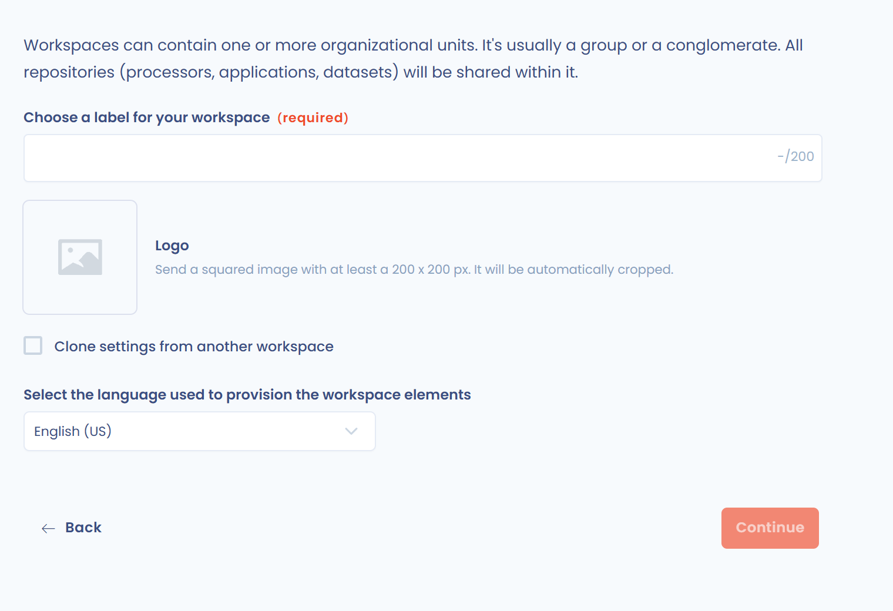

# Setting up

This section guides you through creating your first workspace, inviting users, and setting up roles, permissions and teams.

## First steps

<table data-view="cards"><thead><tr><th></th><th></th><th data-hidden data-card-target data-type="content-ref"></th></tr></thead><tbody><tr><td><strong>Key concepts</strong></td><td>Definitions of the concepts that structure Dastra: organization, workspace, organizational unit, entity, department and owner.</td><td><a href="key-concepts.md">key-concepts.md</a></td></tr><tr><td><strong>Sign in and manage authentication</strong></td><td>Sign in to Dastra with a password, a passkey, an email link or SSO, and secure your account.</td><td><a href="login.md">login.md</a></td></tr><tr><td><strong>Set up your user profile</strong></td><td>Edit your personal information, language and time zone, and delete your user account.</td><td><a href="profile.md">profile.md</a></td></tr></tbody></table>

## Structure your workspace

Begin by creating your workspace:

<figure><figcaption>
The workspace creation form
</figcaption></figure>

<table data-view="cards"><thead><tr><th></th><th></th><th data-hidden data-card-target data-type="content-ref"></th></tr></thead><tbody><tr><td><strong>Create and set up a workspace</strong></td><td>Learn how to create your first workspace in Dastra.</td><td><a href="workspace.md">workspace.md</a></td></tr><tr><td><strong>Create and set up organizational units</strong></td><td>Learn how to create and set up entities and departments in Dastra.</td><td><a href="organizational-units.md">organizational-units.md</a></td></tr><tr><td><strong>Appointing a DPO</strong></td><td>Appoint a DPO and add them to the relevant entity in Dastra.</td><td><a href="dpo.md">dpo.md</a></td></tr><tr><td><strong>Add a lead authority</strong></td><td>Set the lead supervisory authority of an entity in Dastra.</td><td><a href="lead-authority.md">lead-authority.md</a></td></tr></tbody></table>

## Manage users

<table data-view="cards"><thead><tr><th></th><th></th><th data-hidden data-card-target data-type="content-ref"></th></tr></thead><tbody><tr><td><strong>Invite users</strong></td><td>Find out how the Dastra invitation system works.</td><td><a href="users.md">users.md</a></td></tr><tr><td><strong>Managing roles and permissions</strong></td><td>Find out how to manage roles and permissions in Dastra.</td><td><a href="roles.md">roles.md</a></td></tr><tr><td><strong>Why can't a user see a processing activity?</strong></td><td>A user cannot see a processing activity or a tab, or gets a 403 error? Understand how roles, teams and organizational units determine what they can see.</td><td><a href="visibility.md">visibility.md</a></td></tr><tr><td><strong>Create and assign teams</strong></td><td>Find out how the Dastra team system works.</td><td><a href="teams.md">teams.md</a></td></tr></tbody></table>

## Go further

You are ready to start using Dastra.\
You can explore the features on your own, or follow a concrete case in the tutorial:


[README.md](../tutorial/README.md)



[faq.md](faq.md)


Questions about setting up? See the [FAQ](../../other/faq.md), which lists the questions of every module.


You can change roles, teams and organizational units in your workspace at any time. These settings remain fully customizable to fit your organization.

