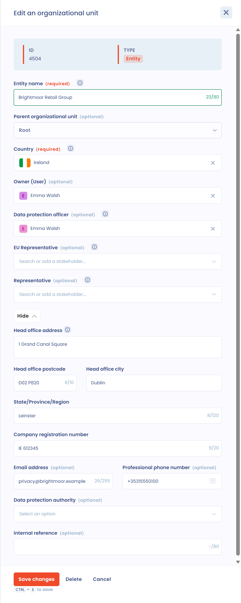

# Appointing a DPO

## Appoint a DPO

The data protection officer (DPO) is the conductor of GDPR compliance.

Article 37.1 of the GDPR (General Data Protection Regulation) **requires the appointment of a DPO** in three situations:

* where the processing is carried out by a **public authority or body**;
* where the **core activities** of the controller or processor consist of processing operations that **require regular and systematic monitoring of data subjects on a large scale**;
* where the **core activities** of the controller or processor consist of **large-scale processing** of special categories of data or of personal data relating to criminal convictions and offences.

To learn more about when and how to appoint a DPO, read the [CNIL practical guide on data protection officers](https://www.cnil.fr/sites/cnil/files/atoms/files/cnil-gdpr_practical_guide_data-protection-officers.pdf), which covers the role of the DPO and the appointment procedure.

## Add a DPO to Dastra

Only one DPO is attached to an entity.

1. In the left menu, click **Workspace settings**, then **Organizational units**.
2. Click the three dots to the right of the entity, then **Edit**.
3. In the **Data protection officer** field, select the DPO.
4. Click **Save changes**.

<figure><figcaption>
The entity edit window
</figcaption></figure>

The DPO is a stakeholder of the directory. If the DPO is a natural person, add them as a natural person. If it is a company, for example an external DPO, add it as a legal entity: click **Create stakeholder** at the bottom of the field's list.

<figure><figcaption>
The form for adding a stakeholder
</figcaption></figure>

Don't forget to save the entity. To change the DPO, see [How to change the DPO?](faq.md#how-to-change-the-dpo).
