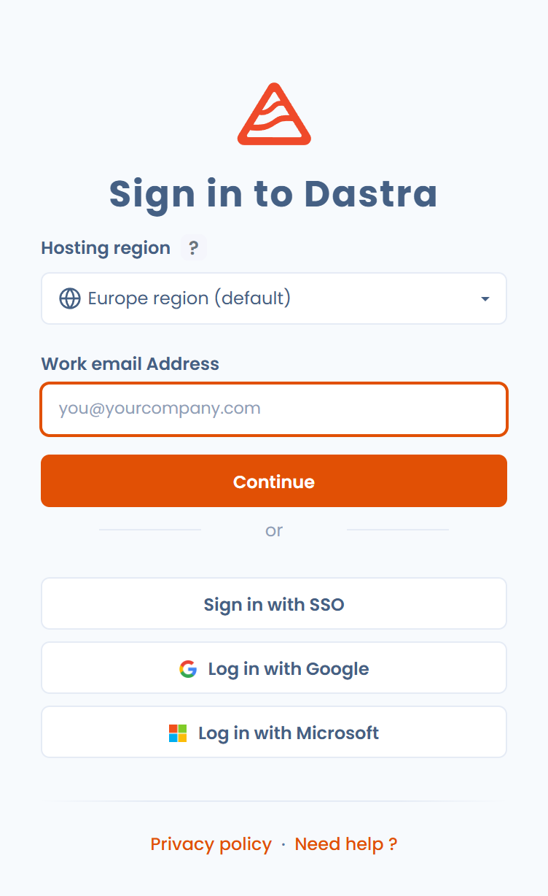

# Sign in and manage authentication

This page explains how to sign in to Dastra, how to reset your password and how to strengthen the security of your account: strong authentication, passkeys and active sessions.

## Sign in to Dastra

Signing in takes two steps: you enter your email address first, then you choose how to authenticate.

### With your email address and password

1. Go to [app.dastra.eu](https://app.dastra.eu).
2. Enter your **Work email Address**, then click **Continue**.
3. Enter **Your password**, then click **Connect**.

<figure><figcaption>
First step: the email address
</figcaption></figure>

<figure><figcaption>
Second step: the password and the other sign-in options
</figcaption></figure>


Tick **Remember me** only on a personal device.


### With a Google or Microsoft account

On the first step, under **Or**, click **Log in with** followed by Google or Microsoft, then follow the provider's procedure. You can attach an external account to your Dastra account in **Account security** > **Login providers**.

### With SSO

If your organization has configured [single sign-on (SSO)](../../features/settings/sso/README.md), sign in with your identity provider.

1. On the first step, click **Sign in with SSO**.
2. Enter **Your organization's email address or username**, then click **Continue**.
3. Follow your organization's authentication procedure. Dastra then redirects you to your workspace.

<figure><figcaption>
Signing in with SSO
</figcaption></figure>

With SSO, your credentials stay with your identity provider: Dastra does not receive your password.

### With a passkey

A passkey replaces the password with your fingerprint, your face or your device PIN. On the second step, click **Sign in with a passkey**.

You register your passkeys in **Account security** > **Manage my passkeys**. See [Passkeys](../../security/passkey.md).

### With a login link sent by email

On the second step, click **Email me a login link**. Dastra sends a link to your email address that signs you in without a password.

### Choose the hosting region

When your Dastra environment offers several hosting regions, the sign-in page shows a **Hosting region** field with the current region: **Europe region (default)** or **Bleu cloud France**. Click the field to open the other region, then sign in there.

Click the **?** button next to the field (**Learn more about hosting regions**) to compare the regions. A tenant is hosted in a single region, and the two regions are neither mirrored nor synchronized: an account of one region cannot sign in on the other. To move an existing tenant to the other region, use **Contact our sales team** in the same window. See [Dastra on Bleu](../../security/bleu.md) for the addresses and the hosting details of each region.

## Reset your password

1. On the second sign-in step, click **Forgot your password ?**.
2. Enter the email address linked to your account.
3. Open the email you receive and follow the reset link.
4. Choose a new password.

<figure><figcaption>
The password reset page
</figcaption></figure>

If the link no longer works, start again. Once signed in, you can also click **Change Password** in **Account security**: Dastra sends you an email with a reset link.

## Manage the security of your account

Open the profile menu at the top right, click **User profile**, then click **Account security** in the left menu. The page groups:

* **Password**: the **Change Password** button;
* strong authentication, also called two-factor authentication;
* passkeys;
* **Login providers**;
* **Actives sessions**;
* your **Activity history**.

<figure><figcaption>
The Account security page
</figcaption></figure>

### Enable strong authentication

Strong authentication adds a step to sign-in: a 6-digit code generated by an authenticator app on your phone.

1. In **Account security**, click **Enable the two factors authentication**.
2. Scan the QR code with an authenticator app (Microsoft Authenticator, Google Authenticator, 1Password, and so on).
3. Enter the generated code to confirm the activation.
4. Keep the recovery code displayed during activation.


The recovery code gives you back access to your account if you lose your authenticator app. Without it, you must ask the organization owner to reset the strong authentication of your account.


Once strong authentication is enabled, you enter your password, then the 6-digit code from your app. See [Strong authentication](../../security/mfa.md).

### Manage active sessions

1. In **Account security**, find the **Actives sessions** section: it lists the devices and browsers connected to your account.
2. Click **Revoke** next to the session to close.

Close any session you do not recognize immediately.

## Security best practices

* Use a long, unique password for Dastra.
* Never share your credentials, even internally.
* Enable strong authentication or register a passkey.
* Sign out on shared or public devices.
* Check your active sessions regularly.

## See also

* [Set up your user profile](profile.md)
* [Notifications](../../features/settings/notifications.md)
* [Security](../../security/general.md)
