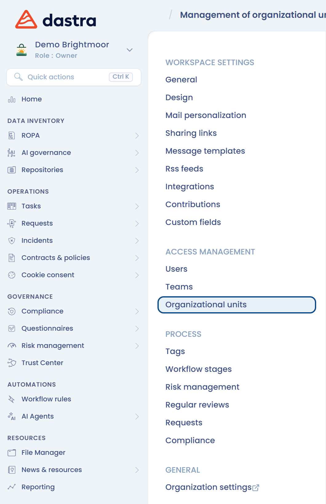
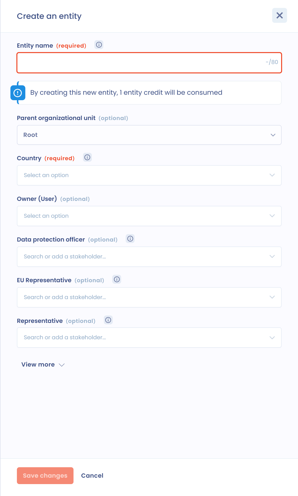
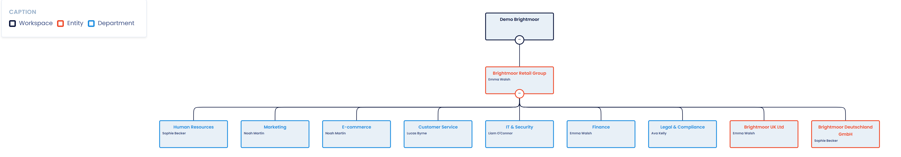

# Create and set up organizational units



## Introduction

Organizational units structure your workspace. Two types of organizational units can be created:

* **entities**, which correspond to legal entities and represent a controller;
* **departments**, which organize the entities.

In Dastra, a workspace is not a legal entity: **a workspace can refer to several distinct legal entities**, as in a corporate group. However, there can be only one legal representative per legal entity.


Each entity in Dastra is considered a controller.


## Access the organizational units

In the left menu, click **Workspace settings**, then **Organizational units**.

<figure><figcaption>
The Workspace settings menu
</figcaption></figure>

The screen for **creating and setting up** organizational units opens. It has two tabs: **Organizational units** (the list) and **Organigram**.

<figure><figcaption>
The list of organizational units
</figcaption></figure>

## Create or edit an entity

1. Click **Create an entity**.
2. Fill in the **Entity name** and the **Country**, which are required. You can also indicate the person in charge (the legal representative), the data protection officer and the representative within the European Union, if applicable.
3. Click **Save changes**.

<figure><figcaption>
The form for creating an entity
</figcaption></figure>


Unlike departments, the number of entities (controllers) you can create depends on a quota linked to your subscription. To increase it, [contact the sales team](https://www.dastra.eu/en/contacts).


To edit an entity, click the three dots to the right of the entity, then **Edit**. Make your changes and click **Save changes**.

<figure><figcaption>
The three-dot menu of an organizational unit
</figcaption></figure>

## Create or edit a department

To create a department, open the menu of the **Create an entity** button, click **Create department** and fill in the fields.

To edit it, click the three dots to the right of the department, then **Edit**, make your changes and click **Save changes**.

## Add child units

The three-dot menu of a unit also offers:

* **Add a child department**: creates a department under the unit;
* **Add a child entity**: creates an entity under the unit, for example to represent the subsidiary of a subsidiary.

## Delete an organizational unit and transfer its data

An organizational unit cannot be deleted while items are attached to it. In the three-dot menu, click **Delete**, then click the listed items and assign them to another unit. You can also click **Transfer data** to move the object types of your choice to another unit without deleting the unit.

<figure><figcaption>
Deleting an organizational unit
</figcaption></figure>


Deleting an organizational unit is permanent. The associated data is transferred to the unit you choose.


## Import and export organizational units

Open the menu of the **Create an entity** button: it offers **Import** and **Export**.

To import, click **Import**, then **Download the file template**. Fill in the file and drop it in the drop box. The file can be in CSV format (UTF-8 encoding, `;` separator), TXT or XLSX.

<figure><figcaption>
The import window
</figcaption></figure>

Two columns are required:

* `Id`: the identifier of the unit, a text that is unique within the file (80 characters maximum);
* `Label`: the name of the unit (80 characters maximum).

The other columns are optional:

* `ParentId`: the `Id` of the parent unit, if there is one;
* `CountryCode`: the country, as a 2-letter code ([ISO 3166](https://www.iso.org/iso-3166-country-codes.html)). The default value is `FR`;
* `Type`: `Entity` for an entity or `Area` for a department. The default value is `Entity`;
* `City`, `Address`, `ZipCode`, `MailAddress`, `PhoneNumber` and `ImmatriculationNumber`: the contact details of the unit;
* `RepresentativeName` and `RepresentativeType`, `DpoName` and `DpoType`, `ReferentName` and `ReferentType`: the name and type of the stakeholder associated as representative, DPO or person in charge;
* `OwnerEmail`: the email address of the owner of the unit.


Limit the hierarchy to 7 levels (parent-child relationships) so that the import is processed correctly.


Example:

<table><thead><tr><th>Id</th><th>ParentId</th><th width="492">Label</th><th>CountryCode</th><th>Type</th></tr></thead><tbody><tr><td>20996</td><td></td><td>HOLDING</td><td>FR</td><td>Entity</td></tr><tr><td>21009</td><td>20996</td><td>IT</td><td>BE</td><td>Area</td></tr></tbody></table>

## View and set up units from the organigram

The **Organigram** tab shows your entities and departments graphically. You can perform most of the operations available in the list from there.

<figure><figcaption>
The Organigram view
</figcaption></figure>

## Restrict access to the content of an organizational unit

You can use teams of users to restrict access to the content attached to an organizational unit. To do so, attach teams to the unit: in the three-dot menu, click **Set permissions for** and add the authorized users or teams.

By default, a child unit inherits the permissions of its parent unit. As soon as you add permissions to the child unit, they replace the inherited ones.

### Restricted access to a child entity only

You can add a user or a team **only to a child entity**, without giving them access to the parent entities. They then have access **exclusively to the data of that entity**, neither to the parent entities nor to the sibling entities.

This mode is useful to delegate the management of a subsidiary or a department to local users without exposing group data. To configure it, open the permissions of the entity and add the user or team directly to that entity, without attaching them to the parent entity.


Unlike the standard mode, restricted access to a child entity does not give access to the data of the parent entities.


## Go further


[teams.md](teams.md)

