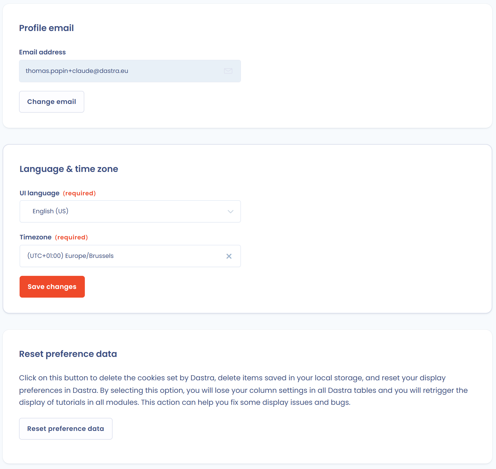

# Set up your user profile

Each Dastra user has a personal profile: identification details, language and time zone, and options linked to the privacy of the account. Open the profile menu at the top right of the screen, then click **User profile**.

## Profile picture

You can add a logo or a profile photo, displayed in Dastra next to your name. Click **Upload a logo** and choose a square image of at least 200 x 200 px. Dastra crops it automatically.

<figure><figcaption>
The User profile page
</figcaption></figure>

## Personal information

You can fill in or update the following fields at any time. The address, website and bio fields are hidden by default: click **View more** to display them. Click **Save changes** to confirm.

| Field | Description | Required |
| --- | --- | --- |
| **First name(s)** | Your first name as it appears in Dastra | Yes |
| **Surname** | Your family name | Yes |
| **Public pseudonym** | Pseudonym used in the users' forum (the community) and in messages of data subject requests sent outside your organization. At least 4 characters: letters, digits and underscores | No |
| **Professional phone number** | Your professional phone number | No |
| **Address**, **Postcode**, **City**, **State/Province/Region**, **Country** | Your contact details | No |
| **Blog/Website url** | Link to your website or professional profile | No |
| **Bio** | Short description of your role or position | No |

## Change your email address

The **Profile email** section shows the address linked to your account.

1. Click **Change email**.
2. Enter your new email address in **Enter your new email address**, then click **Send a confirmation link**.
3. Open the email sent to the new address and click the validation link.

## Language and time zone

The **Language & time zone** section customizes how Dastra is displayed.

| Setting | Description |
| --- | --- |
| **UI language** | Language of the application. Ten entries are offered: English (US), English (UK), Français, Deutsch, Español, Italiano, Nederlands, Ελληνικά, Polski and Português |
| **Timezone** | Time zone used to display dates and times |

These preferences only change your personal display. They do not change the language of the other workspace members.

<figure><figcaption>
The email, language and preferences sections
</figcaption></figure>

## Reset preference data

The **Reset preference data** button resets the preferences saved in your browser. It deletes:

* the cookies set by Dastra;
* the items saved in the browser's local storage;
* your display preferences, including the column settings in tables;
* the history of tutorials already seen: they display again in all modules.

This action can help fix some display issues.


Your preferences are lost, and the display of some modules goes back to what you saw on your first sign-in.


## Account deletion

If you want to leave Dastra for good, you can delete your user account in the **Account deletion** section. This action permanently deletes your profile, your access rights and your teams. It signs you out and redirects you to the home page.

<figure><figcaption>
The account deletion confirmation
</figcaption></figure>


Deletion is irreversible. No recovery is possible. Before you delete your account, tell your organization's administrator to avoid any loss of data.


## Best practices

* Keep your contact details up to date to ensure continuity of communication.
* Choose a professional pseudonym: it can be read by the Dastra community and by the external people who exchange with you in a data subject request.

## See also

* [Sign in and manage authentication](login.md)
* [Notifications](../../features/settings/notifications.md)
* [Roles and permissions](../../features/settings/roles.md)
