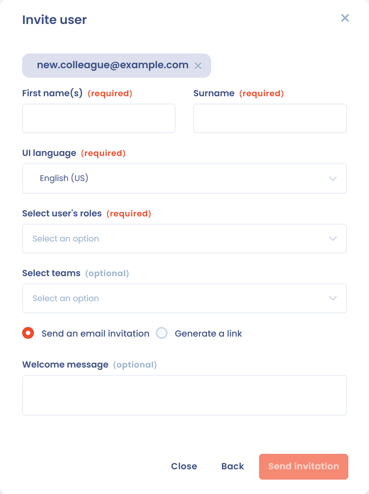
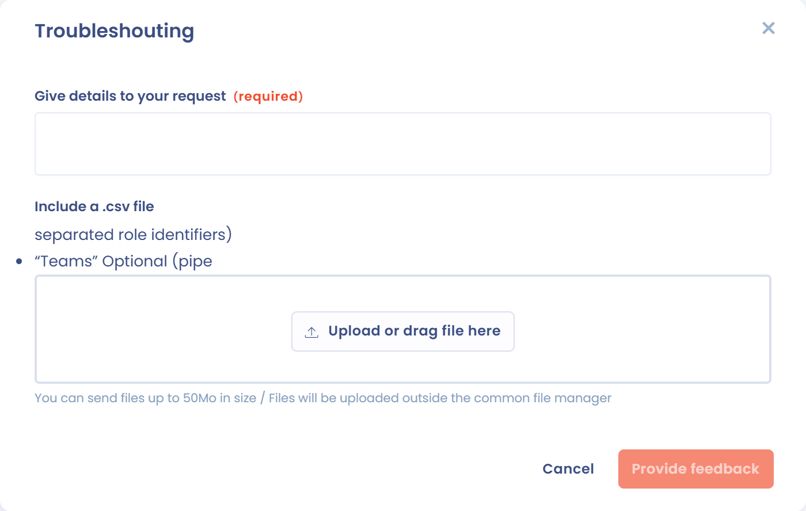

# Invite users

## Invite a user

You can invite someone to collaborate on your workspaces by inviting them to the organization the workspace belongs to.

1. In the left menu, click **Workspace settings**, then **Users**.
2. Click **Invite user**.
3. Enter the email address of the person. If this address is not already attached to the organization, click it to continue.
4. Fill in the invitation form (see the table below), then click **Send an email invitation**.

<figure><figcaption>
The Users page of the workspace settings
</figcaption></figure>

<figure><figcaption>
The invitation form
</figcaption></figure>

| Field | Description |
| --- | --- |
| **First name(s)** and **Surname** | Identity of the invited person |
| **UI language** | Language in which the person sees Dastra |
| **Invite to all workspaces** | Switch: without it, you choose the workspace concerned |
| **Select user's roles** | See [Managing roles and permissions](roles.md) |
| **Select teams** | See [Create and assign teams](teams.md) |
| **Default login method** | Local account (login and password) or SSO, when an SSO is configured |
| **Welcome message** | Text added to the invitation email |

You can also click **Invite a member** at the bottom of the left sidebar: it opens the same form.

The invited person receives an email with a link that gives access to the workspace. You receive a notification email when they click the link. The invitation link expires after 10 days.

Instead of sending the email, you can click **Generate a link**: Dastra displays a link that you pass on to the person yourself.

### Find the pending invitations

You manage pending invitations in the **Invitations** tab of the **Users** page.

<figure><figcaption>
The Invitations tab
</figcaption></figure>

### Resend an invitation link

If the invited person has not clicked the link and it has expired, click **Resend** next to the invitation, then confirm.

### Create and assign teams

In Dastra, users are grouped into teams. Teams are then assigned to entities or departments, which lets you manage roles and responsibilities precisely. See [Create and assign teams](teams.md).

### Default roles

Dastra offers five base roles. Their detailed permissions are described in [Managing roles and permissions](roles.md).

| Role | Identifier |
| --- | --- |
| Administrator | 1 |
| Contributor | 2 |
| Reader | 3 |
| Auditor | 11000 |
| Compliance tester | 11500 |


**Organization owner and DPO are not roles.** To give an already invited user the **owner** status of the organization, see [How to add an organization owner?](faq.md#how-to-add-an-organization-owner). To **change the DPO**, see [How to change the DPO?](faq.md#how-to-change-the-dpo).


## Import a large list of users

To import a large list of users (50 or more), you go through the Dastra team. You can request the import of a list of up to 200 users, within the limit of the available users.

**Steps to follow:**

1. Open [https://app.dastra.eu/general-settings/users](https://app.dastra.eu/general-settings/users), click the arrow to the right of the **Invite a user** button, then **Import**.

<figure><figcaption>
The import menu in the organization settings
</figcaption></figure>

2. Create one file per workspace, in CSV format, with the following columns separated by commas.

Required:

* `Email`: the email address of the user;
* `GivenName`: their first name;
* `FamilyName`: their last name;
* `Roles`: the identifiers of the roles in Dastra, separated by `|`;
* `Teams`: the identifiers of the teams in Dastra, separated by `|`.

Optional:

* `SSOConfigurationId`: the identifier of the SSO login, if applicable.

Here is a sample file to download and fill in:


Import file template


**Role identifiers**

The base roles have the identifiers of the table above. For the custom roles you created, the identifier is visible in your browser's developer console, in the Network tab. Roles must be created before the import.


To open the console in Chrome: Cmd + Option + C (Mac) or Ctrl + Shift + J (Windows).

To open the console in Firefox: Cmd + Option + K (Mac) or Ctrl + Shift + J (Windows).

To open the console in Microsoft Edge: Ctrl + Shift + I.


**Team identifiers**

Teams are identified by their identifier number. To find it, open the team in Dastra with the **Edit** button: the number is in the title of the window.

<figure><figcaption>
In this example, the identifier of the Test team is 8019
</figcaption></figure>

Teams are not mandatory in Dastra. The teams you use in the file must be created beforehand in the workspace.

**SSO configuration identifier**

The `SSOConfigurationId` column is **optional**: fill it in only if you want the imported users to be attached to an SSO login already configured in your organization. Leave it empty for a standard email and password login.

As for custom roles, this identifier is retrieved from your browser's **developer console**, in the **Network** tab:

1. Open [the SSO logins configuration page](https://app.dastra.eu/general-settings/sso) (you must be the owner of the organization).
2. Open the developer console (see the keyboard shortcuts above) and go to the **Network** tab.
3. Click the pencil icon of the relevant SSO login to open the **Edit SSO login** window. This is a modal window: the page URL stays `https://app.dastra.eu/general-settings/sso`.
4. In the **Network** tab, open the request triggered when the window opens and note the value of the `scheme` field (it is also the end of the request URL, after `ssoConfiguration/`): this is the value to enter in the `SSOConfigurationId` column.


The SSO login must be configured beforehand. See [Single Sign On (SSO)](../../features/settings/sso/README.md).


3. Save your file in CSV UTF-8 format. In Excel, choose the file type **CSV UTF-8 (Comma delimited)**.
4. Tell us in which workspace you want to import the users and drop the file in the upload interface.

<figure><figcaption>
The file upload interface
</figcaption></figure>

The Dastra team receives your request and gets back to you.
