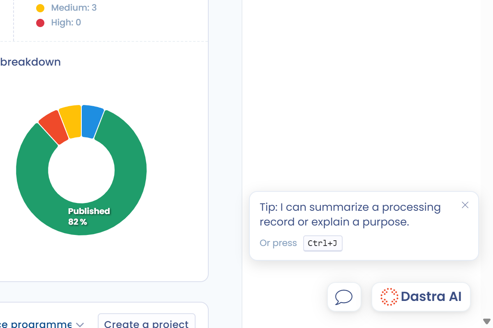
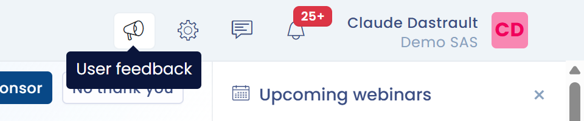

# Request support

Sometimes the problem you are facing cannot be solved with this documentation, the chat or the online help.

In that case, Dastra lets you contact us directly from the application: through **the chat**, at the bottom right of the screen, to ask **functional questions to your dedicated Privacy Success Manager**, or through the **support request** form, at the top right of the screen, **for technical issues**.

<figure><figcaption>
The chat button at the bottom right of the screen
</figcaption></figure>

<figure><figcaption>
The User feedback button at the top right of the screen
</figcaption></figure>


To access the support request form or the chat, you must have an account and be signed in to the application.


## The chat

The chat lets you talk with your **dedicated Privacy Success Manager** about how to use the platform, or to get help understanding the features.

## The support request form

It lets you report bugs, suggest feature ideas or ask technical questions to the support team.

1. Click the **User feedback** button (megaphone icon) at the top right. A window opens.
2. Choose one of the six request types:

   | Type | When to choose it |
   | --- | --- |
   | **Troubleshouting** | You face a problem or have a question about how to use a feature. A documentation search is offered first: if it does not answer your question, click **Create a ticket**. |
   | **Issue** | You want to report a malfunction of the application. |
   | **Subscription update** | You want to change your subscription or get information about your billing. |
   | **New feature** | You want to suggest a new feature. |
   | **Notation** | You want to give your opinion on the application. |
   | **Other** | For all other requests. |

3. Describe your request in detail, then click **Provide feedback**.

<figure><figcaption>
Choosing the request type
</figcaption></figure>

For an issue and for troubleshooting, the window offers two check boxes:

* **I authorize Dastra's support teams to connect to my space and perform the necessary tests to identify this problem**: your data is not modified and all manipulations performed by the teams are cancelled;
* **I authorize Dastra to collect diagnostic data from my browser**: console error and browser type. This box is ticked by default.

<figure><figcaption>
The authorization check boxes of an issue report
</figcaption></figure>

Leaving these boxes ticked lets the team respond more quickly and efficiently to your request.

Once the request is sent, the team replies as soon as possible. The form is available at any time and keeps a record of your requests.

## Phone

For application access problems or major emergencies:\
[+33 1 76 31 05 47](tel:+33176310547) (availability: 9:00 / 18:00 GMT+2)

## Other requests

If you want to make another type of request, or if you do not have a Dastra account yet, write to [support@dastra.eu](mailto:support@dastra.eu). This way, all requests are centralized and handled in the official support process.
