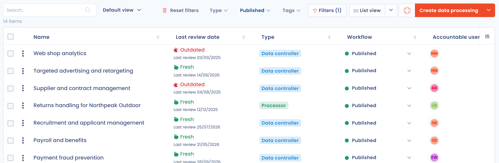

# FAQ

This page is the entry point to the questions answered in the documentation. It lists the FAQ of every module, then answers the general questions that follow the list.

## FAQ of the modules

* [Getting started FAQ](../getting-started/setup/faq.md): teams and organizational units as stakeholders, exporting and importing organizational units, changing the DPO and managing the owners of the organization.
* [General features FAQ](../features/general/faq.md): importing datasets.
* [AI assistant FAQ](../features/general/ai-assistant/faq.md): privacy and data, quality and reliability, configuration and access, and the AI Act.
* [Record of processing activities FAQ](../features/ropa/faq.md): history of modifications, deletion, datasets in read-only mode, bulk changes of stakeholders, duplication to another workspace, change of type and error messages.
* [Questionnaires FAQ](../features/questionnaires/faq.md): DPIA on several processing activities, email templates, external respondents, suggested tasks, publishing templates, error messages and limits.
* [Risks FAQ](../features/risks/faq.md): the missing menu, moving a risk to the next step, initial, residual and current risk, changing the risk scale.
* [Tasks FAQ](../features/tasks/faq.md): attaching tasks to a project, deleting a task, recording the workload and following up.
* [Requests FAQ](../features/requests/faq.md): closure emails, the requester's secure space and email verification, message length and cookies on the collection page.
* [Zapier FAQ](../features/integrations/zapier/faq.md): contractual status of Zapier, who signs the contract and reliability documentation.

For problems rather than questions, see [Known problems](known-problems.md) and the [known problems of SSO](../features/settings/sso/known-problems.md).

## How to change the organization logo in Dastra?

The organization has no logo. The image displayed at the top right of the screen, next to your name and the organization name, is the image of your user account. To change it, open your profile menu at the top right, click **User profile** and upload a new image.

To customize the logo used in exports, see the next question.

## How to change the workspace logo in Dastra?

Open the workspace settings, then the **Design** section. You can upload a square logo and a rectangle logo, and choose the **Brand color** and the **Secondary color**. These elements adapt Dastra exports to your brand.

This section is reserved for the organization's owners.

## How to import my record of processing activities in the CNIL format?

You can import an existing record of processing activities in the CNIL format into Dastra. The import takes several steps:

1. Import the names of the processing activities.
2. Import the datasets.
3. Import the stakeholders.
4. Import the security measures.
5. Create the links between these objects in the processing activities.

For the import of processing activities, see [Export / import the record](../features/ropa/export-import.md). To get help importing your record, [contact support](../getting-started/support/request.md).

## How to delete a processing activity?

Deletion takes two steps, to prevent deletions by mistake. First move the processing activity to the recycle bin with **Move to recycle bin**. Then display the recycle bin with **View recycle bin** in the filters, and choose **Delete** to delete it permanently, or **Restore** to put it back in the record.

The full procedure is described in the [FAQ of the record](../features/ropa/faq.md#how-to-delete-a-processing-activity).

## I can't find some items, what can I do?

If you can't find an item you should have access to, it may be hidden for one of the following reasons:

1. A filter is active and restricts the display. The number of active filters appears in brackets on the button, for example "(1)". Click **Reset filters**.

   <figure><figcaption>
An active filter restricts the list
</figcaption></figure>
2. The item is linked to an organizational unit you can't access, or for which you don't have the necessary rights. Contact your workspace manager.
3. The item is in the recycle bin, so it no longer appears in the default list. Click **Filters** and tick **View recycle bin**.

   <figure><figcaption>
Displaying the recycle bin
</figcaption></figure>
4. Incorrect settings are saved in your browser. To check, open Dastra in a private browsing window. If the problem disappears, clear your browser's local storage with the procedure in the next question.

## How to clear the browser's local storage?

Local storage (localStorage) holds data that the browser keeps so that Dastra works and remembers your settings, such as your filters. If you have a display problem, support may ask you to clear it.

You can also use the **Reset preference data** button in your user profile, described in [Known problems](known-problems.md).

### Google Chrome

1. Open the browser menu, then **More tools** > **Developer tools** (F12).
2. Open the **Application** tab, then **Storage** > **Local storage**.
3. Right-click the Dastra address and choose **Clear**.
4. Refresh the page (F5).

### Mozilla Firefox

1. Open the browser menu, then **More tools** > **Web Developer** > **Developer Tools** (F12).
2. Open the **Storage** tab, then **Local Storage**.
3. Right-click the Dastra address and choose **Delete All**.
4. Refresh the page (F5).
