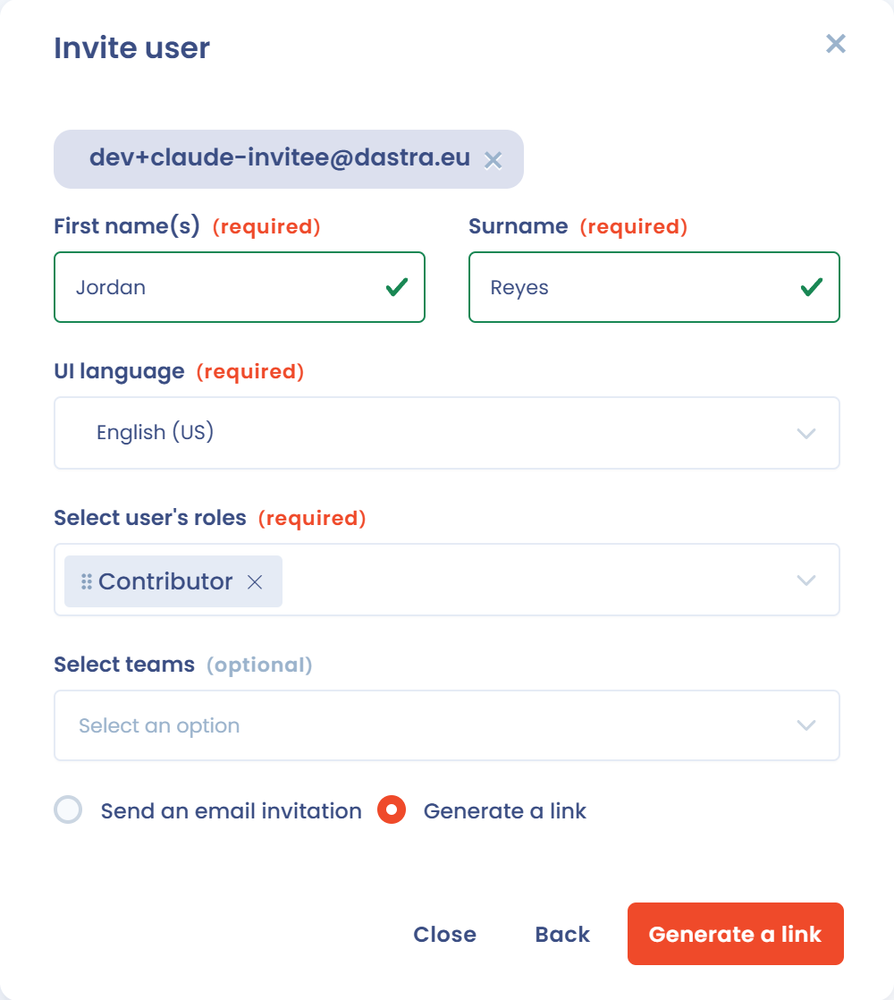
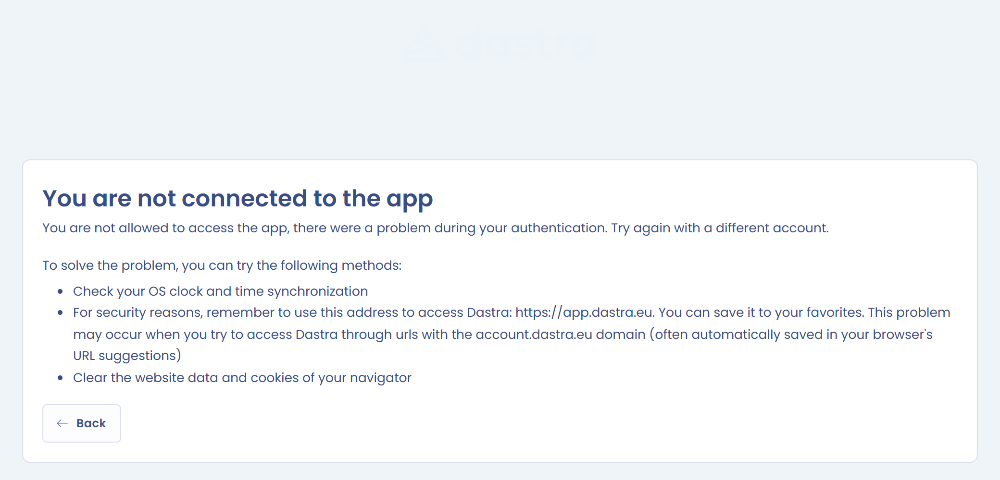

# Known problems

## The invited user does not receive the invitation emails

First check the following:

* The user's email address (domain, name, etc.) is correct. If it is wrong, the interface does not show an error.
* The person's mailbox is not full.
* The email is not in the junk folder. In rare cases, the anti-spam filter of the recipient's mail server blocks the email sent by Dastra.

If the email still does not arrive, generate an invitation link:

1. In the list of users, click **Invite user** and follow the steps.
2. At the step where you choose how to invite, select **Generate a link**, then click the **Generate a link** button.

   <figure><figcaption>
Choosing the invitation link
</figcaption></figure>
3. Copy the link displayed under **Invitation link to send directly to the user**.

   <figure><figcaption>
Generated invitation link
</figcaption></figure>

Then send the link to the user through your company chat or from your mailbox.


The user still has to validate their email address to access your workspace.


## Resolve problems with your browser's cache

The browser uses a cache and cookies to store information from websites. Deleting them fixes some problems, such as those related to loading applications like Dastra.

Try the following solutions in order:

1. **Refresh the page without using the cache**, with Ctrl + F5 (Windows) or Cmd + Shift + R (Mac).
2. If the problem persists, **reset your preference data**. This action deletes the cookies set by Dastra, clears the items saved in your local storage and resets your display preferences in Dastra. It can resolve some display problems.

To run it, open your profile menu at the top right, click **User profile**, then click **Reset preference data**.

<figure><figcaption>
Resetting preference data
</figcaption></figure>


This action deletes your column settings in all Dastra tables and shows the tutorials again in all modules.


If these two actions do not solve your problem, contact support from the application: open your profile menu, then **Help** > **Contact support** or **Chat with us**.

## 401 error during connection

**Scenario**: you connect to Dastra through https://app.dastra.eu, you enter your credentials and an error page appears. Its title is "You are not connected to the app".

<figure><figcaption>
401 error page
</figcaption></figure>

**Solutions**:

1. **Check your computer's clock settings.** Turn on time synchronization with the internet. The expiration times of your identification tokens are compared to your machine's time: if it is not synchronized with the server time, you get this error. To set your clock, see the following links:
   * [Mac](https://support.apple.com/en-ca/guide/mac-help/mchlp2996/mac)
   * [PC](https://support.microsoft.com/en-us/windows/how-to-set-your-time-and-time-zone-dfaa7122-479f-5b98-2a7b-fa0b6e01b261)
2. **Use https://app.dastra.eu to access Dastra.** You can save it to your favorites. The problem can occur when you access Dastra through addresses on the account.dastra.eu domain, which browsers often save automatically in their address suggestions.
3. **Clear your browser's site data and cookies.**

## Error 403: access denied

The message "You are not allowed to access this feature or resource (area/entity)" means that you are trying to access a part of Dastra without the necessary authorization. An administrator has restricted access to some items or modules in your workspace, based on your role or team permissions.

To resolve the problem:

* Check that you have the necessary permissions for the module or item.
* Contact one of your workspace administrators to check or update your access rights.

## Error 404: item not found

The message "404 not found" means that the item you are trying to access cannot be found. It may have been modified, moved or deleted, by another user or by you.

To resolve the problem:

* Check the address (URL).
* Find the item again from the list of its module.

## Error 500

This error can occur occasionally. It is often caused by:

* connection problems;
* problems with your environment (browser, extension, etc.);
* several people working on the same item at the same time;
* an action that requires a lot of server resources.

In most cases, the issue is temporary: wait a few minutes before trying again.

If the problem persists, send a bug report from **Help** > **Contact support**, in your profile menu, so that our teams can investigate it.
