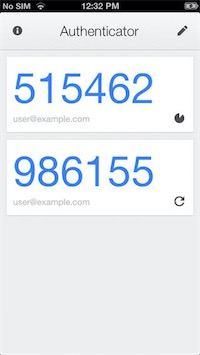

# Strong authentication

Dastra uses [TOTP](https://en.wikipedia.org/wiki/Time-based_One-time_Password_algorithm) technology to manage users' [multi-factor authentication](https://en.wikipedia.org/wiki/Multi-factor_authentication). Users sign in with their usual password and a 6-digit code provided by an authenticator app, such as Microsoft Authenticator or Google Authenticator.

This page explains how to turn on strong authentication for your account, then how to make it mandatory for the users of your organization.

## Enable strong authentication on your account

1. Open the profile menu at the top right, click **User profile**, then click **Account security** in the left menu. You can also go directly to [https://app.dastra.eu/general-settings/account-security](https://app.dastra.eu/general-settings/account-security).
2. In the **Protect your account with the two-steps authentication** card, click **Enable the two factors authentication**.

<figure><figcaption>
The two-factor authentication card in Account security
</figcaption></figure>

3. On the **Setup the two-factors authentication** screen, install an authenticator app on your phone if you don't have one yet.
4. Scan the QR code with the app. If the app cannot scan it, enter the code shown under the text.

<figure><figcaption>
The setup screen: the QR code to scan with your app
</figcaption></figure>

5. Click **Continue**. Dastra then shows your recovery code: keep it in a safe place.
6. Each time you sign in, enter your password, then the **6-digit code** provided by your app.

<figure><figcaption>
Example of an authenticator app
</figcaption></figure>


Keep the recovery code safe. If you lose your authenticator app, it lets you reset strong authentication: on the code entry screen, click **Unable to connect ?**. Without this code, your account stays locked: contact your organization owner so they reset the strong authentication of your account.


## Make strong authentication mandatory

Organization owners can require all internal users, meaning the users managed by the organization, to use strong authentication. This option is part of the organization security settings, which are reserved for the Enterprise plan.

1. Open the profile menu, click **Organisation Configuration**, then click **Security** in the left menu. You can also go directly to [https://app.dastra.eu/general-settings/security](https://app.dastra.eu/general-settings/security).
2. In the **Force users to use strong authentication (two-factor)** card, turn on the switch: it changes to **Enabled**.

<figure><figcaption>
The card that makes strong authentication mandatory
</figcaption></figure>


At their next sign-in, the users concerned cannot access the application until they have set up strong authentication. Warn your team and remind them how to keep the recovery code safe. A [passkey](passkey.md) sign-in with user verification already counts as two factors: it does not ask for a 6-digit code.

