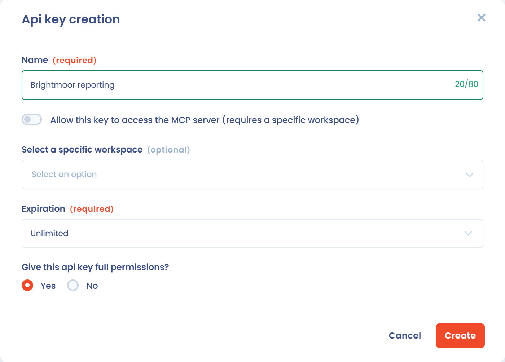
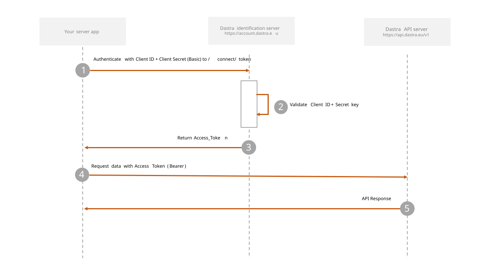

# Authentification

## Obtention de la clé secrète d'API

L'API REST de Dastra utilise les clés d'API pour authentifier chaque requête. Vous gérez vos clés dans la page **Clés d'API & MCP**, réservée aux propriétaires de l'organisation. Voir [Gestion des clés d'API](../features/settings/api-keys.md).

Vous pouvez utiliser une clé d'API pour un espace de travail spécifique ou l'organisation complète.

Une clé d'API donne accès à vos données : conservez-la précieusement. Ne partagez pas votre clé privée dans les parties publiques d'applications, comme GitHub ou le code client.

Une clé expirée ou inconnue est refusée avec le code 401.

Si vous souhaitez utiliser l'authentification OAuth2 en mode « authorization\_code », renseignez les URI de redirection et les origines CORS autorisées dans le panneau de détails de la clé.

<figure><figcaption><p>La création d'une clé d'API</p></figcaption></figure>

## Clé d'API (X-API-Key)

Pour vous authentifier, la manière la plus simple est d'utiliser une entête HTTP **X-API-Key** contenant la clé privée de votre clé d'API, comme dans l'exemple ci-dessous :

```bash
curl -X 'GET' \
  'https://api.dastra.eu/me' \
  -H 'accept: */*' \
  -H 'X-API-Key: <your private key here>'
```

## OAuth2 « Authorization code » flow

### Authorization

La phase d'autorisation s'effectue en appelant l'URL suivante :

```
https://account.dastra.eu/connect/authorize?
    response_type=code&
    client_id={YOUR_CLIENT_ID}&
    redirect_uri=https://YOUR_APP/callback&
    scope=api1+offline_access&
    state={STATE}
```

**Paramètres**

<table><thead><tr><th width="272.5595168190588">Nom du paramètre</th><th width="470.9578998488362">Description</th></tr></thead><tbody><tr><td><code>response_type</code></td><td>code</td></tr><tr><td><code>client_id</code></td><td>La clé publique de votre clé d'api configuré dans votre compte Dastra</td></tr><tr><td><code>redirect_uri</code></td><td>L'url configuré dans la clé d'API de Dastra. Vous serez automatiquement redirigé sur cette page à l'issue du processus d'authorisation</td></tr><tr><td><code>scope</code></td><td><p>api1 => obligatoire</p><p>offline_access <em>=></em> pour récupérer un refresh_token (sessions longues)</p></td></tr><tr><td><code>state</code></td><td>Une clé aléatoire généré par votre application qui permet d'éviter les attaques de type cross-site request forgery (CSRF) , lire <a href="https://auth0.com/docs/protocols/oauth2/mitigate-csrf-attacks">Mitigate CSRF Attacks With State Parameters</a>. Les librairies cliente gèrent ça rapidement</td></tr></tbody></table>

## OAuth2 « Client credential » flow

### Méthode d'authentification

L'authentification de l'API s'effectue grâce à l'aide du [protocole OAuth2](https://oauth.net/2/) utilisant le flow « Client credential ». Ce mode d'authentification doit être utilisé uniquement pour des requêtes de serveur à serveur et ne doit en aucun cas être utilisé côté navigateur (SPA en javascript par exemple).

<figure><figcaption><p>Le flow Client credentials</p></figcaption></figure>

### Récupération du token

<mark style="color:green;">`POST`</mark> `https://account.dastra.eu/connect/token`

Demandez un jeton en passant vos clés dans un en-tête Basic.

#### En-têtes

| Nom                                | Type          | Description                                |
| ---------------------------------- | ------------- | ------------------------------------------ |
| <mark style="color:red;">\*</mark> | Authorization | `Basic {base64("{PublicKey}:{PrivateKey}")}` |

#### Corps de la requête

| Nom                                | Type        | Description         |
| ---------------------------------- | ----------- | ------------------- |
| <mark style="color:red;">\*</mark> | grant\_type | client\_credentials |
| <mark style="color:red;">\*</mark> | scope       | api1                |



```javascript
{
  "access_token":"tNQoqsSePv0DnSSNVJv1aDxzSFh9H2z3YBKtuBKqWAU",
  "expires_in":3600,
  "token_type":"Bearer",
  "scope":"api1"
}
```



Une fois que vous avez récupéré un access\_token, vous pouvez ensuite appeler n'importe quel endpoint de l'API Rest à l'aide de ce jeton d'accès en le passant en « Bearer token ».

Par exemple, pour récupérer la liste de vos espaces de travail :

<mark style="color:blue;">`GET`</mark> `https://api.dastra.eu/v1/Workspaces`

Liste les espaces de travail de Dastra.

#### En-têtes

| Nom                                | Type          | Description            |
| ---------------------------------- | ------------- | ---------------------- |
| <mark style="color:red;">\*</mark> | Authorization | Bearer {access\_token} |



```javascript
{
  "items": [
    {
      "id": 1,
      "tenantId": 1,
      "label": "My data company",
      "logoUrl": null,
      "state": "Active",
      "permissions": null,
      "dataSubjectArchivedRetentionDays": null,
      "nbEntities": 1
    },
    {
      "id": 2,
      "tenantId": 1,
      "label": "My test workspace",
      "logoUrl": null,
      "state": "Active",
      "permissions": null,
      "dataSubjectArchivedRetentionDays": null,
      "nbEntities": 1
    },
    {
      "id": 3,
      "tenantId": 1,
      "label": "My experimentation workspace",
      "logoUrl": null,
      "state": "Active",
      "permissions": null,
      "dataSubjectArchivedRetentionDays": null,
      "nbEntities": 0
    }
  ],
  "total": 3
}
```



Toutes les requêtes doivent s'effectuer en [HTTPS](http://en.wikipedia.org/wiki/HTTP_Secure) et toujours côté serveur. Les requêtes sans authentification échoueront avec le code d'erreur 401

Consultez les références de l'API ici : [https://api.dastra.eu/swagger/index.html](https://api.dastra.eu/swagger/index.html)<br>
