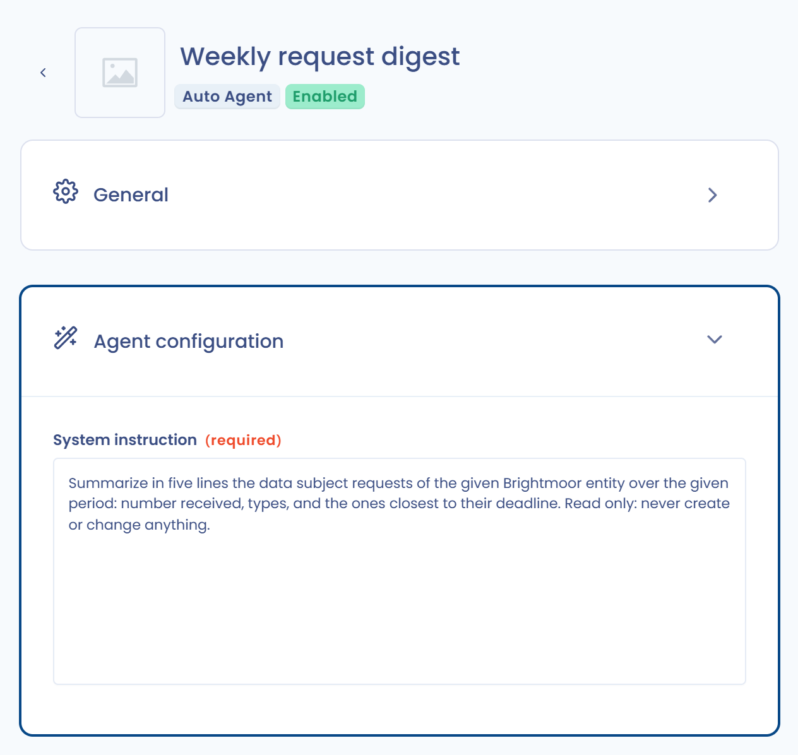
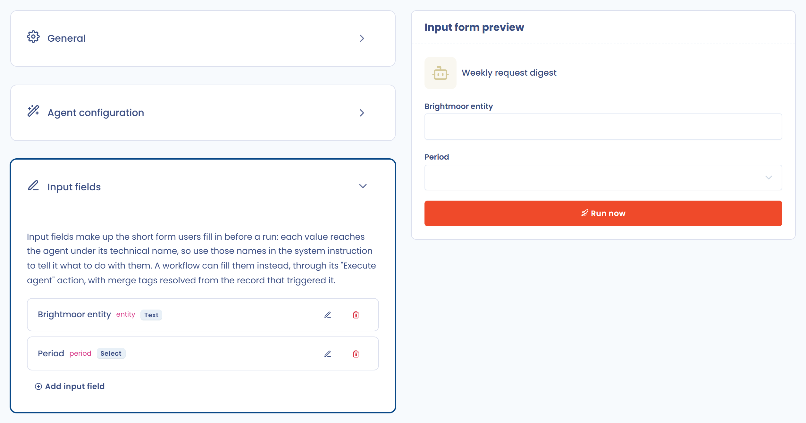
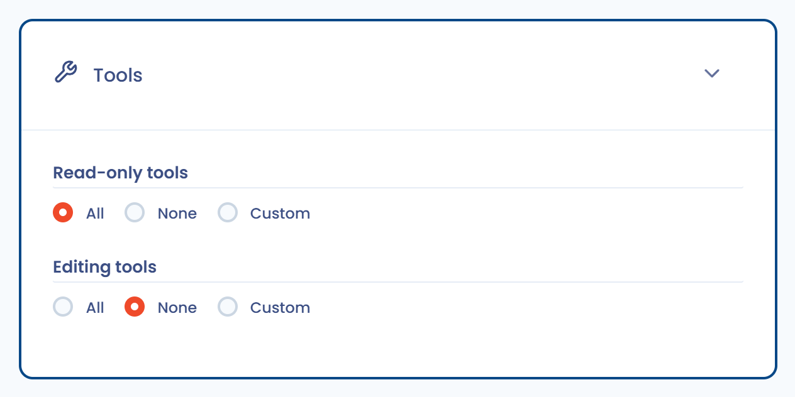
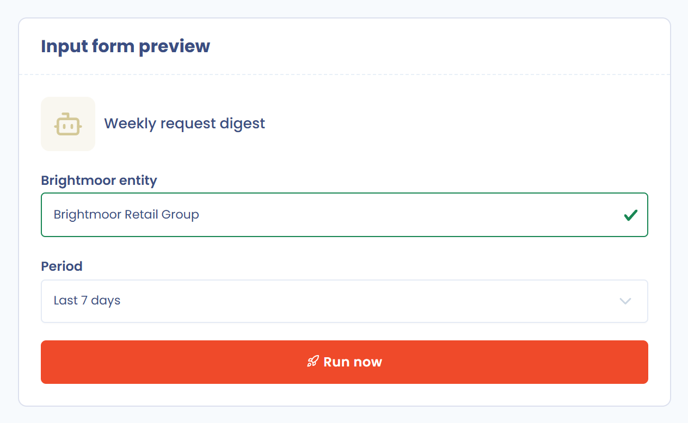
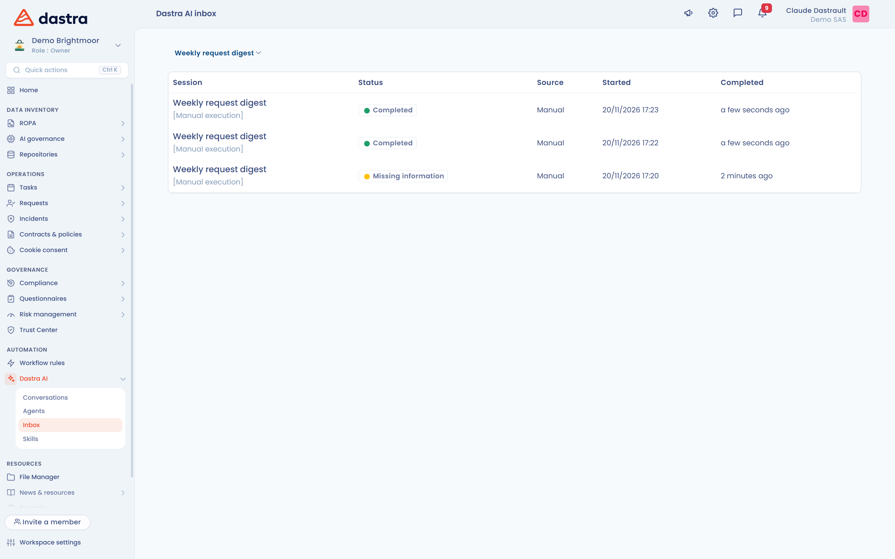
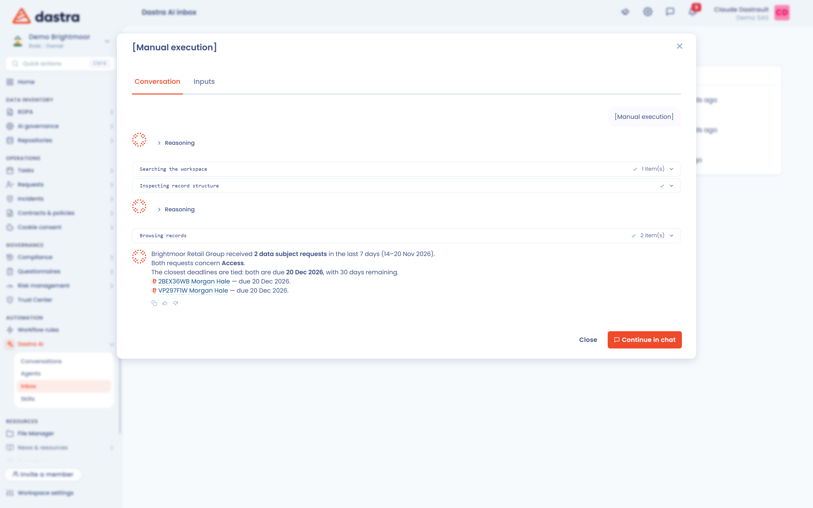
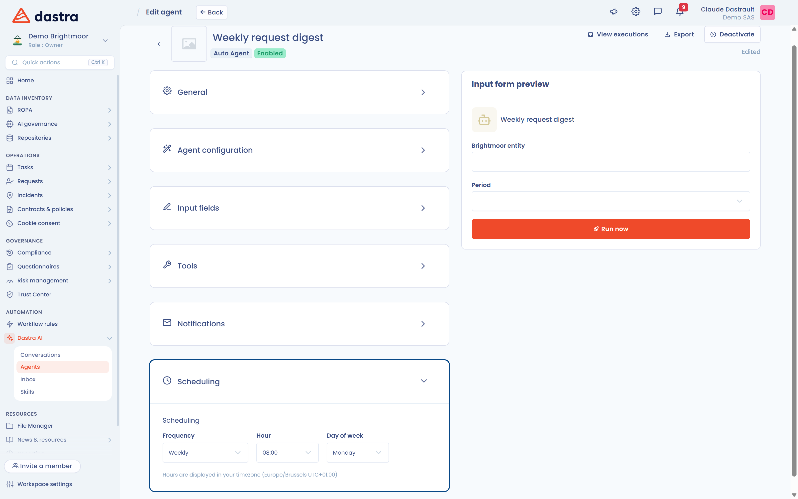

# Construire un agent autonome

Cet exemple construit un agent pour Brightmoor Retail Group qui résume les demandes d'exercice de droits de la semaine : combien sont arrivées, quels droits elles concernent et lesquelles sont les plus proches de leur échéance. C'est le cas où un [agent autonome](../features/general/ai-assistant/agents/autonomous.md) convient le mieux : une tâche récurrente qui se contente de lire des données et d'en rendre compte, sans que personne la surveille.

Les captures sont en anglais. L'instruction et la réponse sont citées telles qu'elles y apparaissent.

## Ce que fait l'agent

L'agent reçoit deux valeurs, une entité Brightmoor et une période, lit les demandes de l'espace de travail et rédige une synthèse en cinq lignes. Il ne modifie rien. Le résultat est conservé dans la **Boîte de réception** de Dastra AI, où vous le lisez après chaque exécution.

Ce modèle convient quand la tâche revient régulièrement, garde toujours la même forme et n'a besoin d'aucune réponse d'une personne en cours de route. Si la tâche doit poser des questions ou faire confirmer chaque étape, un [agent conversationnel](../features/general/ai-assistant/agents/conversational.md) est plus adapté.

## Créer l'agent

1. Ouvrez **Automatisation** > **Dastra AI** > **Agents** et cliquez sur **Créer un agent**.
2. Choisissez **Agent autonome**.
3. Saisissez le **Nom**, ici `Weekly request digest`, et une **Description** facultative, par exemple `Synthèse en cinq lignes des demandes d'exercice de droits d'une entité`.
4. Cliquez sur **Créer un agent**. Le bouton reste inactif tant qu'aucun nom n'est saisi.

L'éditeur s'ouvre sur le nouvel agent.

## Rédiger l'instruction système

Ouvrez le bloc **Configuration de l'agent** et renseignez **Instruction système**, qui est obligatoire :

```
Summarize in five lines the data subject requests of the given Brightmoor entity over the given period: number received, types, and the ones closest to their deadline. Read only: never create or change anything.
```

<figure><figcaption><p>L'éditeur, avec l'instruction système</p></figcaption></figure>

Trois choix font fonctionner cette courte instruction.

* La forme de sortie est fixe : « in five lines », puis les trois éléments que chaque synthèse doit contenir : le nombre de demandes reçues, leurs types et les échéances les plus proches. Chaque exécution répond sous la même forme, ce qui rend les synthèses comparables d'une semaine à l'autre.
* Le périmètre vient des champs de saisie. « The given Brightmoor entity » et « the given period » renvoient aux deux champs de l'étape suivante. L'instruction ne contient ni nom d'entité ni date : un seul agent sert toutes les entités et toutes les périodes. L'aide du bloc **Champs de saisie** précise qu'une valeur peut aussi être désignée par son nom technique, ici `entity` et `period`.
* La règle de lecture seule clôt l'instruction. La dernière phrase énonce l'intention. Ce n'est pas une protection technique : l'étape suivante la fournit.

## Ajouter les champs de saisie

Ouvrez le bloc **Champs de saisie**, cliquez sur **Ajouter un champ** et créez les deux champs :

| Libellé | Nom | Type | Options |
| --- | --- | --- | --- |
| Brightmoor entity | `entity` | **Texte** | aucune |
| Period | `period` | **Liste de choix** | `Last 7 days, Last 30 days, Current quarter` |

Le **Nom** suit le libellé (`brightmoor_entity`) tant que vous n'en saisissez pas un autre : remplacez-le par `entity`. Pour un champ **Liste de choix**, **Options** attend des valeurs séparées par des virgules. Laissez **Obligatoire** désactivé : cet exemple fonctionne très bien avec un champ vide.

<figure><figcaption><p>Les deux champs, et le formulaire qu'ils produisent à droite</p></figcaption></figure>

L'**Aperçu du formulaire**, à droite, est le formulaire qu'une personne remplit avant l'exécution.

## Choisir les outils



Ouvrez le bloc **Outils** et réglez les deux groupes :

* **Outils de lecture** : **Tout**. L'agent doit chercher dans l'espace de travail et parcourir les demandes pour les compter.
* **Outils de modification** : **Aucune**. La synthèse ne crée ni ne modifie jamais de fiche.


Les **Outils de modification** sont sur **Tout** à la création d'un agent. La phrase « never create or change anything » de l'instruction n'empêche pas l'agent de le faire, et personne ne relit un agent autonome pendant qu'il travaille. Réglez le groupe sur **Aucune**.




<figure><figcaption><p>Outils de lecture sur All, outils de modification sur None</p></figcaption></figure>



## Lancer l'agent



1. Dans l'**Aperçu du formulaire**, saisissez `Brightmoor Retail Group` dans **Brightmoor entity** et choisissez `Last 7 days` dans **Period**.
2. Cliquez sur **Exécuter**. Un message confirme que l'exécution a démarré.
3. Ouvrez **Dastra AI** > **Boîte de réception**. L'exécution apparaît avec son statut, puis passe à **Terminée** au bout d'une vingtaine de secondes.
4. Cliquez sur la ligne pour ouvrir l'exécution. L'onglet **Conversation** montre les étapes de l'agent et sa réponse, et l'onglet **Données d'entrée** les valeurs reçues.



<figure><figcaption><p>Le formulaire, prêt à être exécuté</p></figcaption></figure>



<figure><figcaption><p>Les exécutions dans la boîte de réception</p></figcaption></figure>

Voici la réponse d'une exécution réelle :

```
Brightmoor Retail Group received 2 data subject requests in the last 7 days (14–20 Nov 2026).
Both requests concern Access.
The closest deadlines are tied: both are due 20 Dec 2026, with 30 days remaining.
2BEX36WB Morgan Hale — due 20 Dec 2026.
VP297F1W Morgan Hale — due 20 Dec 2026.
```

Les cinq lignes suivent la forme de l'instruction : le nombre de demandes reçues, le type, puis les échéances les plus proches. Morgan Hale est le demandeur fictif des demandes de démonstration. Les étapes listées au-dessus de la réponse montrent que l'agent a seulement cherché et parcouru des fiches.

<figure><figcaption><p>Le détail d'une exécution</p></figcaption></figure>

Consultez [Suivre les exécutions](../features/general/ai-assistant/agents/inbox.md) pour tous les statuts et pour ce qu'une exécution enregistre.

## Planifier l'agent

Cette étape est facultative. Pour recevoir la synthèse chaque lundi, ouvrez le bloc **Planification**, choisissez **Hebdomadaire** dans **Fréquence**, puis l'**Heure** et le **Jour de la semaine**. La modification est enregistrée immédiatement.

<figure><figcaption><p>Une planification hebdomadaire, le lundi à 08:00</p></figcaption></figure>

Une exécution planifiée ne reçoit aucune valeur pour ses champs de saisie. L'agent de cet exemple n'aurait alors ni entité ni période à lire : pour une synthèse planifiée, écrivez l'entité et la période dans l'instruction elle-même. Dans le bloc **Notifications**, choisissez les **Utilisateurs notifiés** qui doivent être prévenus quand une exécution se termine. Les règles d'heure et de fuseau horaire sont décrites dans [Créer un agent autonome](../features/general/ai-assistant/agents/autonomous.md#planification).

## Bon à savoir

* L'éditeur enregistre tout seul. Il n'y a pas de bouton d'enregistrement : chaque modification est enregistrée un instant plus tard, et l'heure du dernier enregistrement s'affiche en haut à droite.
* L'agent est actif dès sa création. Une planification ou une règle de workflow peut le démarrer dès qu'il existe. Cliquez sur **Désactiver** dans l'en-tête tant que vous le mettez au point : **Exécuter** continue de fonctionner.
* L'aperçu du formulaire lance une vraie exécution. **Exécuter** y est le même bouton que pour n'importe quel utilisateur, et l'exécution compte dans vos crédits IA mensuels.
* Un agent autonome ne s'exécute pas avec les droits de la personne qui l'a lancé. Lisez l'[avertissement de la page de référence](../features/general/ai-assistant/agents/autonomous.md) et les [droits des agents](../features/general/ai-assistant/agents/README.md#qui-peut-faire-quoi) avant de lui donner des outils de modification.
