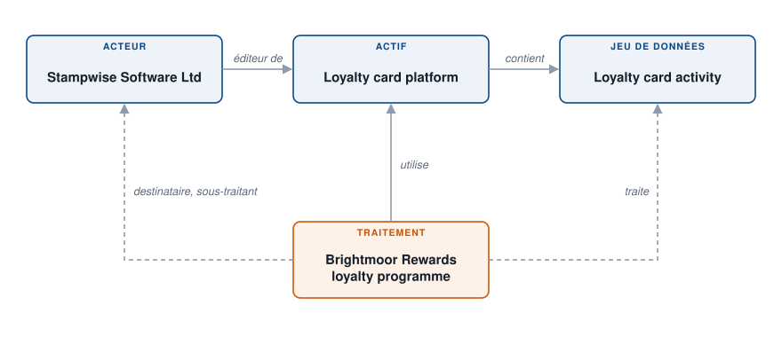

# Cartographier un flux de données

Brightmoor Retail Group gère un programme de fidélité. Les données de ses membres vivent dans une plateforme de cartes de fidélité éditée par un éditeur externe. Cet exemple cartographie ce flux une fois dans les **Référentiels**, puis le réutilise dans le traitement, afin que le registre et la cartographie restent cohérents. Voir [Cartographie](../features/mapping/README.md) pour la méthode.

<figure><figcaption>
Les quatre objets et leurs liens
</figcaption></figure>

Les liens sont les suivants :

* l'**acteur** édite l'**actif** ;
* l'**actif** contient le **jeu de données** ;
* le **traitement** utilise l'actif, liste l'acteur comme sous-traitant et traite le jeu de données.

## 1. Créer l'éditeur

Dans **Inventaire** > **Référentiels** > **Acteurs**, créez l'acteur « Stampwise Software Ltd », l'entreprise qui édite la plateforme. Il sera référencé comme sous-traitant dans le traitement. Voir [Acteurs](../features/mapping/repositories/stakeholders.md).

## 2. Créer l'actif

Dans **Référentiels** > **Actifs**, créez l'actif « Loyalty card platform ». Dans **Editeur**, sélectionnez « Stampwise Software Ltd ». Voir [Actifs](../features/mapping/repositories/assets.md).

## 3. Créer le jeu de données

Dans **Référentiels** > **Jeux de données**, créez le jeu de données « Loyalty card activity », avec ses champs de données : numéro de carte, solde de points, historique d'achats. Dans **Actif lié**, sélectionnez « Loyalty card platform ». Un jeu de données sans actif est un orphelin : grâce au lien, vous retrouvez tout ce qu'un actif contient. Voir [Jeux de données](../features/mapping/repositories/datasets.md).

## 4. Construire le traitement à partir de la cartographie

Ouvrez le traitement « Brightmoor Rewards loyalty programme », ou créez-le.

1. Dans la section **Actifs**, cliquez sur **Sélectionner les actifs** et sélectionnez « Loyalty card platform ».
2. Sur la ligne de l'actif, cliquez sur **Synchro. données**. La fenêtre **Synchronisation des informations de l'actif** liste ce que Dastra peut copier depuis la cartographie : l'**Editeur de l'application à ajouter en sous-traitant**, les **Jeux de données associés à l'actif** et les mesures de sécurité.
3. Cochez **Sélectionner tout** et cliquez sur **Ajouter**.

Dastra ajoute « Stampwise Software Ltd » à la section **Destinataires**, dans la catégorie **Sous-traitant**, et « Loyalty card activity » à la section des jeux de données. Rien n'est saisi deux fois. La ligne de l'actif affiche maintenant **Synchronisé**. Voir [Actifs](../features/ropa/activity/assets.md) et [Destinataires](../features/ropa/activity/recipients/README.md).

## 5. Lire le résultat

* Dans le traitement, **Destinataires** montre l'éditeur comme sous-traitant. Depuis son menu **...**, **Modifier l'acteur lié** ouvre l'acteur.
* Dans **Référentiels** > **Cartographie**, la vue **Cartographie des flux entre les actifs** montre l'actif, son éditeur et son jeu de données comme des nœuds reliés. Voir [Référentiels](../features/mapping/repositories/README.md).

Si l'éditeur change, vous modifiez l'acteur une seule fois. Si un second jeu de données est ajouté à l'actif, la ligne de l'actif indique qu'il a changé depuis la dernière synchronisation : relancez **Synchro. données** dans chaque traitement qui l'utilise.

<figure><figcaption>
Le flux sur le graphe Cartographie des nœuds
</figcaption></figure>
