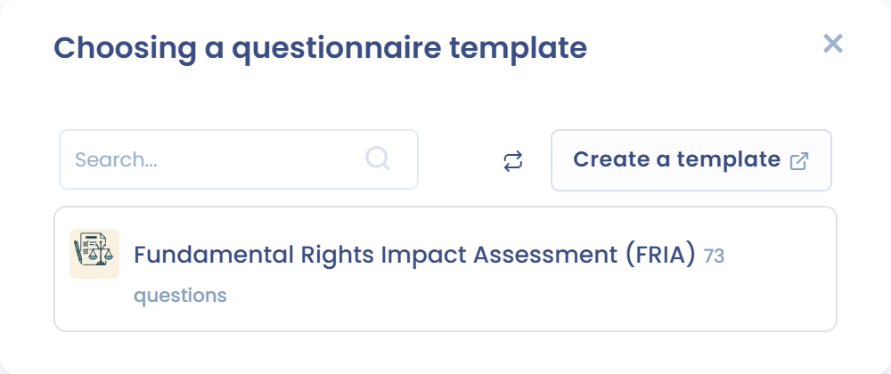

# Analyse d’impact sur les droits fondamentaux (FRIA)

Cette page explique à qui s'applique l'analyse d'impact sur les droits fondamentaux (FRIA) et comment la réaliser dans Dastra. Elle s'adresse aux déployeurs de systèmes d'IA à haut risque.

## Contexte réglementaire

L'article 27 du règlement européen sur l'intelligence artificielle (**AI Act**) impose une analyse d'impact sur les droits fondamentaux avant le premier usage de certains systèmes d'IA à haut risque. L'obligation ne vise pas tous les systèmes à haut risque.

Elle s'applique aux systèmes à haut risque visés à l'article 6, paragraphe 2, à l'exception de ceux de l'annexe III, point 2 (infrastructures critiques). Elle concerne :

* les déployeurs relevant du droit public ;
* les entités privées qui fournissent des services publics ;
* les déployeurs de systèmes à haut risque de l'annexe III, points 5, b et c : l'évaluation de la solvabilité des personnes et l'évaluation des risques et la tarification en assurance vie et en assurance maladie.

Le déployeur réalise l'analyse avant de mettre le système en service. Dans des cas similaires, il peut s'appuyer sur une analyse déjà réalisée ou sur les analyses d'impact existantes fournies par le fournisseur. Une fois l'analyse terminée, il en notifie les résultats à l'autorité de surveillance du marché (article 27, paragraphe 3).

Cette analyse est distincte d'une PIA RGPD, mais elle la complète : lorsqu'une PIA couvre déjà certaines obligations, l'analyse d'impact sur les droits fondamentaux s'y ajoute (article 27, paragraphe 4).

## Objectif de l'analyse

L'analyse décrit, pour le système concerné :

* les processus du déployeur dans lesquels le système est utilisé ;
* la durée et la fréquence d'utilisation prévues ;
* les catégories de personnes susceptibles d'être touchées ;
* les risques spécifiques d'atteinte à leurs droits, par exemple à la vie privée, à la non-discrimination, à la liberté d'expression, à la présomption d'innocence, à la dignité ou aux droits des travailleurs ;
* les mesures de surveillance humaine ;
* les mesures à prendre si ces risques se réalisent, y compris la gouvernance interne et les mécanismes de plainte.

## Quand Dastra propose l'analyse

L'encadré **Évaluation d'impact d'un système d'IA sur les droits fondamentaux** apparaît à l'étape **Classification** de la fiche lorsque :

* l'étape **Responsabilité** déclare le rôle de déployeur ;
* le niveau de risque est **Haut risque** ;
* votre plan inclut le module **Questionnaires** et vous avez accès aux questionnaires en modification.

Si le niveau de risque est **Inacceptable**, l'encadré prévient que le déploiement est interdit par l'article 5 de l'AI Act.

<figure><figcaption>
L'encadré affiché pour un déployeur de système à haut risque
</figcaption></figure>

## Effectuer l'analyse d'impact

1. Dans l'encadré, cliquez sur **Effectuer une évaluation d'impact**.
2. La fenêtre **Choisir un modèle de questionnaire** liste les modèles de type **Analyse d'impact d'un système d'IA** installés dans votre espace de travail. Cliquez sur un modèle pour le planifier.
3. Dans la fenêtre **Planifier un questionnaire**, choisissez le mode de réponse. Voir [Planifier un questionnaire](../questionnaires/schedule.md).

<figure><figcaption>
Les modèles d'analyse d'impact d'un système d'IA
</figcaption></figure>

Si la fenêtre n'affiche aucun modèle, installez-en un :

1. Dans la fenêtre, cliquez sur **Créer modèle**. Le module Questionnaires s'ouvre dans un nouvel onglet.
2. Choisissez **A partir d'un modèle**.
3. Dans la bibliothèque, filtrez avec **Types** sur **Analyse d'impact d'un système d'IA**, puis cliquez sur le modèle à installer. Voir [Les modèles de questionnaires automatisés](../questionnaires/templates/README.md#les-modeles-de-questionnaires-automatises).
4. Revenez à la fiche et cliquez de nouveau sur **Effectuer une évaluation d'impact**.


La fenêtre ne propose que les modèles du type **Analyse d'impact d'un système d'IA**. Un modèle de type **Analyse d'impact (PIA)**, même conçu pour l'IA, n'y apparaît pas.


## Retrouver les analyses réalisées

Cliquez sur **Systèmes d'IA** dans la barre latérale, puis sur **Analyses d'impact**. Cette page affiche le module Questionnaires limité au type **Analyse d'impact d'un système d'IA**. Elle apparaît si votre plan inclut le module Questionnaires et si vous avez accès aux questionnaires.

<figure><figcaption>
La page Analyses d'impact
</figcaption></figure>
