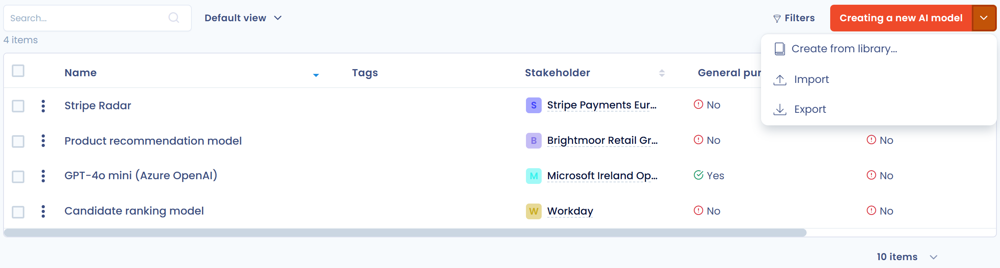
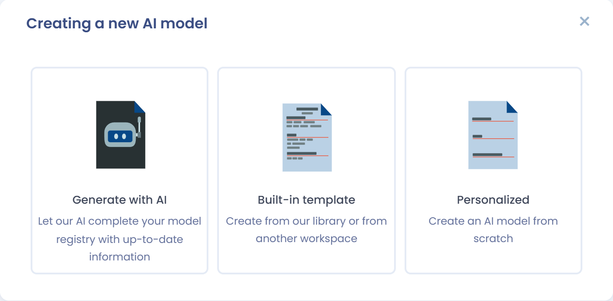
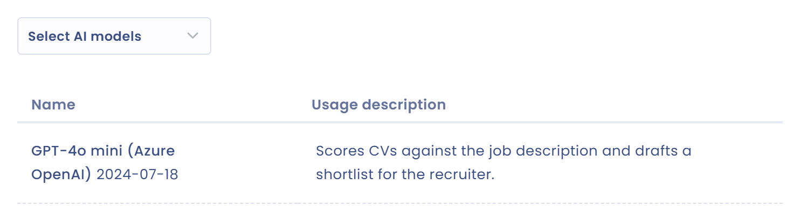

# Le référentiel des modèles d'IA

Pour chaque système d'IA que vous enregistrez, vous indiquez le ou les modèles d'IA utilisés. Les modèles sont décrits une seule fois, dans un référentiel, puis liés aux systèmes qui les utilisent.

## Définition

Un modèle d'intelligence artificielle est un programme informatique conçu pour effectuer des tâches précises à l'aide de techniques d'apprentissage automatique et d'analyse de données.

* Fondements : un modèle d'IA repose sur des algorithmes et des architectures spécifiques, comme les réseaux de neurones de l'apprentissage profond, qui lui permettent d'apprendre à partir de données.
* Apprentissage : le modèle est entraîné sur de vastes ensembles de données pour repérer des motifs et des relations. Il peut ensuite faire des prédictions ou générer du contenu à partir de nouvelles données.
* Fonctionnalité : c'est le but dans lequel le modèle est utilisé, par exemple la génération d'images pour le modèle de Midjourney.
* Utilisation : ces modèles sont déployés dans des applications variées, des chatbots et assistants virtuels à l'analyse de données et à la création de contenu.

## Ouvrir le référentiel

Cliquez sur **Systèmes d'IA** dans la barre latérale, puis sur **Modèles d'IA**.

<figure><figcaption>
Le référentiel des modèles d'IA
</figcaption></figure>

Le bouton **Créer un modèle d'IA** ouvre la fenêtre de création. Son menu propose aussi :

* **Créer à partir de modèles** : choisir un modèle de la bibliothèque Dastra ;
* **Importer** : importer une liste de modèles depuis un fichier, voir plus bas ;
* **Exporter** : exporter la liste au format CSV, Excel, JSON ou Markdown.

## Créer un modèle d'IA

Cliquez sur **Créer un modèle d'IA**. La fenêtre propose trois options :

* **Générer avec l'IA** : l'assistant IA remplit la fiche à partir d'un nom ou d'une description, voir la section suivante ;
* **A partir d'un modèle** : créer la fiche à partir d'un modèle pré-défini de la bibliothèque ;
* **A partir de zéro** : saisir la fiche vous-même.

<figure><figcaption>
Les trois options de création d'un modèle d'IA
</figcaption></figure>

Avec **A partir de zéro**, saisissez le nom du modèle, puis complétez la fiche dans le panneau **Modèle d'IA** :

| Champ | Contenu |
| --- | --- |
| **Nom du modèle** | Obligatoire, 120 caractères au maximum. Exemple : GPT 4, Mistral AI, MidJourney. |
| **Version** | Version précise du modèle, 30 caractères au maximum. Exemple : gpt-4o-2024-05-13. |
| **Référence** | Votre propre référence du modèle, 120 caractères au maximum. |
| **Editeur** | L'éditeur du modèle, choisi parmi les parties prenantes de votre espace de travail. Vous pouvez en créer une depuis la liste. |
| **Tags** | Les tags qui classent le modèle. |
| **Décrire brièvement ce modèle d'IA** | La description, 3 000 caractères au maximum. Détaillez les fonctionnalités et les informations dont vous disposez. |
| **Type d'apprentissage de l'IA** | La méthode d'entraînement du modèle, voir ci-dessous. |
| **Ce modèle est-il à usage général ?** | Oui ou non. Un modèle d'IA à usage général (GPAI) est polyvalent et peut être intégré dans de nombreux systèmes en aval. Une infobulle rappelle la définition de l'AI Act. |
| **Ce modèle présente-t-il un risque systémique ?** | Oui ou non. La question apparaît seulement si le modèle est à usage général. Une infobulle rappelle la définition du risque systémique. |
| **Documentation** | Un éditeur de texte pour la documentation du modèle. |

<figure><figcaption>
La fiche d'un modèle d'IA
</figcaption></figure>

Le type d'apprentissage décrit comment le modèle a été entraîné pour accomplir ses tâches. Il influence la façon dont le modèle généralise ce qu'il a appris. Dastra en propose quatre, chacun avec sa définition dans la liste :

* Apprentissage Supervisé : apprentissage avec des données étiquetées pour faire des prédictions ;
* Apprentissage Non Supervisé : apprentissage sans données étiquetées pour trouver des schémas similaires ;
* Apprentissage par Renforcement : apprentissage par récompenses et punitions pour optimiser les actions ;
* Apprentissage par transfert : utilisation des connaissances d'un domaine pour améliorer l'apprentissage dans un autre.

### Générer la fiche avec l'assistant IA

L'option **Générer avec l'IA** de la fenêtre de création génère une fiche de modèle d'IA à partir d'un simple nom ou d'une description. Elle est disponible si votre plan inclut les fonctions d'IA correspondantes.

1. Cliquez sur **Créer un modèle d'IA**, puis sur **Générer avec l'IA**.
2. Saisissez le nom ou une description du modèle, par exemple « GPT-4o d'OpenAI ». La recherche sur le Web complète les informations.
3. Relisez et complétez la fiche générée avant de la valider.

Le contenu généré est une proposition : vérifiez et complétez les informations avant de valider.

<figure><figcaption>
Décrivez le modèle d'IA à générer (nom, éditeur...) : la recherche sur le Web est utilisée pour compléter les informations
</figcaption></figure>

<figure><figcaption>
La fiche générée est à relire avant validation
</figcaption></figure>

### Importer et exporter des modèles

Pour importer plusieurs modèles, ouvrez le menu du bouton **Créer un modèle d'IA** et cliquez sur **Importer**. La procédure est celle des autres modules : voir [Importer vos données (Excel, Csv, JSON)](../general/import.md). Le fichier peut contenir les colonnes suivantes :

| Colonne | Description |
| --- | --- |
| `Label` | Nom du modèle, obligatoire. |
| `Ref` | Votre référence du modèle. |
| `Description` | Description du modèle. |
| `VersionName` | Version du modèle. |
| `LearningType` | `SupervisedLearning`, `UnSupervisedLearning`, `ReinforcedLearning` ou `TransferLearning`. |
| `IsGeneralPurposeAi` | `true` si le modèle est à usage général, sinon `false`. |
| `SystemicRisk` | `true` si le modèle présente un risque systémique, sinon `false`. |
| `DocumentationHtml` | Documentation du modèle, au format HTML. |

L'action **Exporter** produit un fichier CSV, Excel, JSON ou Markdown de la liste.

## Lier un modèle à un système d'IA

Ouvrez la fiche du système d'IA concerné. L'étape **Modèles d'IA** est la troisième, après **Général** et **Responsabilité**.

1. Dans le sélecteur **Sélectionner les modèles d'IA**, choisissez un ou plusieurs modèles de votre référentiel. Vous pouvez aussi en créer un depuis le sélecteur.
2. Pour chaque modèle, renseignez la **Description de l'utilisation**. Ce champ explique comment le modèle est utilisé dans ce système d'IA.
3. Enregistrez la fiche.

Une icône d'alerte signale les modèles qui présentent un risque systémique.

<figure><figcaption>
Lier un modèle et un système d'IA
</figcaption></figure>
