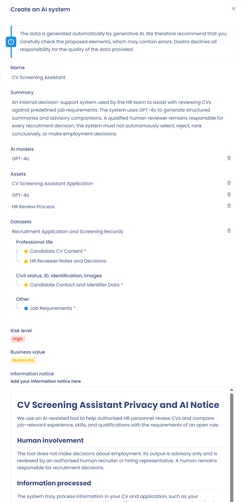

# Établir un registre des systèmes d'IA

Pour établir le registre de vos systèmes d'IA, vous avez deux options :

* Vous disposez déjà d'un registre : importez-le directement dans Dastra. Voir [Importer vos systèmes d'IA](import.md).
* Vous n'en avez pas : créez les systèmes d'IA un à un, comme décrit ci-dessous.

## Créer un système d'IA

Cliquez sur **Systèmes d'IA** dans la barre latérale, puis sur **Registre des systèmes d'IA**. Cliquez ensuite sur **Créer un nouveau système d'IA**. Une fenêtre propose trois modes de création :

<figure><figcaption>
Trois modes de création : assistant IA, modèle ou fiche vierge
</figcaption></figure>

* **Créer avec assistant IA** : l'assistant IA génère une fiche à partir d'une courte description du système (nom, éditeur, URL...). Il utilise la navigation web pour enrichir les informations.
* **A partir d'un modèle** : choisissez un système dans la bibliothèque de systèmes d'IA de Dastra ou dans un autre espace de travail.
* **A partir de zéro** : créez une fiche vierge et renseignez chaque champ vous-même. Saisissez le nom du système et son unité organisationnelle.

Le bouton avec l'icône d'IA, à gauche du bouton **Créer un nouveau système d'IA**, ouvre directement la génération par l'assistant IA.

### Générer un système d'IA avec l'assistant IA

Sélectionnez **Créer avec assistant IA**, puis décrivez le système à documenter (nom, éditeur...). Vous pouvez ajouter une pièce jointe ou une URL pour enrichir la génération.

<figure><figcaption>
Décrivez le système d'IA à générer (nom, modèle d'IA utilisé...)
</figcaption></figure>

L'assistant produit une fiche pré-remplie que vous pouvez relire et valider avant l'enregistrement.

<figure><figcaption>
La fiche générée est à relire avant validation : l'IA peut faire des erreurs
</figcaption></figure>


Les données générées automatiquement par l'IA peuvent contenir des erreurs. Relisez et corrigez la fiche proposée avant de l'enregistrer dans votre registre.


Une fois les informations obligatoires enregistrées, Dastra ouvre la fiche du système, un formulaire de 12 étapes. Vous y détaillez le système d'IA le plus précisément possible.

<figure><figcaption>
Les 12 étapes de la fiche d'un système d'IA
</figcaption></figure>

## Les 12 étapes du formulaire

Les étapes sont listées à gauche de la fiche, avec le nombre d'éléments saisis ou une coche lorsque l'étape est remplie : **Général**, **Responsabilité**, **Modèles d'IA**, **Parties prenantes**, **Actifs**, **Traitements de données**, **Données**, **Personnes concernées**, **Classification**, **Valeur ajoutée**, **Documentation** et **Récapitulatif**. Enregistrez la fiche à tout moment avec **Enregistrer**.

### 1. Général

Saisissez les informations de base du système d'IA :

* le nom du système ;
* une référence interne, si vous en avez une ;
* l'unité organisationnelle ;
* les tags ;
* la description de la finalité du système et de son fonctionnement ;
* la date de déploiement.

### 2. Responsabilité

Définissez votre rôle au regard de l'AI Act. Une même organisation peut cumuler plusieurs rôles selon ses activités :

* **Fournisseur** : développe un système d'IA, ou le fait développer, et le met sur le marché ou en service sous son propre nom ou sa propre marque, à titre onéreux ou gratuit.
* **Déployeur** : utilise un système d'IA sous sa propre autorité dans le cadre de ses activités professionnelles.
* **Importateur** : met sur le marché de l'Union un système d'IA qui porte le nom ou la marque d'une personne établie dans un pays tiers.
* **Distributeur** : met un système d'IA à disposition sur le marché de l'Union sans en être le fournisseur ni l'importateur.
* **Représentant autorisé** : personne établie dans l'Union qui a reçu un mandat écrit d'un fournisseur établi hors de l'Union.
* **Fabricant de produits** : si un système d'IA est intégré à un produit soumis à une législation sectorielle, par exemple un dispositif médical, le fabricant du produit est considéré comme le fournisseur de ce système.

Pour chaque responsabilité, vous pouvez ajouter une justification. Identifiez vos rôles avec précision : ils déterminent vos obligations au titre de l'AI Act.


Si aucune responsabilité n'est définie, Dastra propose un questionnaire d'auto-évaluation des rôles et des responsabilités dans l'IA, avec le bouton **Auto-évaluation des Rôles et Responsabilités dans l'IA**. Une fois les responsabilités identifiées, l'assistant IA peut générer une justification : cliquez sur **Générer une description de la responsabilité avec l'IA**.


### 3. Modèles d'IA

Indiquez le ou les modèles d'IA utilisés dans ce système, avec leur description d'utilisation. Voir [Le référentiel des modèles d'IA](models.md).

### 4. Parties prenantes

Ajoutez les utilisateurs en charge de ce système d'IA et attribuez un rôle à chacun.

### 5. Actifs

Ajoutez les actifs qui supportent ce système d'IA, par exemple des composants d'infrastructure, des outils logiciels ou des API. Cette information n'est pas obligatoire : elle sert à cartographier la chaîne applicative qui relie les données entre elles.

### 6. Traitements de données

Liez les traitements de votre registre RGPD à ce système d'IA, puis synchronisez leurs informations avec la fiche. Voir [Traitements liés et synchronisation des données](#traitements-lies-et-synchronisation-des-donnees).

### 7. Données

Listez les jeux de données associés à ce système d'IA : cliquez sur **Ajouter un jeu de données** pour en créer un, ou sur **Lier jeux de données exist.** pour en choisir dans votre référentiel. Pour chaque jeu de données :

* décrivez la relation entre le jeu de données et le système d'IA dans le champ prévu à cet effet ;
* indiquez, par **Oui** ou **Non**, l'usage qu'en fait le système dans les trois colonnes **Entrainement**, **Requête** et **Validation**.

Les trois colonnes ont chacune une aide :

* **Entrainement** : les données sont utilisées pour entraîner un modèle d'IA, c'est-à-dire pour lui faire apprendre des motifs, des relations ou des classifications à partir de données historiques.
* **Requête** : les données sont utilisées pour interroger le modèle d'IA, par exemple les données traitées par le système lors de son utilisation en conditions réelles.
* **Validation** : les données servent à valider un modèle d'IA, c'est-à-dire à évaluer ses performances et à ajuster ses paramètres pour éviter le surapprentissage.

Le commutateur **Afficher les champs** affiche les champs de données de chaque jeu de données. Documentez pour chaque jeu de données sa finalité, sa composition et son lien avec le système d'IA.

<figure><figcaption>
L'étape Données d'un système d'IA
</figcaption></figure>

### 8. Personnes concernées

Ajoutez les catégories de personnes concernées dont le système d'IA traite les données personnelles, par exemple des clients, des salariés ou des utilisateurs. Indiquez si des personnes vulnérables sont concernées.

### 9. Classification

Attribuez au système un niveau de risque au regard de l'AI Act. Cette étape peut aussi afficher des alertes liées à votre rôle :

* **Risque inacceptable** : si vous êtes déployeur d'un système classé **Inacceptable**, une alerte rappelle que son déploiement est interdit par l'article 5 de l'AI Act.
* **Haut risque** : si vous êtes déployeur d'un système classé **Haut risque**, une alerte présente le champ d'application de l'article 27 de l'AI Act et vous propose de réaliser l'[analyse d'impact sur les droits fondamentaux (FRIA)](fria.md).

Pour le détail de cette étape, voir [Analyse de risque et valeur ajoutée](risk-analysis.md).

### 10. Valeur ajoutée

Évaluez la valeur ajoutée du système pour votre organisation. Cette évaluation vous aide à prioriser les projets d'IA à forte valeur. Voir [Analyse de risque et valeur ajoutée](risk-analysis.md).

### 11. Documentation

Indiquez si une notice d'information existe, rédigez-la ou générez-la, et joignez les documents du système : notices, guides techniques, analyses de conformité. Voir [Notice de transparence](transparency-notice.md).

### 12. Récapitulatif

Consultez la synthèse de toutes les informations saisies pour ce système d'IA, avant de finaliser sa fiche.

## Traitements liés et synchronisation des données

L'étape **Traitements de données** de la fiche d'un système d'IA associe un ou plusieurs traitements de votre registre RGPD à ce système. Cette liaison assure la cohérence entre votre registre des traitements et votre registre des systèmes d'IA.

<figure><figcaption>
L'étape Traitements de données liste les traitements RGPD associés à ce système d'IA
</figcaption></figure>

### Synchroniser les données d'un traitement

Pour chaque traitement lié, le bouton **Synchro. données** importe dans la fiche du système d'IA les éléments du traitement : actifs, jeux de données et catégories de personnes concernées.

<figure><figcaption>
Le bouton de synchronisation des données déclenche l'import des données du traitement dans la fiche du système d'IA
</figcaption></figure>

Une fenêtre liste les éléments à importer. Vous pouvez sélectionner précisément ceux à ajouter.

<figure><figcaption>
Sélection des éléments à synchroniser depuis le traitement vers le système d'IA
</figcaption></figure>

### Voir les systèmes d'IA liés depuis un traitement

Réciproquement, depuis la fiche d'un traitement, le panneau **Systèmes d'IA liés** liste tous les systèmes d'IA qui lui sont associés.

<figure><figcaption>
Le panneau Systèmes d'IA liés est accessible depuis la fiche de n'importe quel traitement
</figcaption></figure>

Cette liaison dans les deux sens facilite les audits et la documentation de la conformité à l'AI Act depuis le registre RGPD.

## Inviter des utilisateurs à compléter la fiche

Dans une fiche, cliquez sur le bouton avec l'icône d'utilisateurs, **Invites des utilisateurs à compléter ce système d'IA**. Dans la fenêtre :

1. Choisissez la **Section** de la fiche à compléter.
2. Sélectionnez les **Utilisateurs à inviter**. Ils doivent disposer au moins du droit de modification, ou du droit de lecture et d'écriture de leurs propres éléments s'ils sont parties prenantes du système.
3. Rédigez le **Message d'invitation**, ou sélectionnez un modèle de message.
4. Cliquez sur **Envoyer une invitation**.

## Autres actions sur un système d'IA

Dans le registre, le menu de chaque ligne propose **Modifier**, **Dupliquer** et **Déplacer dans la corbeille**. Dans la fiche, le menu du bouton **Enregistrer** propose notamment :

* **Passer en revue** : marque la fiche comme relue. L'action apparaît pour un système à l'état **En cours** si la revue régulière est activée pour les systèmes d'IA. Voir [Revue régulière (fraicheur)](../regular-review.md) ;
* **Exporter** : exporte la fiche, aux formats CSV, Excel, JSON, HTML, Word, PDF ou Markdown ;
* **Générer notice d'information** et **Exporter la notice d'information** : voir [Notice de transparence](transparency-notice.md) ;
* **Déplacer dans la corbeille**.

Le menu du bouton **Créer un nouveau système d'IA** du registre propose aussi **Créer à partir de modèles**, **Importer**, **Exporter** et **Configurer revue régulière**, qui ouvre les réglages de la revue régulière des systèmes d'IA.

## Restaurer une version antérieure

Le panneau **Historique d'activités** de la fiche d'un système d'IA conserve chaque création et chaque modification. Vous pouvez restaurer une version passée directement depuis ce panneau.

<figure><figcaption>
Chaque version de l'Historique d'activités propose un bouton de restauration
</figcaption></figure>

Chaque entrée de l'historique affiche un bouton de restauration, visible pour les utilisateurs qui ont le droit d'écriture. Après confirmation, Dastra crée un nouveau système d'IA à partir des données de la version choisie. Son nom reçoit le suffixe « - restored version - [date] » et vous êtes redirigé vers cette nouvelle fiche. Le système d'IA d'origine reste inchangé.

<figure><figcaption>
La version restaurée apparaît comme un nouveau système d'IA suffixé « - restored version - [date] »
</figcaption></figure>
