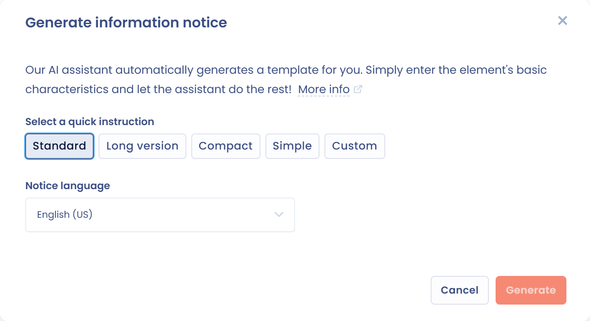

# Notice de transparence

Une notice de transparence (ou notice d'information) explique aux personnes concernées et aux utilisateurs comment fonctionne un système d'IA et comment il est utilisé. L'AI Act impose des obligations de transparence selon le niveau de risque du système : voir [Analyse de risque et valeur ajoutée](risk-analysis.md).

Dans Dastra, vous renseignez la notice à l'étape **Documentation** de la fiche du système d'IA.

## Renseigner la notice

À l'étape **Documentation** :

1. Répondez par **Oui** ou par **Non** à la question **Avez-vous rédigé une notice d'information ?**
2. Rédigez la notice dans l'éditeur, sous le bouton **Générez votre notice d'information**. Vous pouvez la saisir directement ou la coller depuis un autre document.
3. Ajoutez, dans la zone des pièces jointes, les documents liés au système : notice au format PDF ou Word, guides techniques, analyses de conformité.
4. Enregistrez la fiche.

<figure><figcaption>
L'étape Documentation d'un système d'IA
</figcaption></figure>

## Générer la notice avec l'assistant IA

L'assistant IA rédige une notice à partir des informations de la fiche. La fonction est disponible si votre plan inclut les fonctions d'IA correspondantes et si vous avez le droit de modifier le système.

1. Cliquez sur **Générez votre notice d'information**, à l'étape **Documentation**. Vous pouvez aussi ouvrir le menu du bouton **Enregistrer** et cliquer sur **Générer notice d'information**.
2. Dans la liste **Choisissez une instruction rapide**, sélectionnez la forme de la notice : **Standard**, **Version longue**, **Compact**, **Plus didactique** ou **Personalisée**. Avec **Personalisée**, saisissez vos consignes dans le champ **Donnez des instructions personnalisées à l'assistant** (300 caractères au maximum).
3. Choisissez la **Langue de la notice**.
4. Cliquez sur **Générer**, puis relisez la notice proposée.

<figure><figcaption>
La fenêtre de génération de la notice
</figcaption></figure>

La notice générée n'est pas enregistrée dans la fiche. Elle reste dans la fenêtre jusqu'à sa fermeture : exportez-la pour la conserver. Le contenu généré est une proposition, relisez-le et complétez-le avant de l'utiliser.

## Exporter la notice

Dans la fenêtre de génération, cliquez sur **Exporter** et choisissez le format : PDF, HTML, Word ou Markdown. L'option **Ajouter ce fichier aux pièces jointes de ce système d'IA**, activée par défaut, ajoute le fichier exporté aux pièces jointes de l'étape **Documentation**. Chaque export crée une nouvelle pièce jointe. L'option n'apparaît pas si vous n'avez pas le droit de modifier le système d'IA.

<figure><figcaption>
Ajouter la notice exportée aux pièces jointes du système d'IA
</figcaption></figure>

Pour exporter la notice que vous avez saisie dans l'éditeur de l'étape **Documentation**, ouvrez le menu du bouton **Enregistrer** et cliquez sur **Exporter la notice d'information**. Cette action apparaît quand la fiche contient une notice enregistrée. Le fichier est téléchargé sans être ajouté aux pièces jointes.
