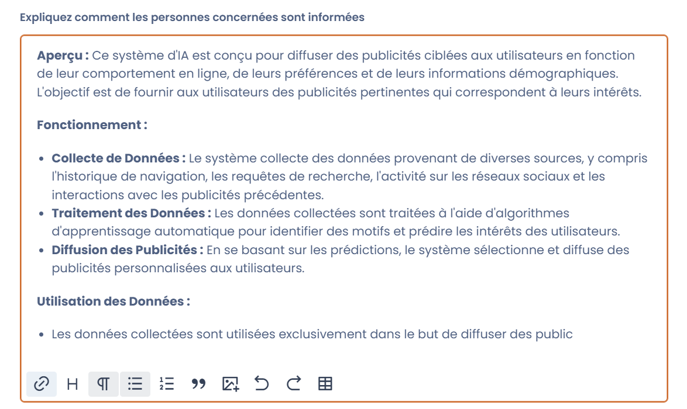

# Notice de transparence

Une **notice de transparence** (ou notice d'information) est un document crucial pour informer les utilisateurs et les parties prenantes sur le fonctionnement et l'utilisation des systèmes d'IA. Cette notice vise à garantir que les systèmes d'IA sont transparents, responsables et respectent les droits fondamentaux des individus.

Dans Dastra, vous devez intégrer cette notice dans la **section "Documentation"** d'un système d'IA. Vous pouvez la téléverser sous forme de document, ou bien la rédiger directement au sein de l'onglet.

La notice générée par l'assistant IA s'exporte en PDF, Word, HTML ou Markdown, depuis l'assistant de notice ou depuis l'action **Exporter la notice d'information** de la fiche du système d'IA. Dans la fenêtre d'export, l'option **Ajouter ce fichier aux pièces jointes du système d'IA**, activée par défaut, ajoute le fichier exporté aux pièces jointes de l'étape « Documentation » ; chaque export crée une nouvelle pièce jointe.

<figure><figcaption>
Ajouter la notice exportée aux pièces jointes du système d'IA
</figcaption></figure>

<figure><figcaption>
Notice de transparence d'un système d'IA
</figcaption></figure>
