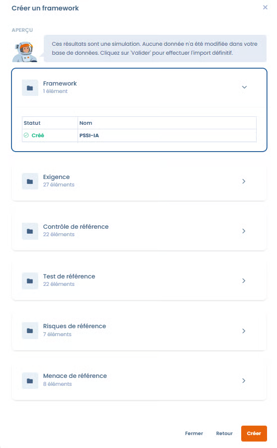

# Import et modèles Dastra

Dans **Conformité** > **Bibliothèque** > **Frameworks**, cliquez sur **Créer un framework**. La fenêtre propose trois méthodes :



* **A partir d'un modèle** : partir d'un modèle de la bibliothèque Dastra (voir ci-dessous)
* **À partir de zéro** : créer un framework vierge (voir [Création de framework personnalisé](custom.md)). Cette méthode dépend de votre offre
* **Importer un framework** : envoyer un fichier JSON ou Excel (voir ci-dessous)

Depuis la même page, vous pouvez aussi consulter les **détails d'un framework existant**.







***

## Créer un framework à partir d’un modèle

### Intérêt de partir d’un modèle

Importer un framework depuis un modèle permet de **gagner du temps** et de s’appuyer sur un référentiel déjà structuré et conforme aux bonnes pratiques réglementaires ou sectorielles.

Les modèles proposés par Dastra incluent :

* La structure des chapitres
* Les exigences associées
* Les contrôles
* Les risques et menaces liés

Ils peuvent ensuite être **personnalisés** selon votre contexte.

***

### Étapes d’import d’un modèle



* Cliquez sur **Créer un framework**
* Sélectionnez **A partir d'un modèle**
* Accédez à la bibliothèque de modèles Dastra
* Recherchez un modèle par son nom, puis réglez :
  * la **Source de données de la bibliothèque** (par défaut **Modèles créés par Dastra**)
  * la langue
  * le mode d'affichage des résultats
* Sélectionnez le modèle souhaité
* Consultez les **détails du framework** :
  * Nombre d’exigences
  * Contrôles
  * Risques
  * Menaces
  * Description fonctionnelle
* Validez l’import\
  → Le framework est ajouté à votre Librairie et devient **modifiable**.



<figure><figcaption></figcaption></figure>

<figure><figcaption></figcaption></figure>




La création d’un nouveau framework consomme un **crédit de framework** sur votre compte. Lorsque le quota est atteint, vous pouvez encore consulter les détails d'un modèle, mais pas l'importer tant que vous n'avez pas libéré de place ou augmenté votre quota.


Les versions ultérieures du framework (créées, importées ou issues d'une mise à jour du référentiel source) ne consomment pas de crédit supplémentaire.

***

## Importer un framework depuis un fichier

Vous pouvez importer un framework que vous avez préparé ou exporté depuis Dastra. Cette méthode nécessite le droit d'import sur la bibliothèque et un crédit de framework disponible.

1. Cliquez sur **Créer un framework**, puis sur **Importer un framework**. Si la bibliothèque est vide, le bouton **Importer un framework** est aussi proposé directement.
2. Choisissez le format :
   * **JSON** : importer votre framework au format .json ;
   * **Classeur excel complexe** : importer votre framework à partir d'un classeur excel composé de plusieurs feuilles.
3. Pour le classeur Excel, cliquez sur **Télécharger le modèle de fichier** pour obtenir le classeur type, que l'import utilise pour reconnaître les données. Activez **Utiliser les noms de colonnes ou états natifs (Recommandé pour importer les données)** si votre fichier reprend les noms de colonnes natifs.
4. Envoyez votre fichier (un seul à la fois).
5. Dastra affiche d'abord une simulation : aucune donnée n'est modifiée. Le tableau indique, pour chaque élément, s'il sera **Créé**, **Mis à jour**, **Ignoré** ou **Simulé**, avec les totaux. Vérifiez-le, puis cliquez sur **Valider** pour effectuer l'import définitif.

L'import crée le framework et tous les éléments qu'il contient dans votre bibliothèque.

<figure><figcaption></figcaption></figure>

***

## Résultat après import



<figure><figcaption></figcaption></figure>



Vous pourrez ensuite vérifier les éléments avant la création.

L'ensemble des objets contenus dans votre framework seront créés dans votre bibliothèque.



Une fois importé, le framework :

* Est disponible dans la bibliothèque
* Peut être enrichi ou adapté
* Sert de base pour :
  * Des **projets de conformité**
  * L’évaluation des contrôles
  * La gestion des risques

***

## Mise à jour depuis le référentiel source

Lorsqu'une version plus récente du modèle d'origine est disponible, la carte du framework affiche le badge **Mise à jour disponible** et sa fiche affiche le message _Une version plus récente du référentiel source est disponible_ avec le lien **mettre à jour**.

Ce lien ouvre un aperçu des changements (contrôles, tests, scénarios de risque et menaces). Après validation, une version publiée du framework est créée à partir de la source et devient la version actuelle ; les versions antérieures et les projets qui les utilisent ne sont pas modifiés. Voir [Versions de framework](versions.md).

