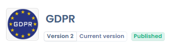
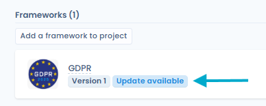

# Versions de framework

Chaque framework de la Bibliothèque est versionné. Une version porte un numéro attribué automatiquement (_Version 1_, _Version 2_, etc.), une note de version et un statut (brouillon ou publié). Les versions permettent de faire évoluer un référentiel (mise à jour réglementaire, ajout ou reformulation d'exigences, réorganisation des chapitres) sans modifier les projets de conformité qui utilisent une version antérieure.

<figure><figcaption>
Le numéro de version, la mention Version actuelle et le statut s'affichent sous le nom du framework
</figcaption></figure>

***

## Numéro de version et version actuelle

Le numéro de version s'affiche sous le nom du framework, sur sa carte dans la liste des frameworks et dans l'onglet **Détails** (carte **Informations de version**, avec la note de version).

La mention **Version actuelle** identifie la version installée par défaut lorsque le framework est ajouté à un projet. Un framework n'a qu'une seule version actuelle.

La liste des frameworks de la Bibliothèque affiche la version actuelle de chaque framework. Les autres versions sont accessibles depuis l'onglet **Versions** du framework.

***

## Consulter l'historique des versions

L'onglet **Versions** d'un framework liste toutes ses versions, de la plus récente à la plus ancienne. Chaque ligne indique :

* le numéro de version et, le cas échéant, la mention **Version actuelle**,
* le statut (brouillon ou publié),
* la note de version,
* la date de création et l'auteur de la version.

Cliquez sur une version (ou sur **Voir** dans son menu d'actions) pour l'ouvrir. Une version publiée s'affiche en lecture seule.

Le menu d'actions de chaque version propose, selon son statut :

* **Voir** : ouvrir la version,
* **Modifier la note de version**,
* **Définir comme version actuelle** (version publiée qui n'est pas la version actuelle),
* **Publier** (version en brouillon),
* **Annuler publication** (version publiée),
* **Supprimer** (version en brouillon).

***

## Créer une version

1. Ouvrez le framework, puis l'onglet **Versions**.
2. Cliquez sur **Créer une nouvelle version**.
3. La fenêtre affiche le numéro attribué automatiquement (**Nouvelle version :** _Version n_). Saisissez si besoin les **Notes de version** (jusqu'à 3 000 caractères), par exemple _Mise à jour réglementaire 2026_.
4. Cliquez sur **Valider**.

La version reprend la structure du framework (chapitres, exigences et contrôles liés) et est créée à l'état **brouillon**. Elle s'ouvre directement : cliquez sur **Modifier** pour faire évoluer ses chapitres et ses exigences (voir [Création de framework personnalisé](custom.md)).

Le bouton **Importer une nouvelle version** de l'onglet **Versions** permet aussi de créer une version à partir d'un fichier JSON ou Excel.

La note de version reste modifiable à tout moment depuis le menu d'actions de la version (**Modifier la note de version**).


Les versions d'un framework ne sont pas décomptées séparément dans le quota de frameworks : créer ou importer une version ne consomme pas de crédit de framework.


***

## Publier, annuler la publication ou supprimer une version

* **Publier** : depuis le menu d'actions de la version, ou avec le bouton **Publier** en haut de la fiche du framework. Une version publiée est proposée lors de l'ajout du framework à un projet. Plusieurs versions publiées d'un même framework peuvent coexister.
* **Annuler publication** : la version repasse à l'état brouillon et n'est plus proposée lors de l'ajout du framework à un projet. La version actuelle ne peut pas être dépubliée : définissez d'abord une autre version comme version actuelle.
* **Supprimer** : seule une version en brouillon peut être supprimée. Les autres versions du framework ne sont pas affectées.


Les exigences d'une version publiée sont verrouillées : le bouton **Modifier** est désactivé. Pour modifier les chapitres ou les exigences, créez une version. Le nom, le logo et la description du framework (onglet **Détails**) restent modifiables sur une version publiée.


***

## Définir la version actuelle

Dans l'onglet **Versions**, ouvrez le menu d'actions d'une version publiée et cliquez sur **Définir comme version actuelle**.

Cette version devient celle proposée et installée par défaut lorsque le framework est ajouté à un projet. Les projets qui utilisent une autre version ne sont pas modifiés.

***

## Mettre à jour depuis le référentiel source

Lorsqu'un framework a été créé à partir d'un modèle et qu'une version plus récente de ce référentiel source est disponible :

* la carte du framework, dans la liste, affiche le badge **Mise à jour disponible**,
* la fiche du framework affiche le message _Une version plus récente du référentiel source est disponible_, suivi du lien **mettre à jour**.

Cliquez sur **mettre à jour** pour ouvrir la fenêtre **Mettre à jour depuis le référentiel source**. Elle présente un aperçu des changements sur les contrôles, les tests, les scénarios de risque et les menaces ; les éléments retirés du référentiel source sont signalés par la mention **Absent de la source**.

Cliquez sur **Valider** : une version publiée du framework est créée à partir de la source et devient la version actuelle. Les versions antérieures et les projets qui les utilisent ne sont pas affectés.

***

## Versions et projets de conformité

### Choisir la version à installer

Lors de l'ajout d'un framework à un projet (**Ajouter un framework au projet**), seules les versions publiées sont proposées. Lorsque plusieurs versions publiées existent, une liste déroulante (**Version à installer**) apparaît à côté du nom du framework ; la version actuelle y est présélectionnée. Le projet est ensuite rattaché à la version installée.

### Repérer un projet à mettre à jour

Dans la vue d'ensemble du projet, la carte de chaque framework affiche le numéro de la version utilisée. Le badge **Mise à jour disponible** signale que le projet utilise une version qui n'est plus la version actuelle du framework.

<figure><figcaption>
Le badge Mise à jour disponible signale un projet rattaché à une version antérieure du framework
</figcaption></figure>

### Migrer un projet vers une autre version

1. Dans la vue d'ensemble du projet, ouvrez le menu d'actions de la carte du framework et cliquez sur **Mettre à jour la version du framework**.
2. Choisissez la **Version cible** parmi les autres versions publiées. Sa note de version et un aperçu des éléments ajoutés au projet s'affichent.
3. Cliquez sur **Valider**.

Lors de la migration :

* les éléments apportés par la version cible sont ajoutés au projet,
* les libellés, descriptions et tags des contrôles, tests, scénarios de risque et menaces existants sont mis à jour à partir de la version cible,
* les résultats et les preuves sont conservés,
* les contrôles absents de la version cible sont dissociés des exigences, mais restent dans le projet (un message en indique le nombre avant validation).


La migration est toujours manuelle : un projet n'est jamais basculé automatiquement vers la version actuelle. Elle est impossible tant qu'un audit est en cours dans le projet.

