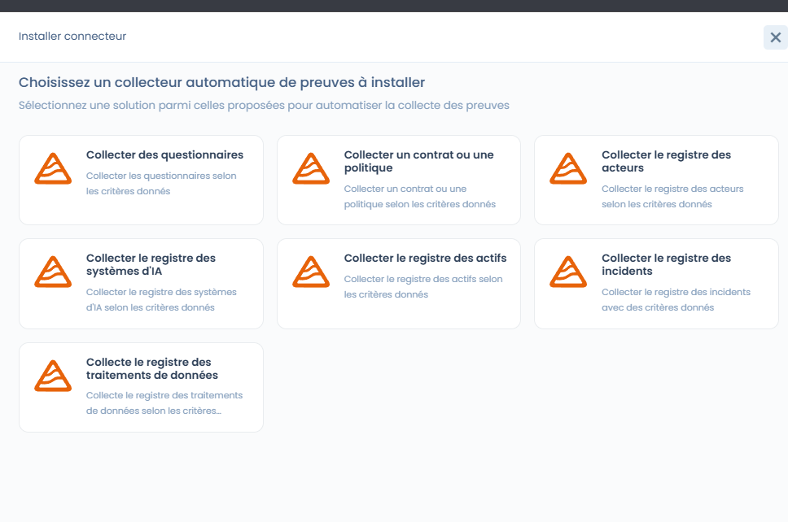
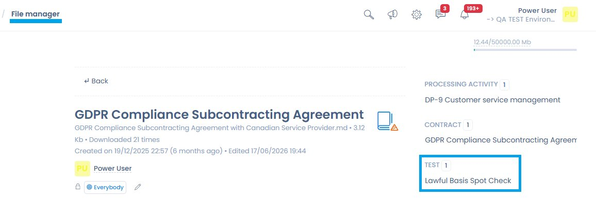

# Tests

Un test définit **comment** et **à quelle fréquence** un contrôle est évalué, et sur quelles preuves repose cette évaluation.

Les tests constituent le lien opérationnel entre :

* les **contrôles** (mesures mises en œuvre),
* les **preuves** collectées,
* et les **résultats de conformité** observés dans le temps.

***

## Rôle des tests dans Dastra

Un test répond à une question :

> _Le contrôle est-il effectivement appliqué et efficace ?_

Chaque test est :

* associé à un **contrôle de référence**
* exécuté selon une **fréquence définie**
* utilisé dans les **projets de conformité** pour produire des preuves et des résultats exploitables

***

## Vue bibliothèque des tests

<figure><figcaption></figcaption></figure>

La bibliothèque des tests offre une vision transverse de tous les tests disponibles, avec notamment :

* leur type (manuel ou automatisé),
* la date de création,
* les contrôles associés,
* des filtres avancés (framework, type, exigences, tests orphelins).

Cette vue permet :

* d’identifier les tests réutilisés dans plusieurs contextes,
* de détecter les tests non rattachés,
* d’industrialiser les méthodes de vérification.

***

## Tests manuels (par défaut)

Par défaut, un test est **manuel**.

Un test manuel repose sur une **action humaine**, par exemple :

* revue documentaire,
* entretien avec les équipes,
* vérification d’un registre,
* audit ponctuel d’un processus.

### Fonctionnement dans un projet de conformité

Lorsqu’un test manuel est ajouté à un projet :

* il requiert une **mise à jour régulière des preuves**
* selon la **fréquence définie** dans le test (mensuelle, trimestrielle, annuelle, etc.)

Cela permet de garantir une conformité **vivante**, mise à jour dans le temps.

***

## Configuration d’un test



Lors de la création ou de l’édition d’un test, l’utilisateur définit :

* **le nom et la référence du test** (avec générateur de référence)
* **la fréquence du test**
* **la description détaillée**, incluant :
  * l’objectif du test
  * la procédure à suivre
  * les éléments de preuve attendus



<figure><figcaption></figcaption></figure>



Ces informations servent de guide opérationnel lors de l’exécution du test dans un projet.

### Fenêtre d’un test dans un projet

Dans un projet, un test s’ouvre dans une fenêtre à onglets :

* **Détails de test** : libellé, **Propriétaire du test**, état, **Procédure de test**, **Fréquence du test** et preuves ;
* **Contrôles Associés** : les contrôles vérifiés par le test ;
* **Tests en erreur** : les erreurs signalées par les auditeurs sur ce test (voir [Audits](../projects/audits.md)) ;
* **Contexte** : le projet, les frameworks et le périmètre auxquels le test appartient.

***

## Tests automatisés avec les connecteurs Dastra

Dastra propose des connecteurs prêts à l’emploi (questionnaires, registres, politiques, etc.), ainsi qu’un connecteur générique de requête HTTP. Ces connecteurs, aussi appelés collecteurs automatiques de preuves, s’utilisent directement dans les **tests automatisés** du module Compliance.

<figure><figcaption></figcaption></figure>

En complément des tests manuels, Dastra permet de configurer des **tests automatisés** à l’aide de **connecteurs**.

Un test automatisé s’appuie sur un connecteur Dastra pour :

* interroger directement des éléments de l’espace de travail
* collecter automatiquement des preuves
* vérifier la conformité selon des critères définis

### Installer un connecteur sur un test

1. Ouvrez un test manuel et cliquez sur **Installer connecteur**.
2. Dans **Choisissez un collecteur automatique de preuves à installer**, sélectionnez le connecteur.
3. Réglez la **Fréquence du test** (en jours, mois ou années) et configurez les valeurs par défaut du connecteur.
4. Cliquez sur **Valider**. La collecte de la preuve démarre immédiatement avec cette configuration.

Cliquez ensuite sur **Exécuter** pour relancer la collecte à la demande. Chaque exécution est enregistrée comme preuve du test. Si la configuration d’un connecteur est invalide, la collecte automatique reste désactivée jusqu’à ce que vous la corrigiez.

### Connecteurs disponibles

| Connecteur | Collecte |
| --- | --- |
| **Collecter des questionnaires** | Les questionnaires de l’espace de travail, selon des critères. |
| **Collecter un contrat ou une politique** | Un contrat ou une politique, par exemple pour vérifier sa présence et sa mise à jour. |
| **Collecter le registre des acteurs** | Les acteurs (tiers) de l’espace de travail. |
| **Collecter le registre des systèmes d'IA** | Le registre des systèmes d’IA, par exemple pour vérifier leur documentation. |
| **Collecter le registre des actifs** | Les actifs de l’espace de travail. |
| **Collecter le registre des incidents** | Les incidents de l’espace de travail. |
| **Collecte le registre des traitements de données** | Les traitements du registre. |
| **Requête HTTP** | Le résultat d’une requête vers n’importe quelle API ou endpoint (voir plus bas). |

Exemple : un test automatisé peut vérifier que chaque système d’IA dispose d’une documentation conforme et à jour, sans intervention manuelle.

## Ajout d’un connecteur personnalisé

En complément des connecteurs standards, Dastra permet de créer des **connecteurs personnalisés** afin d’automatiser la collecte de preuves dans les tests de conformité.

Un connecteur personnalisé permet :

* d’exécuter une requête technique (ex. requête HTTP),
* d’interroger une source interne ou externe,
* de collecter automatiquement des éléments factuels,
* de produire des preuves exploitables dans les audits.

Le connecteur devient ainsi une **source de preuve récurrente et traçable**.

### Requête HTTP

Le connecteur **Requête HTTP** permet d’interroger n’importe quelle API ou endpoint exposé.

Il est particulièrement adapté pour :

* interroger des outils tiers,
* vérifier l’existence ou l’état d’une ressource,
* automatiser des contrôles techniques ou documentaires.

## Configuration du connecteur HTTP

<figure><figcaption>
Interface de configuration du connecteur HTTP avec ses onglets Auth, En-têtes, Paramètres d'URL et Corps
</figcaption></figure>

L’interface de configuration du connecteur HTTP permet de construire une requête sans connaître la syntaxe JSON.

| Champ | Description |
| --- | --- |
| **URL** | Endpoint à interroger. Obligatoire, au format `http://` ou `https://`. |
| **HTTP Method** | `GET` ou `POST`. |
| Onglet **Auth** | Choisissez l’**Authentification** : **Aucune**, **Clé API**, **Jeton d'autorisation (Bearer)** ou **Authentification basique (Basic)**. L’en-tête correspondant est ajouté automatiquement à chaque requête, sans saisir de JSON. |
| Onglet **En-têtes** | En-têtes personnalisés sous forme de paires clé/valeur, envoyés en complément de l’authentification. |
| Onglet **Paramètres d'URL** | Paramètres de requête sous forme de paires clé/valeur, ajoutés à l’URL. |
| Onglet **Corps** | **Corps de la requête** au format JSON. |

Les champs sensibles (clé d’API, jeton, mot de passe) sont masqués par défaut ; une icône en forme d’œil permet de les révéler ponctuellement. Des aperçus en lecture seule affichent ce qui sera réellement envoyé : **En-têtes qui seront envoyés**, **URL qui sera appelée** et **Corps de la requête qui sera envoyé**, les valeurs sensibles restant masquées.

### Résultat de la requête

Le test réussit lorsque l’endpoint répond avec le code HTTP 200. Chaque exécution est enregistrée comme preuve dans le projet de conformité, et le test est réexécuté selon la **Fréquence du test** choisie à l’installation du connecteur. Les critères de succès ne sont pas configurables.

## Avantages des tests automatisés

Les tests automatisés permettent :

* une **collecte continue des preuves**
* une réduction de la charge opérationnelle
* une meilleure fiabilité des contrôles
* une détection plus rapide des écarts

Ils sont particulièrement adaptés aux contrôles récurrents ou structurés.

***

## Joindre une preuve depuis le gestionnaire de fichiers

Lors de l'ajout d'une preuve à un test, il est possible de sélectionner un fichier directement depuis le **gestionnaire de fichiers** Dastra, sans avoir à le réimporter. Cliquez sur **Explorateur de fichier** dans la fenêtre d'ajout de preuve.

<figure><figcaption>
Le bouton **Explorateur de fichier** permet de sélectionner une preuve déjà présente dans le gestionnaire de fichiers Dastra
</figcaption></figure>

***

## Analyse IA des preuves

Dastra peut analyser automatiquement les preuves jointes à un test et indiquer si elles correspondent à ce que la procédure attendait. Cette fonctionnalité est une **aide à la décision pour l'auditeur** : elle ne remplace jamais le jugement humain et n'accepte ni ne rejette une preuve à votre place.

### Comment ça fonctionne

Lorsqu'une preuve est ajoutée à un test, l'IA compare le contenu de la preuve avec le libellé et la description de la procédure du test. Le résultat s'affiche dans la colonne **Appréciation IA** du tableau des preuves, sous forme d'un **badge coloré** :

| Appréciation | Signification |
| --- | --- |
| **Correct** | La preuve correspond à la procédure. |
| **Probablement correct** | La preuve semble correspondre, une vérification humaine est recommandée. |
| **Non conforme** | La preuve ne correspond pas à la procédure. |
| **Inconnu** | L'IA ne peut pas conclure. |

Survolez le badge pour afficher le **Document** (résumé du document analysé), la **Confiance de l'analyse** (de 0 à 100 %) et les **Détails** qui justifient l'appréciation.

### Types de preuves supportés

L'analyse s'adapte au type de preuve fournie :

| Type de preuve | Méthode d'analyse |
| --- | --- |
| Image (capture d'écran, JPEG, PNG, etc.) | Analyse visuelle du contenu par un modèle de vision |
| Document (PDF, Word) | Extraction du texte, puis analyse du texte |

L'infobulle de l'en-tête de la colonne **Appréciation IA** rappelle cette méthode.

### Activation et paramétrage

La fonctionnalité est optionnelle et désactivée par défaut. Pour l'activer, rendez-vous dans **Paramètres** > **Conformité** et activez l'option **Analyse IA automatique des preuves**.


Tant que la fonctionnalité n'est pas activée, **aucune donnée de preuve n'est envoyée au modèle d'IA**.


Pour désactiver l'analyse, cliquez sur **Je veux désactiver cette fonctionnalité** dans l'infobulle d'un résultat : le lien mène aux paramètres de conformité. Le modèle d'IA utilisé peut être configuré selon le choix de votre organisation, via les paramètres de l'assistant IA (famille de modèles ou Custom AI provider).

### Ce que l'analyse ne fait pas

* Elle **n'accepte ni ne rejette** une preuve automatiquement : la décision finale appartient toujours à l'auditeur.
* Elle ne modifie pas le statut du test.
* Elle est non contraignante : une appréciation **Inconnu** ou **Probablement correct** signale qu'une vérification humaine est recommandée.

***

## Fusion de tests

Tout comme pour les contrôles, la bibliothèque de tests peut accumuler des tests redondants, notamment après l'import de plusieurs frameworks. La fonctionnalité de **fusion de tests** permet de consolider ces doublons en un seul test de référence.

### Comment fonctionne la fusion

Depuis la bibliothèque de tests, sélectionnez les tests à fusionner puis cliquez sur **Fusionner**. Choisissez la **version de référence**, c'est-à-dire le test à conserver : les associations des autres tests (contrôles liés, résultats d'exécution, fréquence) sont reportées sur ce test, puis les autres tests sont supprimés. Dans le tableau de comparaison, cochez dans les colonnes **Conserver sélection** les champs à reporter.


La fusion est irréversible. Vérifiez les associations de chaque test source avant de confirmer.


### Cas d'usage typiques

* **Déduplication** : deux imports de frameworks ont créé un test « Vérification de la politique de confidentialité » en double : la fusion les consolide.
* **Rationalisation** : plusieurs tests manuels très proches peuvent être regroupés en un seul test plus complet.
* **Nettoyage avant audit** : réduire le nombre de tests orphelins améliore la lisibilité du tableau de bord.

***

## Lier un test à un document

Un test de conformité peut être associé à un ou plusieurs **documents du gestionnaire de fichiers** Dastra (contrats, politiques, preuves documentaires, accords de sous-traitance). Cette liaison permet de retrouver les tests associés à chaque document, et inversement.

### Depuis la vue d'un document

Lorsqu'un test est lié à un document, un panneau **Tests** apparaît dans la vue d'édition du document ou du contrat concerné, affichant la référence, le nom et le statut de chaque test associé.

<figure><figcaption>
Un test lié apparaît dans le panneau Tests à droite du document (ici : G-T2 Lawful Basis Spot Check, Done / Pass)
</figcaption></figure>

### Depuis le gestionnaire de fichiers

Dans le gestionnaire de fichiers, la fiche détail d'un document affiche dans la colonne latérale toutes les entités Dastra auxquelles il est rattaché : traitements, contrats, et tests de conformité.

<figure><figcaption>
Le gestionnaire de fichiers affiche les tests associés à chaque document dans la colonne de détail
</figcaption></figure>

Cette traçabilité bidirectionnelle permet d'auditer quels tests s'appuient sur quel document, et de retrouver l'ensemble des preuves documentaires depuis le gestionnaire de fichiers.

***

## Complémentarité des approches

Dastra permet de combiner :

* des **tests manuels** pour les contrôles nécessitant analyse ou jugement humain
* des **tests automatisés** pour les vérifications objectives et répétitives

Cette complémentarité offre un équilibre entre rigueur, efficacité et pragmatisme.
