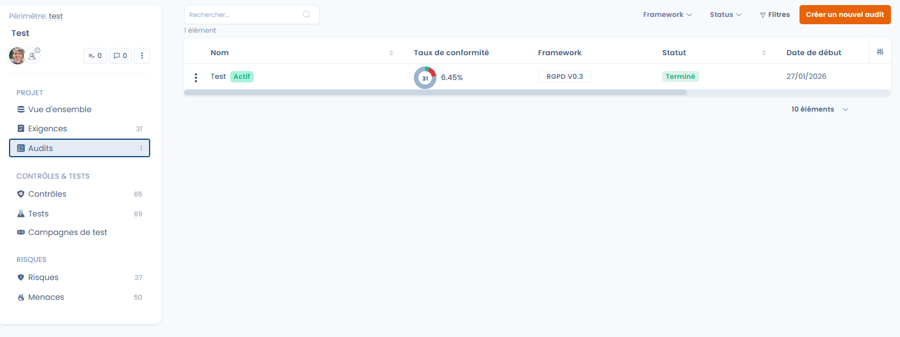

# Audits

Les phases **Audit interne** et **Audit final** d'un projet permettent de valider officiellement l'état de conformité à un instant donné. Elles s'appuient sur le travail de conception et de surveillance réalisé en amont pour offrir une évaluation structurée, réalisée en interne ou par des auditeurs externes.

Un audit porte sur un framework du projet. Les auditeurs évaluent chaque exigence à partir des contrôles, des tests et des preuves déjà présents dans le projet, puis l'audit est finalisé avec une appréciation globale.

<figure><figcaption></figcaption></figure>

## Ce que permet le module

* **Réaliser des audits** internes ou externes avec les frameworks standards (RGPD, AI Act, etc.) ou vos propres grilles personnalisées.
* **Collaborer** : les auditeurs accèdent aux exigences, aux contrôles, aux tests et aux preuves associés, et un auditeur peut être ajouté en cours de mission.
* **Réutiliser le travail de surveillance** : les contrôles et les preuves du projet sont consultables directement pendant l'évaluation.
* **Traiter les écarts** : signalez les erreurs constatées sur les tests et créez des tâches de correction.
* **Exporter** les résultats aux formats XLSX, PDF, DOCX, JSON, HTML ou Markdown.

<figure><figcaption></figcaption></figure>

## Créer un audit

Créez un audit depuis le projet de conformité, et non depuis le module Questionnaires. Deux points d'entrée existent :

* l'onglet **Audits** du projet, avec le bouton **Créer un nouvel audit**. Choisissez ensuite le framework dans la liste **Sélectionnez un framework à auditer** : elle indique pour chacun si un audit est déjà en cours ;
* le menu **⋯** de la carte d'un framework sur la **Vue d'ensemble** du projet, avec **Créer un nouvel audit**. Le framework est alors déjà choisi.

Si le projet ne contient aucun framework, Dastra affiche **Aucun framework à auditer** : ajoutez d'abord un framework au projet (voir [Conception du projet](design.md)).


Créer un audit hors d'une phase d'audit n'est pas recommandé : Dastra affiche un avertissement mais ne vous bloque pas. Le choix de la phase d'audit **Audit final** déclenche le même avertissement tant que le projet n'est pas en phase **Audit final**.


### Informations générales

| Champ | Description |
| --- | --- |
| **Nom** | Titre de la mission, par exemple « Audit de conformité annuel ». Obligatoire, 80 caractères au maximum. |
| **Description** | Contexte ou périmètre spécifique de la mission. Facultatif, 500 caractères au maximum. |
| **Auditeurs** | Utilisateurs autorisés à réaliser l'audit. Obligatoire. Si vous n'êtes pas dans cette liste, vous ne pourrez pas évaluer les exigences, même si vous êtes propriétaire de l'organisation. |

<figure><figcaption></figcaption></figure>

### Phase de l'audit et dates

La **Phase de l'audit** segmente la mission et permet de filtrer les tableaux de bord de gouvernance. Elle est indépendante de la phase du projet.

| Phase | Usage |
| --- | --- |
| **Analyse initiale** | Cadrage : définition du périmètre, du référentiel et des enjeux réglementaires. Valeur par défaut. |
| **Préparation** | Logistique : affectation des contrôles aux auditeurs et planification des entretiens. |
| **Pré-audit** | Audit à blanc : auto-évaluation pour identifier les écarts avant l'échéance officielle. |
| **Audit final** | Clôture : notation finale, conclusions et rapport officiel. |

Renseignez la **Date de début** et l'**Échéance** pour encadrer la mission dans le temps. Les deux sont obligatoires.

### Options

* **Préserver les résultats d'un précédent audit ?** : repart des évaluations d'un audit existant, utile pour les audits récurrents ou pour refaire un audit dont des contrôles n'étaient pas satisfaisants. Sélectionnez ensuite l'audit dont vous souhaitez reprendre les résultats.
* **Définir comme audit actif** : l'audit alimente les indicateurs de suivi du framework, dont le taux de conformité affiché sur la vue d'ensemble du projet. Activé par défaut.
* **Notifier l'auditeur par email** : envoie une invitation aux auditeurs désignés. Saisissez au besoin un **Contenu du message**, puis laissez **Envoyer l'email immédiatemment** activé, ou désactivez-le et choisissez une date et une heure d'envoi, dans les 3 jours à venir.

Cliquez sur **Valider** pour créer l'audit : le tableau de bord de l'audit s'ouvre.

## Piloter l'audit

Le tableau de bord de l'audit centralise l'avancement et l'équipe.

À gauche, trois onglets :

* **Exigences auditées (x/y)** : l'arborescence du framework avec le statut de chaque exigence. Filtrez par statut avec **Filtrer par statut** ;
* **Tests en erreur (n)** : les erreurs signalées par les auditeurs sur les tests (voir [Signaler une erreur sur un test](#signaler-une-erreur-sur-un-test)) ;
* **Cartographie** : les graphiques de répartition des exigences et des contrôles.

À droite :

* le périmètre audité, le titre, la description, l'état et la phase de l'audit, les dates et le framework avec sa version. **Modifier** ouvre les informations générales ;
* la **Progression** de l'audit en pourcentage, avec la répartition des exigences (non auditées, conformes, partiellement conformes, non conformes, non applicables) ;
* la liste des **Auditeurs**, avec le nombre d'évaluations réalisées par chacun. **Ajouter un auditeur** et **Retirer l'auditeur** permettent d'ajuster l'équipe en cours de mission ;
* les **Pièces jointes** : centralisez ici les documents de preuve externes pour qu'ils soient accessibles à tous les auditeurs.

Les boutons de tâches et de commentaires du tableau de bord servent à suivre l'audit avec les autres utilisateurs, par exemple pour créer des tâches de correction.

Le bouton **Compléter l'audit** ouvre l'espace d'évaluation. Son menu propose aussi :

* **Réouvrir l'audit** : permet de modifier de nouveau un audit finalisé ;
* **Exporter** ;
* **Copier lien** ;
* **Archiver l'audit**, puis **Restaurer** pour le rétablir. L'audit défini comme actif ne peut pas être archivé.

Si vous n'êtes pas désigné comme auditeur, le bouton **Compléter l'audit** est verrouillé : demandez à être ajouté à la liste des **Auditeurs**.

## Évaluer les exigences

L'espace d'évaluation permet de passer en revue chaque exigence du framework sans quitter la page d'audit.

* **Barre de navigation** : **Retour** et **Suivant** parcourent les exigences, une flèche mène à la prochaine exigence non complétée, et un compteur indique la position (par exemple 1/31).
* **Volet de gauche** : l'arborescence du framework, découpée en chapitres et en exigences. Un indicateur confirme les exigences déjà évaluées.
* **Zone centrale** : l'objectif de l'exigence, puis les contrôles associés avec leurs tests. Pour chaque test, vous consultez les preuves jointes (fichiers, liens, données JSON) directement dans l'interface.
* **Volet de droite** : la progression de l'audit et trois onglets : **Évaluation**, **Détails de l'audit** et **Détails du framework**.

<figure><figcaption></figcaption></figure>

Après avoir analysé les preuves, attribuez un statut à l'exigence dans l'onglet **Évaluation** et saisissez un **Commentaire** pour justifier votre avis :

| Statut | Signification |
| --- | --- |
| **Conforme** | Les preuves fournies satisfont entièrement l'exigence. |
| **Partiellement conforme** | Des preuves existent mais elles sont insuffisantes ou incomplètes. |
| **Non conforme** | Aucune preuve, ou contrôle jugé inefficace. |
| **Non applicable** | L'exigence ne concerne pas le périmètre de l'audit. |

L'**Historique** de l'exigence conserve les évaluations successives. Chaque saisie met à jour la progression de l'audit.

### Signaler une erreur sur un test

Lorsque les preuves d'un test ne conviennent pas, signalez-le au propriétaire du test sans bloquer l'évaluation.

1. Dans la zone centrale, repérez le test et cliquez sur **Signaler erreur**.
2. Choisissez la **Sévérité** : **Bas**, **Moyen** (valeur par défaut) ou **Élevé**.
3. Dans **Expliquez le problème avec les preuves fournies**, décrivez ce qui ne va pas. Le commentaire est facultatif, mais il aide le propriétaire du test à améliorer ses preuves.
4. Cliquez sur **Créer le rapport d'erreur**.

Le bouton est alors remplacé par un drapeau coloré selon la sévérité. Survolez-le pour lire le commentaire ou supprimer le signalement. Un test ne peut porter qu'un signalement par audit.

<figure><figcaption></figcaption></figure>

Les signalements sont réunis dans l'onglet **Tests en erreur** du tableau de bord de l'audit, avec la référence, le test, son statut et sa sévérité. Filtrez par **Sévérité**, puis cochez des tests pour :

* **Invalider les tests** : les tests signalés repassent au statut **A faire**. Dastra propose alors de **Relancer une campagne de tests** pour notifier leurs propriétaires, afin qu'ils mettent à jour leurs preuves avant le prochain audit ;
* **Lancement d'une campagne de tests** : crée directement une campagne avec les tests cochés (voir [Surveillance de la conformité](monitoring.md)).

<figure><figcaption></figcaption></figure>

## Finaliser l'audit

Quand toutes les exigences sont évaluées, le bouton **Finaliser l'audit** devient disponible. Il ouvre une fenêtre où vous saisissez l'**Appréciation finale de l'audit** (obligatoire, 1 000 caractères au maximum). Cette synthèse donne un avis global sur le niveau de maturité du périmètre audité, souligne les points de vigilance ou les réussites, et peut inclure des documents de synthèse joints depuis le gestionnaire de fichiers.

Cliquez sur **Valider** pour clôturer l'audit.


Une fois l'audit finalisé, les évaluations individuelles ne sont plus modifiables, tant que vous ne rouvrez pas l'audit avec **Réouvrir l'audit**.


## Exploiter les résultats

L'audit finalisé alimente le suivi de conformité :

* le pourcentage de conformité par framework s'affiche sur la vue d'ensemble du projet et dans **Conformité** > **Statistiques** ;
* l'**Appréciation finale de l'audit** apparaît en tête du tableau de bord de l'audit ;
* l'export de l'audit conserve une piste d'audit structurée, réutilisable les années suivantes ;
* les exigences non conformes ou partiellement conformes peuvent être suivies par des tâches, créées depuis le bouton de tâches de l'audit, avant le prochain cycle de surveillance.

<figure><figcaption></figcaption></figure>
