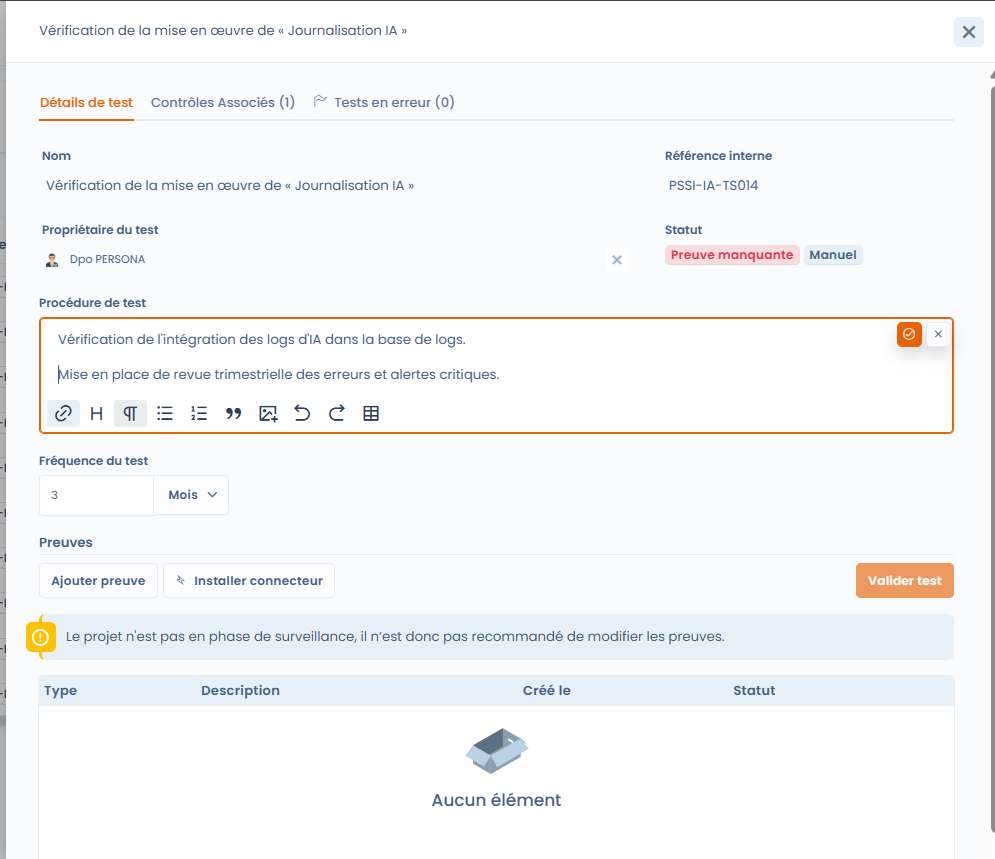
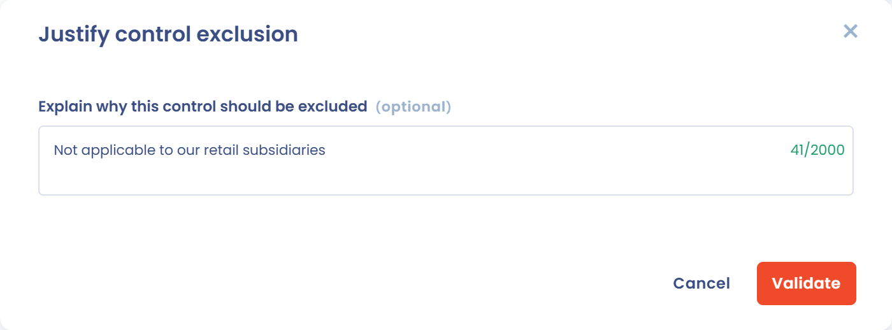
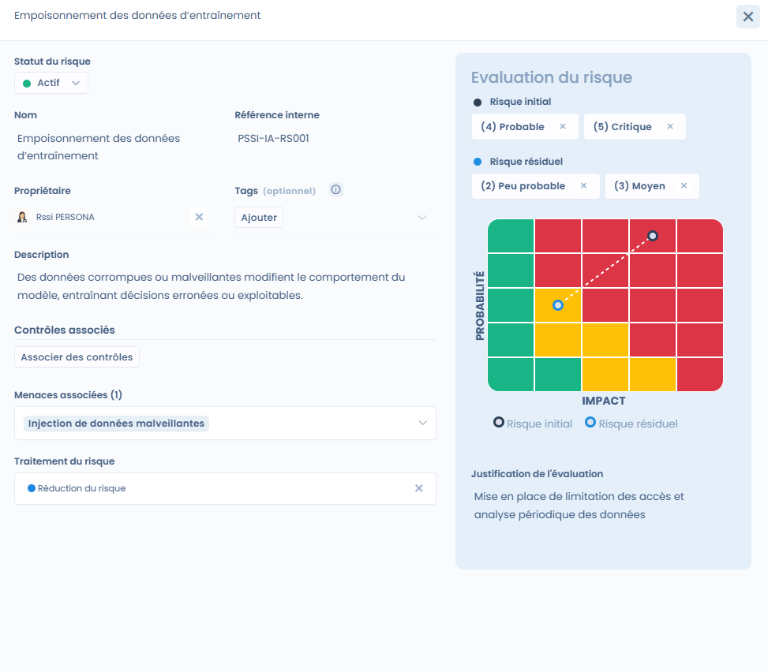
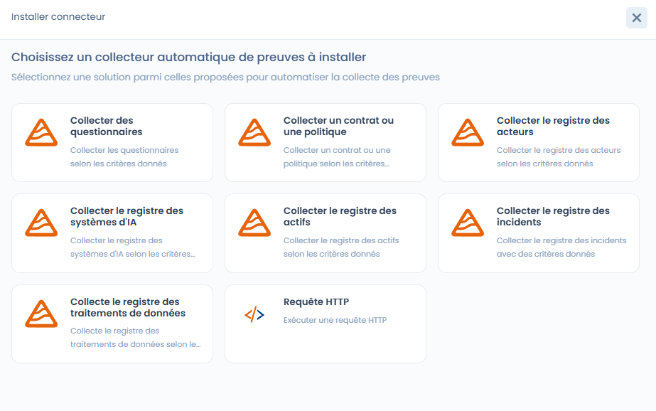

# Implémentation du projet

La phase **Implémentation** marque le passage du cadre théorique à l’exécution opérationnelle de la conformité. Elle consiste à **configurer concrètement les contrôles**, à définir les modalités de vérification et à préparer la collecte des preuves.

À ce stade, le projet dispose déjà :

* de ses frameworks,
* de ses contrôles,
* de ses tests et risques initialisés lors de la conception.

***

## Objectif de la phase

L’objectif de la phase d’implémentation est de :

* définir **comment les contrôles sont vérifiés**,
* configurer les **tests (manuels ou automatisés)**,
* associer les **risques aux contrôles**,
* préparer la **collecte des preuves de conformité**.

***

## 1. Comprendre le statut des tests en phase d’implémentation

Par défaut, tous les tests du projet sont dans l’état **« Preuve manquante »**.

Cela signifie que :

* le contrôle existe,
* le test est défini,
* mais **aucune preuve n’est encore fournie ou collectée**.

Tant que le projet n’est pas en phase **Surveillance**, la modification ou la validation des preuves n’est pas recommandée : Dastra affiche un avertissement, sans vous bloquer.

<figure><figcaption></figcaption></figure>

L'onglet **Contexte** du détail d'un test indique d'où vient le test : le **Projet** (nom, statut, description et **Frameworks**) et son **Périmètre**.

***

## 2. Configurer les tests de conformité

Chaque contrôle peut être vérifié à l’aide d’un ou plusieurs **tests**.



Un test permet de définir :

* une **procédure de vérification**,
* une **fréquence d’exécution** (ex. mensuelle, trimestrielle, annuelle),
* un **responsable du test**.

Les tests peuvent être :

* **manuels**, nécessitant une action humaine et une preuve,
* ou **automatisés**, via un connecteur Dastra ou personnalisé.



<figure><figcaption></figcaption></figure>



***

## Statut des contrôles et exclusion

Chaque contrôle du projet a un **Statut du contrôle**, modifiable dans la liste de l'onglet **Contrôles** ou dans la fenêtre du contrôle :

| Statut | Signification |
| --- | --- |
| **Brouillon** | Le contrôle est identifié mais pas encore mis en œuvre. Il est compté parmi les contrôles non implémentés. |
| **Implémenté** | Le contrôle est en place. C'est le statut des contrôles importés avec un framework. Il est validé lorsque tous ses tests réussissent. |
| **Exclu** | Le contrôle ne s'applique pas au projet. |

Pour exclure un contrôle, choisissez **Exclu** : la fenêtre **Justifier l'exclusion du contrôle** s'ouvre. Saisissez la raison dans **Expliquez pourquoi ce contrôle doit être exclu** (2 000 caractères au maximum). La justification est facultative dans cette fenêtre, mais il est recommandé de la renseigner : elle est affichée sur le contrôle et pendant les audits, et reprise dans la déclaration d'applicabilité, où un contrôle exclu est marqué comme non applicable (voir [Surveillance de la conformité](monitoring.md)).

Un contrôle exclu n'est plus évalué : lors d'un audit, la justification s'affiche à la place de ses tests. Ajouter de nouveau au projet un contrôle exclu, par ajout groupé, le réactive.

<figure><figcaption></figcaption></figure>

***

## Assigner un propriétaire à tous les contrôles et tests d'une exigence

Dans l'onglet **Exigences** du projet, le bouton en forme d'utilisateurs, à droite d'une exigence, ouvre la fenêtre **Assigner un propriétaire à tous les contrôles et tests**. Il fait gagner du temps en début d'implémentation, avant l'étape de checklist **Attribuer des propriétaires aux tests**.

1. Cliquez sur le bouton de l'exigence concernée. L'action s'applique à l'exigence et à ses sous-exigences.
2. Dans **Sélectionner un utilisateur à assigner comme propriétaire**, choisissez la personne.
3. Activez **Écraser les assignations de propriétaire existantes** si vous voulez remplacer les propriétaires déjà définis. Sinon, seuls les éléments sans propriétaire sont renseignés.
4. Cliquez sur **Valider**.

Il faut le droit d'écriture sur la conformité opérationnelle.

<figure><figcaption></figcaption></figure>

***

## 3. Associer et évaluer les risques

Les contrôles peuvent être liés à un ou plusieurs **risques** afin de mesurer leur impact sur la réduction du risque.

Pour chaque risque, vous pouvez :

* définir une **évaluation initiale** (probabilité × impact),
* définir une **évaluation résiduelle**, après application des contrôles,
* choisir le **traitement du risque** (réduction, acceptation, etc.).

Cette approche permet de visualiser concrètement l’effet des contrôles sur la posture de risque.

<figure><figcaption></figcaption></figure>

### Visualiser les risques en carte

Dans l'onglet **Risques** du projet, le sélecteur situé au-dessus de la liste permet de passer de la vue **Tableau**, qui liste chaque risque avec ses scores, à la vue **Cartographie**, qui place les risques sur une matrice probabilité × impact.

La vue **Cartographie** affiche trois matrices côte à côte :

* **Risque initial** : le niveau évalué à l'identification du risque, avant toute mesure de remédiation ;
* **Risque courant** : le niveau à l'instant T, selon l'avancement réel des actions de remédiation et des contrôles ;
* **Risque résiduel** : le niveau attendu une fois toutes les mesures prévues mises en œuvre, c'est-à-dire le risque accepté ou toléré par l'organisation.

Filtrez par **Framework** pour ne voir que les risques d'un référentiel, cliquez sur un risque pour l'ouvrir, ou cliquez sur **Imprimer** pour imprimer la page. Cette lecture en tableau et en carte facilite l'arbitrage et la communication des risques prioritaires auprès des parties prenantes.

<figure><figcaption></figcaption></figure>

***

## 4. Lier menaces, risques et contrôles

Les **menaces** représentent les scénarios concrets pouvant déclencher un risque\
(ex. : injection de données malveillantes, absence de supervision, exfiltration d’informations).

Une menace peut être :

* liée à un ou plusieurs **risques**,
* indirectement couverte par les **contrôles** mis en place.

Ce chaînage permet une traçabilité complète :\
**Menace** > **Risque** > **Contrôle** > **Test** > **Preuve**

***

## 5. Installer un connecteur pour automatiser les preuves

Pour certains tests, il est possible d’installer un **connecteur Dastra** afin d’automatiser la collecte des preuves.

Les connecteurs permettent par exemple de :

* vérifier la présence d’une politique ou d’un contrat,
* interroger un registre (systèmes d’IA, actifs, incidents, traitements, tiers) ou les audits,
* automatiser des contrôles récurrents sans action manuelle.

La liste des connecteurs et leur configuration sont décrites dans [Tests](../library/tests.md).

Chaque connecteur est configuré avec :

* une **fréquence d’exécution**,
* des **paramètres de collecte** adaptés au test.

<figure><figcaption></figcaption></figure>

***

## 6. Résultat de la phase d’implémentation

À la fin de la phase d’implémentation :

* les **contrôles sont configurés**,
* les **tests sont prêts à être exécutés**,
* les **risques sont évalués et liés**,
* les **connecteurs éventuels sont installés**.

Le projet est alors prêt à entrer dans la phase suivante : **Surveillance**, durant laquelle :

* les tests sont exécutés périodiquement,
* les preuves sont collectées,
* et la conformité est mesurée dans le temps.

## Exporter les listes du projet

Les onglets **Contrôles**, **Tests** et **Risques** d'un projet ont chacun un bouton **Exporter**. Il exporte la liste telle qu'elle est affichée : les filtres actifs s'appliquent. Dans la fenêtre d'export, choisissez le format (CSV, Excel ou JSON) et les colonnes à inclure, puis cliquez sur **Télécharger le fichier**.

Le bouton nécessite la permission d'exporter les données opérationnelles du module de conformité. Sans elle, il est désactivé.
