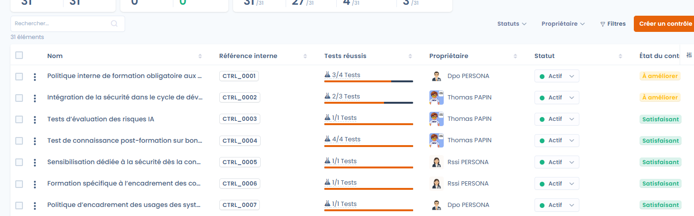
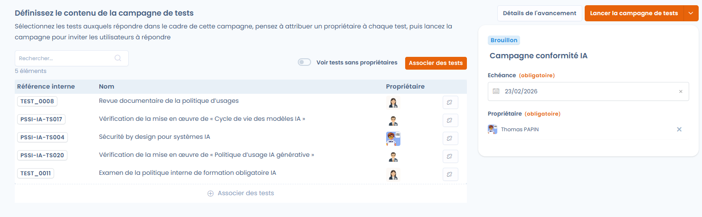

# Surveillance de la conformité

La phase **Surveillance** vise à **vérifier dans le temps l’efficacité réelle des contrôles**, à collecter les preuves associées et à suivre l’évolution de la conformité via des campagnes de tests récurrentes.

Son objectif : collecter des preuves sur l’ensemble du projet à l’aide de campagnes de tests, s’assurer qu’un maximum de contrôles réussissent et maintenir un niveau de conformité mesurable dans le temps.

***

## Vue d’ensemble de la phase de surveillance

Dans cette phase, le projet bascule d’une logique de préparation à une logique d’**exécution continue** :

* les contrôles sont déjà implémentés,
* les tests sont exécutés régulièrement,
* les preuves sont collectées, mises à jour et évaluées,
* les indicateurs de conformité deviennent exploitables.

<figure><figcaption></figcaption></figure>

***

## Suivi global des contrôles et des tests

Dans la zone **Contrôles & tests** de la **Vue d’ensemble** du projet, quatre indicateurs donnent une vision synthétique de l’état du projet :

* **Statut des contrôles** : proportion de contrôles validés.
* **Implémentation** : contrôles implémentés ou non.
* **État des tests** :
  * tests réussis,
  * preuves manquantes,
  * tests qui échouent.
* **Fraîcheur des tests** :
  * tests à jour,
  * tests expirés nécessitant une nouvelle preuve.

Ces indicateurs permettent d’identifier rapidement les points de vigilance et de prioriser les actions correctives.

<figure><figcaption></figcaption></figure>

### Historique du projet

Sous ces indicateurs, le graphique **Historique du projet** montre l’évolution du projet dans le temps. Choisissez la période avec le sélecteur de dates (3 ans au maximum), puis réglez :

* **Unité de temps** : **Jour**, **Semaine**, **Mois** ou **An** ;
* **Métrique** : **Tests**, **Contrôles**, **Exigences**, **Risques** ou **Conformité**.

Le graphique permet de montrer la progression de la conformité à la direction ou aux auditeurs.

<figure><figcaption></figcaption></figure>

***

## Gestion des preuves



Les preuves constituent le cœur de la phase de surveillance.\
Elles peuvent être ajoutées directement depuis un test avec **Ajouter preuve** et être **réutilisées sur plusieurs tests du projet**.

Les modes de collecte disponibles incluent notamment :

* ajout de fichiers de preuve,
* liens externes,
* sélection de preuves déjà présentes dans le projet.

Chaque preuve peut être documentée avec une **Description de la preuve** afin de faciliter les audits ultérieurs.



<figure><figcaption></figcaption></figure>



***

## Campagnes de tests

Les **campagnes de tests** permettent d’orchestrer l’exécution des tests à grande échelle. Elles se gèrent dans l’onglet **Campagnes de test** du projet.

Une campagne permet de :

* regrouper un ensemble de tests à exécuter,
* attribuer un propriétaire à chaque test,
* définir une échéance globale,
* suivre l’avancement de manière centralisée.

Pour créer une campagne, cliquez sur **Créer une campagne de tests** et saisissez le **Libellé de la campagne**. Vous pouvez **pré-sélectionner tous les tests de votre projet en attente de preuves** pour faciliter le lancement. La campagne s’ouvre ensuite en configuration : **Définissez le contenu de la campagne de tests**, vérifiez que chaque test a un propriétaire, puis lancez la campagne.


Si un ou plusieurs tests de la campagne n’ont pas de propriétaire, Dastra affiche un avertissement et vous invite à les vérifier avant d’envoyer les invitations. Utilisez **Voir tests sans propriétaires** pour les retrouver.


Lancer une campagne hors de la phase **Surveillance** n’est pas recommandé : Dastra affiche un avertissement sans vous bloquer.

<figure><figcaption></figcaption></figure>

***

## Lancement et suivi des campagnes



Une fois la campagne configurée :

* les utilisateurs concernés reçoivent une **invitation par e-mail**, que vous envoyez avec **Envoyer les invitations** en sélectionnant les propriétaires à notifier,
* un message personnalisé peut être ajouté pour contextualiser la demande,
* chaque test progresse individuellement (_à faire_, _en attente de validation_, _terminé_).

L’avancement global de la campagne est visible en temps réel, permettant au responsable du projet d’identifier rapidement les retards ou blocages.



<figure><figcaption></figcaption></figure>



### Relancer, clôturer et suivre une campagne

Dans la liste des campagnes, le menu **⋯** de chaque ligne propose :

* **Envoyer un rappel** : sélectionnez les propriétaires qui ont encore des tests à terminer. Un rappel par défaut est envoyé, auquel vous pouvez ajouter un **Message de relance personnalisé** ;
* **Clôturer la campagne** : termine la campagne ; **Ré ouvrir la campagne** la remet en cours ;
* **Copier lien** : copie le lien de la campagne ;
* **Déplacer dans la corbeille** : retire la campagne de la liste. Utilisez **Restaurer** pour la rétablir, ou **Supprimer** pour l’effacer définitivement.

**Détails** ouvre le tableau de bord de la campagne : nombre de tests, de participants et de frameworks, tests validés, **Taux de complétion par utilisateur** (tests terminés, en attente de validation et à faire) et **Répartition des tests par framework**.

***

## Validation des tests

Chaque test dispose d’un cycle de vie clair :

* consultation de la **Procédure de test**,
* ajout ou mise à jour des preuves,
* validation du test avec **Valider test**.

Le résultat d’un test est **Réussi**, **Échec**, **Preuve manquante** ou **Preuve expirée**. Pour un test manuel, **Valider test** le fait passer à **Terminé** ; **Invalider le test** annule cette validation. Une fois validé, le test contribue automatiquement à l’amélioration du statut du contrôle associé et aux indicateurs globaux du projet.

L’invitation envoie l’utilisateur vers un tableau de suivi personnalisé dans lequel il peut renseigner les preuves des tests dont il est propriétaire. Cet espace est aussi accessible depuis **Mes tests** (voir [Projets](README.md)). Lorsqu’un utilisateur a terminé tous ses tests, Dastra affiche un message de félicitations avec le bouton **Voir mes tâches**.

<figure><figcaption></figcaption></figure>

***

## Export de la Déclaration d’Applicabilité (SOA)

La **Déclaration d’Applicabilité** (SOA, Statement of Applicability) est le document de référence qui regroupe tous les contrôles d’un framework du projet. Elle sert aux audits de certification, par exemple ISO 27001, et à démontrer la couverture des exigences à votre direction ou à vos auditeurs.

L’export se fait par framework, au format XLSX :

1. Ouvrez le projet de conformité.
2. Sur la **Vue d’ensemble**, cliquez sur le menu **⋯** de la carte du framework, ou ouvrez l’onglet **Exigences** et utilisez le menu **⋯** du framework.
3. Cliquez sur **Exporter la déclaration d’applicabilité**.

Il faut le droit d’export sur la conformité opérationnelle.

<figure><figcaption></figcaption></figure>

Le fichier contient une ligne par contrôle, avec les colonnes suivantes :

| Colonne | Contenu |
| --- | --- |
| `ControlId` | Référence du contrôle. |
| `Label` | Nom du contrôle. |
| `Description` | Description du contrôle, sans mise en forme. |
| `Applicable` | Statut d’applicabilité : un contrôle dont le statut est **Exclu** n’est pas applicable. |
| `Justification` | Justification de l’exclusion saisie sur le contrôle (voir [Statut des contrôles et exclusion](implement.md)). |
| `ImplementationStatus` | Statut du contrôle : **Brouillon**, **Implémenté** ou **Exclu**. |
| `Evidence` | Références aux preuves collectées sur les tests du contrôle. |
| `Auditor` | Propriétaire du contrôle. |
| `RequirementNodes` | Exigences couvertes par le contrôle. |

***

## Résultat attendu de la phase de surveillance

À l’issue de cette phase, le projet dispose :

* de **preuves collectées et tracées**,
* de **tests régulièrement exécutés et mis à jour**,
* d’une **vision fiable et mesurable de la conformité réelle**,
* d’une base solide pour préparer les phases d’**audit interne** et de **certification**.
