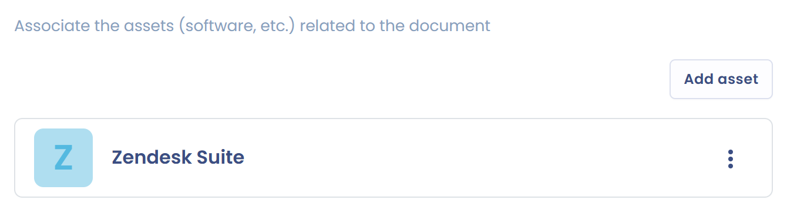

# Les actifs

Dans l'onglet **Actifs**, liez à votre document les actifs concernés : logiciels, équipements, données ou toute autre ressource matérielle ou immatérielle impliquée dans l'exécution du document. Vous suivez ainsi les ressources que couvre chaque contrat ou chaque politique.

Les actifs proviennent de vos [référentiels](../mapping/repositories/README.md). Pour en lier un, cliquez sur **Ajouter un actif**, sélectionnez l'actif dans votre référentiel, puis cliquez sur **Ajouter**. L'onglet affiche entre parenthèses le nombre d'actifs liés.

<figure><figcaption>
Lier des actifs à un document
</figcaption></figure>

Si l'actif sélectionné a un éditeur, Dastra le signale et propose de l'ajouter comme signataire du document : cochez la case pour l'ajouter en même temps que l'actif.

## Retrouver les documents depuis un actif

Les documents liés à un actif apparaissent aussi sur la fiche de l'actif, où le bouton des contrats affiche leur nombre. Depuis ce bouton, vous pouvez lier un document existant avec **Lier à un document**, ou en créer un avec **Créer un document**.
