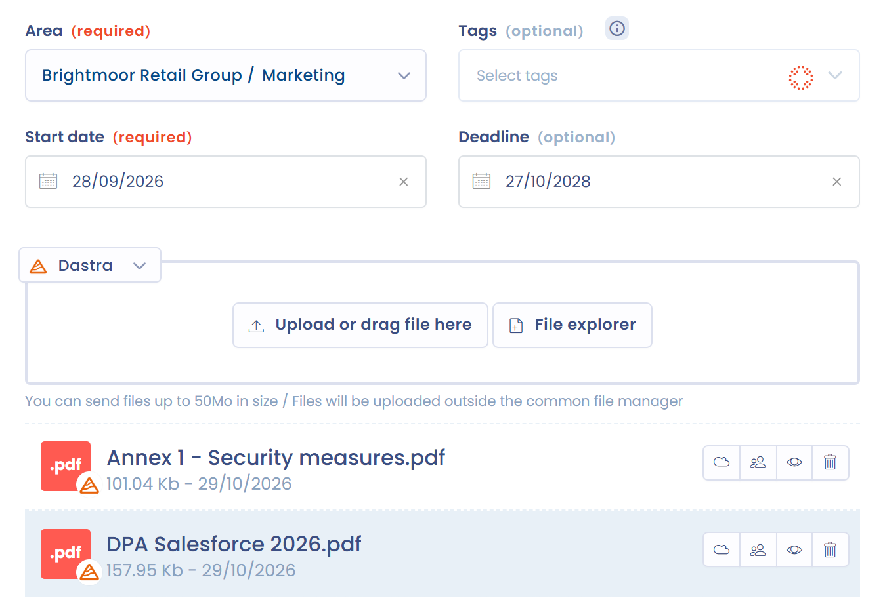
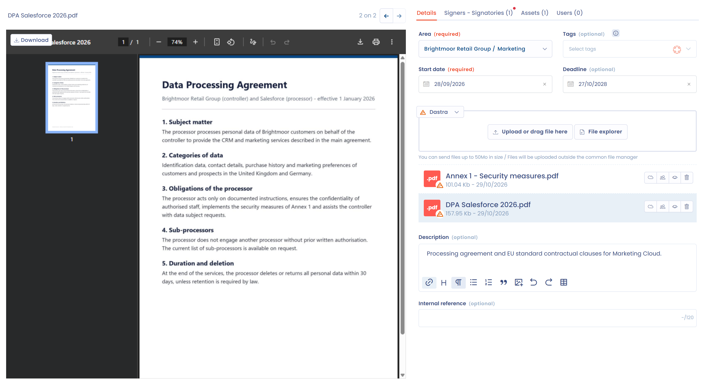

# Détails et pièces jointes

L'onglet **Détails** de la fiche d'un document réunit les informations du document et ses pièces jointes. La prévisualisation des fichiers reste affichée à gauche, quel que soit l'onglet ouvert.

## Les pièces jointes

Ajoutez à votre document les fichiers qui le composent : le contrat lui-même, des avenants, des annexes ou tout autre fichier associé. Pour disposer de la prévisualisation, stockez des fichiers PDF ou des images.

Déposez les fichiers dans la zone prévue, ou cliquez sur **Explorateur de fichier** pour les choisir. Si vous avez installé l'[intégration OneDrive, SharePoint ou Google Drive](../settings/cloud-storage.md), un sélecteur de source permet d'associer des fichiers depuis votre propre stockage.

Le stockage des pièces jointes est lié au [gestionnaire de fichiers](../files/README.md) de Dastra. Les utilisateurs qui gèrent les pièces jointes peuvent basculer un fichier dans le gestionnaire de fichiers commun avec **Basculer vers gestionnaire de fichiers commun (GED)**, puis l'ouvrir depuis le document avec **Afficher dans le gestionnaire de fichiers**.

<figure><figcaption>
Ajouter des pièces jointes à un document
</figcaption></figure>

## Prévisualiser un document

La prévisualisation s'affiche à gauche, la liste des pièces jointes à droite. Pour changer de fichier, cliquez sur son nom dans la liste, cliquez sur les flèches à l'écran ou utilisez les flèches gauche et droite du clavier. Le fichier prévisualisé est surligné en bleu dans la liste. Vous pouvez aussi renommer le fichier prévisualisé en cliquant sur son nom, au-dessus de l'aperçu.

Comme l'aperçu reste visible dans les onglets **Signataires**, **Actifs** et **Utilisateurs**, vous pouvez consulter le document pendant que vous renseignez ces onglets.

<figure><figcaption>
La prévisualisation d'un document
</figcaption></figure>

## Les informations du document

L'onglet **Détails** contient les champs suivants :

* **Unité organisationnelle** : l'unité à laquelle le document est rattaché.
* **Tags**.
* **Date de début** et **Date de fin**.
* **Description** et **Référence interne**.
* Les champs personnalisés définis pour les contrats dans votre espace de travail.

La date de fin pilote le suivi de vos échéances : le document dépassé apparaît dans l'indicateur **En retard** de la page **Statistiques** (voir [Contrats et politiques](README.md#statistiques)), et un avertissement s'affiche dans l'onglet.

## Tests de conformité liés

Lorsqu'un document est utilisé comme **preuve** pour un test du module Conformité, ce lien est visible directement depuis le document. Une icône indique le **nombre de tests de conformité liés** ; en cliquant dessus, vous ouvrez la liste de ces tests. Un clic sur un test affiche son détail sans quitter la page du document.

<figure><figcaption>
L'icône affiche le nombre de tests de conformité liés ; un clic ouvre la liste puis le détail du test sans quitter le contrat
</figcaption></figure>
