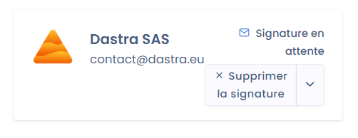

# Intégration avec Docusign

Dastra s'intègre nativement à DocuSign, la solution de signature électronique. Vous envoyez un document à signer, suivez le statut de la signature et le retrouvez à jour directement depuis le module **Contrats et politiques**.

## Installer l'intégration

1. Ouvrez **Réglages espace de travail** > **Intégrations**, puis cliquez sur la carte **Docusign**.

   <figure><figcaption>
Sélectionnez Docusign dans les intégrations
</figcaption></figure>
2. Sur le cas d'usage des contrats, cliquez sur **Ajouter l'intégration**.
3. À l'étape **Connexion**, créez la connexion : Dastra vous redirige vers l'authentification Docusign pour associer votre compte Docusign à Dastra.
4. À l'étape de configuration, renseignez **Account ID (identifiant de compte API)** et **Account Base URI**. Vous les trouvez dans votre compte Docusign, sur la page [Apps and Keys](https://apps.docusign.com/admin/apps-and-keys).

   <figure><figcaption>
Les clés à renseigner dans Dastra, issues de votre compte Docusign
</figcaption></figure>
5. Enregistrez. Dastra vérifie le compte auprès de Docusign.

L'installation est terminée : la signature Docusign est disponible dans la fenêtre de signature de vos documents. Le fonctionnement général des connexions et des cas d'usage est décrit dans [Connexions, cas d'usage et mapping des champs](../integrations/connections.md).

## Envoyer un document à signer

Pour envoyer un document, il vous faut :

* un signataire dont l'acteur a une adresse e-mail valide ;
* au moins une pièce jointe à signer, au format PDF, DOC ou DOCX ;
* un intitulé pour l'e-mail d'invitation.

Dans la fenêtre **Ajouter signature**, choisissez **Signez avec Docusign®** (voir [Signer un document](sign.md)). Si l'intégration n'est pas installée, la fenêtre affiche le bouton **Installer l'intégration**, qui ouvre ses réglages.

### Options d'envoi

Renseignez les champs suivants :

* **Sélectionner les acteurs dont vous souhaitez enregistrer la signature** : les signataires à qui envoyer la demande. Un acteur sans adresse e-mail ou qui a déjà signé ne peut pas être sélectionné. Le bouton **Rafraîchir** recharge la liste après une modification.
* **Choisissez les pièces jointes ajoutées à la demande de signature** : les fichiers PDF, DOC ou DOCX envoyés à signer. Toutes les pièces jointes valides sont cochées par défaut.
* **Intitulé du mail d'invitation** : l'objet de l'e-mail envoyé aux signataires (80 caractères au maximum).
* **Donner des instructions détaillées pour signer le document** : un texte facultatif, inclus dans l'e-mail d'invitation et visible par le signataire dans l'interface Docusign.

Deux options facultatives complètent l'envoi :

* **Ajouter automatiquement un placement de signature (avec une ancre textuelle)** : disponible lorsque toutes les pièces jointes sont des PDF. Dastra affiche, pour chaque signataire, le texte à insérer dans le document à l'endroit où il doit signer, par exemple `[Signature Nom du signataire]`. Docusign place la signature sur ce texte.
* **Ajouter automatiquement des initiales à chaque page du document** : disponible lorsque le placement de signature est activé.

Cliquez sur **Envoyer** pour envoyer la demande. Les signataires reçoivent un e-mail d'invitation de Docusign.

## Suivre la signature

Une fois la demande envoyée, le statut de la signature est synchronisé avec votre document et mis à jour à chaque changement côté Docusign. Dans l'onglet **Signataires**, la ligne du signataire affiche **Signature en attente** tant qu'il n'a pas signé.

<figure><figcaption>
Une signature en attente
</figcaption></figure>
