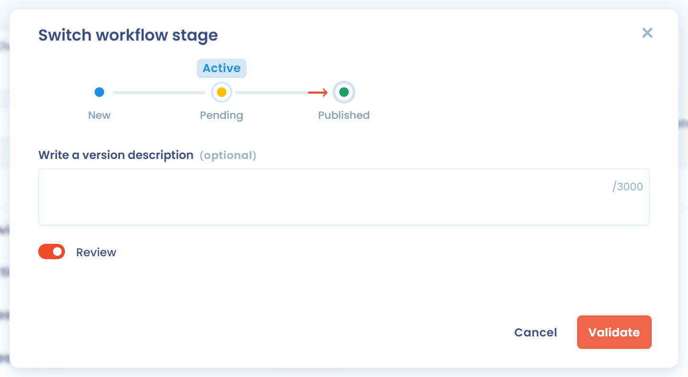

# Revue régulière des documents

La revue régulière fixe une date de revue à vos documents et fait baisser leur fraîcheur à mesure que cette date approche. Elle vous aide à relire vos contrats et vos politiques avant qu'ils ne soient périmés. Le principe, les statuts et les règles d'affichage sont décrits dans [Revue régulière (fraîcheur)](../regular-review.md). Cette page indique où la trouver dans le module **Contrats et politiques**.

## Activer la revue régulière

Dans le registre, cliquez sur la flèche à droite du bouton **Créer un document**, puis sur **Configurer revue régulière**. L'entrée indique si la revue est **Actif** ou **Désactivé** pour les documents, et ouvre les réglages de revue régulière de l'espace de travail. Elle est réservée aux utilisateurs qui disposent des droits de configuration avancée.

La périodicité que vous y définissez s'applique à tous les documents.

## Passer un document en revue

Une fois la revue activée, la fiche de chaque document affiche l'indicateur de fraîcheur dans le menu de raccourcis (voir [Structure d'un document](structure.md)). Il n'est actif que pour les documents publiés. Tant que le document n'est pas publié, l'indicateur reste grisé.

Cliquez sur l'indicateur pour ouvrir la fenêtre **Passer en revue**. Dans l'onglet **Nouvelle revue**, choisissez le **Responsable de la revue**, la **Date de revue** et, si besoin, une description. Dastra calcule la **Date avant la prochaine revue** à partir de la périodicité de l'espace de travail. Vous pouvez la remplacer par une date précise avec **Changer la date de prochaine revue**. L'onglet **Anciennes revues** garde l'historique.

Quand un document devient périmé, son propriétaire reçoit un e-mail.

## Enregistrer une revue lorsqu'un document devient actif

Lorsque la revue périodique est activée, faire passer un document à une étape de processus dont le statut interne est **Actif** ouvre la fenêtre **Basculer l'étape de processus**, avec un interrupteur **Passer en revue** activé par défaut. Laissez-le activé et cliquez sur **Valider** : Dastra change l'étape et enregistre une revue en même temps.

* Le responsable de la revue est vous, et la **Date de revue** est aujourd'hui.
* La **Date avant la prochaine revue** est calculée à partir de la périodicité de l'espace de travail.
* Le texte que vous saisissez dans la description de la version est conservé comme description de la revue.

<figure><figcaption>
La fenêtre de changement d'étape avec l'interrupteur de revue
</figcaption></figure>

La fenêtre apparaît lorsque vous changez l'étape depuis la page du document et depuis la colonne **Workflow** de la liste. La revue met à jour les dates de dernière et de prochaine revue du document et apparaît dans l'onglet **Anciennes revues**. Désactivez l'interrupteur si le changement d'étape ne doit pas compter comme une revue.

Si l'étape change mais que la revue ne peut pas être enregistrée, un message vous demande de l'enregistrer à nouveau depuis la fenêtre **Passer en revue**.
