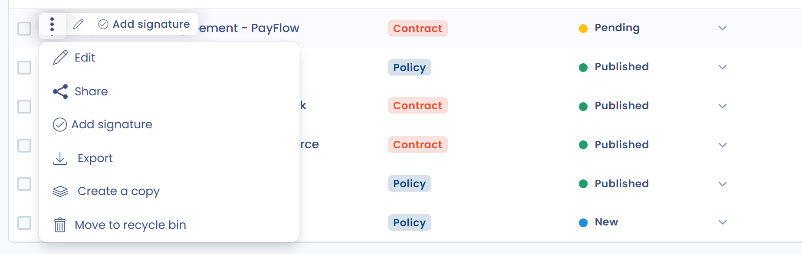

# Signer un document

Une fois que vous avez ajouté au moins un signataire à votre document (voir [Les signataires](signers.md)), vous pouvez gérer sa signature. Enregistrez d'abord le document : tant qu'une modification n'est pas enregistrée, les boutons de signature sont verrouillés.

## Signature manuelle ou Docusign

La fenêtre **Ajouter signature** propose deux modes :

* **Manuelle** : vous déclarez que des signataires ont signé. Sélectionnez les acteurs dont vous souhaitez enregistrer la signature, renseignez la **Date de signature**, puis cliquez sur **Ajouter signature**.
* **Signez avec Docusign®** : Dastra envoie le document à signer électroniquement et suit l'avancement. Ce mode demande l'[intégration avec Docusign](docusign.md).

<figure><figcaption>
Les deux modes de signature
</figcaption></figure>

Lorsque tous les signataires ont une signature, Dastra demande si vous souhaitez publier le document. Confirmez pour passer le document à l'état **Actif**.

## Ouvrir la fenêtre de signature

Il existe trois façons d'ouvrir la fenêtre de signature.

### Signer pour un signataire

Dans l'onglet **Signataires**, cliquez sur **Ajouter signature** sur la ligne du signataire concerné.

### Signer pour plusieurs signataires

Cliquez sur la flèche à droite du bouton **Ajouter acteur**, puis sur **Signer pour tous**. Vous sélectionnez ensuite les signataires pour lesquels vous enregistrez la signature.

<figure><figcaption>
Signer pour plusieurs signataires depuis l'onglet Signataires
</figcaption></figure>

### Signer depuis le registre

Dans le registre, ouvrez le menu de la ligne du document, puis cliquez sur **Ajouter signature**. Cette action est désactivée lorsque tous les signataires ont déjà signé.

<figure><figcaption>
Signer depuis le registre
</figcaption></figure>

## Le bouton de signature de la fiche

Dans le menu d'actions principales de la fiche (voir [Structure d'un document](structure.md)), un bouton résume l'état des signatures. Son libellé change selon le nombre de signataires et de signatures reçues.

### Pas de signataires

Le bouton est désactivé et affiche **pas de signataires**. Ajoutez des signataires pour l'utiliser.

<figure><figcaption>
Aucun signataire
</figcaption></figure>

### Des signatures sont manquantes

Le bouton affiche **Signer pour tous** suivi du nombre de signatures reçues sur le nombre de signataires. Cliquez dessus pour déclarer les signatures manquantes.

<figure><figcaption>
Des signatures sont manquantes
</figcaption></figure>

### Document signé par tous les signataires

Le bouton affiche **Signé**. Au survol, il devient **Supprimer la signature** : un clic, après confirmation, supprime les signatures si vous devez les reprendre.

<figure><figcaption>
Document signé par tous les signataires
</figcaption></figure>
