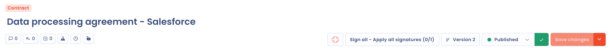

# Structure d'un document

Une fois votre document créé, Dastra ouvre sa fiche (voir [Créer un document](declare.md)). La prévisualisation des fichiers occupe la gauche de l'écran, les onglets de saisie la droite.

<figure><figcaption>
La fiche d'un document nouvellement créé
</figcaption></figure>

## Le titre et le type

Le titre du document, modifiable, se trouve en haut à gauche. Le badge du type (contrat, politique, notice, procédure ou autre) s'affiche au-dessus du titre : cliquez dessus pour changer le type.

<figure><figcaption>
Le type, le titre, les raccourcis et les actions principales
</figcaption></figure>

## Le menu de raccourcis

Sous le titre, à gauche, le menu de raccourcis donne accès aux éléments associés au document :

* les discussions internes ;
* les tâches associées, si la gestion des tâches est active ;
* le journal d'audit, si l'audit est actif, et l'**Historique d'activités** du document ;
* les tests de conformité liés, si le module Conformité est actif (voir [Détails et pièces jointes](documents.md)) ;
* la revue régulière du document (voir [Revue régulière des documents](review.md)).

Si vous êtes arrivé depuis le registre, des flèches vous font passer d'un document à l'autre.

## Les actions principales

Le menu d'actions principales, en haut à droite, regroupe :

* le bouton **Analyse IA** : il ouvre l'analyse du document par l'IA. Cette fonctionnalité est en version bêta, elle demande les fonctionnalités d'analyse IA et d'agent IA, et ses résultats doivent être interprétés avec précaution ;
* le bouton des signatures, dont le libellé suit l'état du document (voir [Signer un document](sign.md)) ;
* le bouton **Version** suivi du numéro de version, qui ouvre le gestionnaire de versions (voir [Versionner un document](versions.md)) ;
* le sélecteur d'étape de processus ;
* le bouton **Enregistrer**.

La flèche à droite du bouton **Enregistrer** déroule trois actions :

* **Partager** : créer un lien de partage du document.
* **Exporter** : exporter le document (voir [Contrats et politiques](README.md#importer-et-exporter)).
* **Déplacer dans la corbeille** : placer le document dans la corbeille.

Un document placé dans la corbeille porte le badge **Dans la corbeille**. Le même menu propose alors **Restaurer** pour le remettre dans le registre, et **Supprimer** pour le supprimer.

<figure><figcaption>
Les actions du bouton Enregistrer
</figcaption></figure>

## Les onglets de saisie

Quatre onglets s'affichent à droite de l'écran. Leur contenu change lorsque vous passez de l'un à l'autre :

* **Détails** : les informations générales, les pièces jointes et les champs personnalisés (voir [Détails et pièces jointes](documents.md)).
* **Signataires** : les parties qui signent le document (voir [Les signataires](signers.md)).
* **Actifs** : les actifs concernés par le document (voir [Les actifs](assets.md)).
* **Utilisateurs** : les utilisateurs de l'espace de travail qui interviennent sur le document (voir [Utilisateurs associés](users.md)).

Chaque onglet, hors **Détails**, indique entre parenthèses le nombre d'éléments qu'il contient.

<figure><figcaption>
Les onglets de la fiche d'un document
</figcaption></figure>

## La prévisualisation des pièces jointes

La zone de gauche prévisualise les fichiers du document : le contrat ou la politique et ses éventuelles annexes. Elle reste affichée quel que soit l'onglet ouvert. Lorsque le document n'a pas encore de fichier, elle propose de déposer un fichier ou d'écrire une politique.
