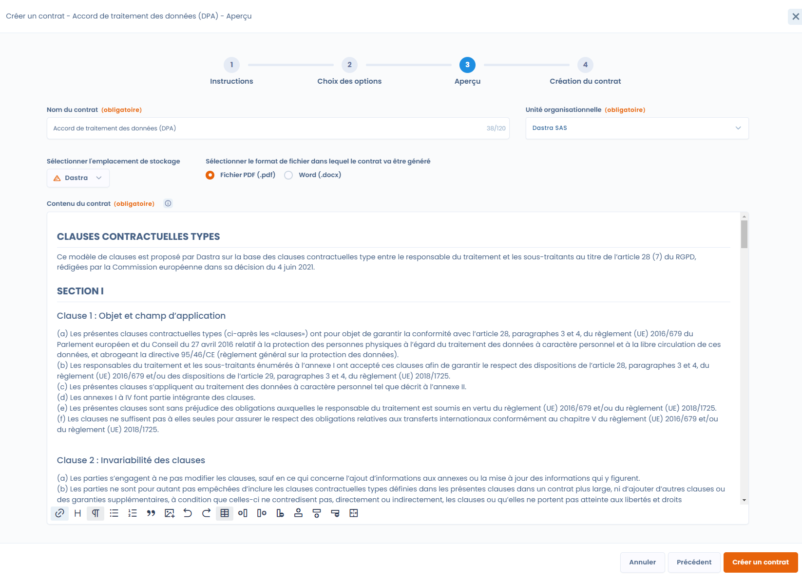

# Modèles de contrats dynamiques

## Utiliser un modèle

Lorsque vous [créez un document dans Dastra](declare.md), choisissez l'option **Générer automatiquement** pour utiliser un modèle dynamique. Vous accédez à la liste des modèles disponibles, par exemple le modèle de clauses contractuelles types pour vos contrats de sous-traitance (DPA).

Avec le modèle de clauses types, le document est rempli avec les informations de votre registre des traitements et de vos référentiels. Plus ils sont complets, plus le document généré est pertinent.

<figure><figcaption>
Sélectionnez le modèle à utiliser
</figcaption></figure>

Une fois le modèle sélectionné, un panneau vous guide en plusieurs étapes. Les boutons **Suivant** et **Précédent** font avancer ou reculer.

1. **Instructions** : les consignes du modèle, lorsqu'il en comporte.
2. **Choix des options** : un formulaire propre à chaque modèle, qui dépend des champs à remplir. Pour le DPA, vous choisissez le traitement du registre concerné, le sous-traitant avec qui vous établissez le contrat, et vous répondez à des questions sur les clauses optionnelles. Cliquez sur **Générer le modèle** pour passer à l'étape suivante.
3. **Aperçu** : le document généré. Cliquez sur **Modifier** pour changer son contenu ou sa mise en page. Dastra vous prévient que la modification peut faire perdre des éléments de mise en page définis par le modèle.

<figure><figcaption>
Répondez aux questions du modèle
</figcaption></figure>

À l'étape **Aperçu**, renseignez le **Nom du document** et l'**Unité organisationnelle**. Sélectionnez l'emplacement de stockage et le format du fichier généré, **Fichier PDF (.pdf)** ou **Word (.docx)**, puis cliquez sur **Créer un document**.

<figure><figcaption>
Vérifiez et modifiez le document avant de le créer
</figcaption></figure>

Dastra crée le document, l'ajoute au registre et ouvre sa fiche.

## Générer un DPA depuis une fiche de traitement

Vous pouvez aussi partir de la fiche de traitement concernée, sans passer par le module **Contrats et politiques**. Ouvrez la fiche du traitement, puis l'étape **Destinataires**. Sur la ligne du destinataire de type sous-traitant avec qui vous établissez le DPA, ouvrez le menu et cliquez sur **Générer DPA**. Cette action demande le droit d'écrire des contrats.

<figure><figcaption>
Générer un DPA avec un sous-traitant depuis une fiche de traitement
</figcaption></figure>

Dastra ouvre la génération avec le modèle DPA déjà sélectionné et rempli avec le traitement et le sous-traitant choisis. La même action existe dans un traitement de type **Sous-traitant**, pour établir un DPA avec un client depuis l'onglet des clients.

## Créer vos propres modèles

L'entrée **Modèles de documents** du module liste les modèles de votre espace de travail. Chaque carte indique le nom du modèle, son état (**Actif** ou **Désactivé**) et sa catégorie. Le menu de la carte propose **Modifier**, **Exporter** et **Supprimer définitivement**.

Pour créer un modèle :

1. Cliquez sur **Ajouter modèle de document**.
2. Choisissez **De zéro** et saisissez le **Nom du modèle**, ou importez un fichier JSON exporté depuis un autre modèle avec **Envoi du fichier**.
3. Dastra ouvre l'éditeur du modèle.

Dans l'éditeur, vous rédigez le **Corps du modèle** en HTML. Utilisez la syntaxe [Liquid](https://shopify.github.io/liquid/) pour insérer les réponses collectées par le formulaire du modèle. Vous définissez ces champs avec **Ajouter champ**, ainsi que les instructions affichées en tête du formulaire, la langue, la catégorie et la description du modèle. Un aperçu et un formulaire de test servent à vérifier le rendu avant de publier le modèle.

Activez le commutateur **Actif** puis cliquez sur **Enregistrer** pour rendre le modèle disponible dans l'option **Générer automatiquement**. Un modèle désactivé n'est pas proposé à la création.

<figure><figcaption>
L'éditeur d'un modèle de document
</figcaption></figure>
