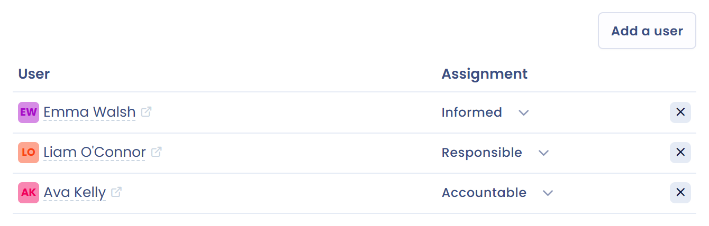

# Utilisateurs associés

Dans l'onglet **Utilisateurs**, associez des utilisateurs de votre espace de travail au document avec un rôle d'approbateur, de réalisateur ou d'informé. Cliquez sur **Ajouter un utilisateur**, choisissez l'utilisateur et son rôle.

Voici une manière de répartir les rôles pour vos documents :

* **Approbateur** : l'utilisateur chargé de valider que le document et les éléments associés, tels qu'ils sont renseignés dans Dastra, répondent aux attentes de l'organisation. Il peut être différent du signataire du document.
* **Réalisateur** : l'utilisateur chargé de mettre en œuvre les actions nécessaires pour répondre aux exigences du document. Il peut s'agir de mettre en place des mesures de sécurité des données, de gérer des accès ou de toute autre tâche requise pour respecter les termes du contrat.
* **Informé** : les utilisateurs qui doivent être tenus au courant de l'avancement et de l'état du document, sans rôle actif dans sa validation ou sa réalisation. Cela peut inclure la direction, des chefs de projet ou d'autres parties prenantes.

Un utilisateur n'a qu'un seul rôle sur un document : il ne peut pas être à la fois approbateur et informé, par exemple. Les utilisateurs déjà associés au document n'apparaissent plus dans la liste de sélection. Pour donner un autre rôle à un utilisateur, changez son rôle dans le tableau.

<figure><figcaption>
Associer des utilisateurs à un document
</figcaption></figure>
