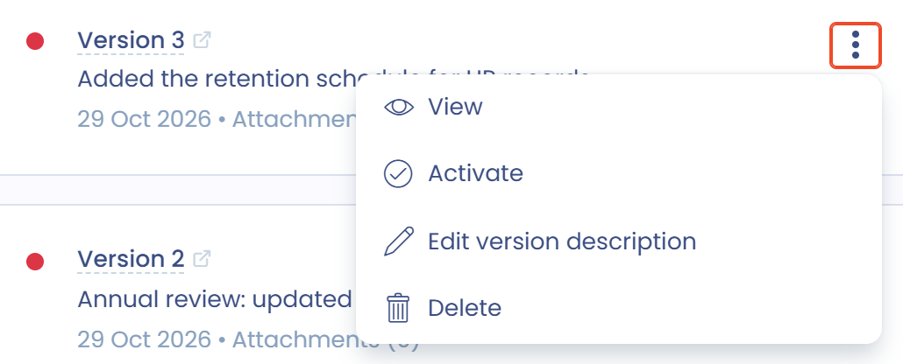

# Versionner un document

Pour suivre les modifications, les mises à jour ou le renouvellement d'un document, créez-en une nouvelle version.

Chaque version porte un numéro de révision, incrémenté automatiquement à la création. Ce numéro est visible dans le registre. Un document n'a qu'une seule version active à la fois : c'est elle que le registre affiche, les versions inactives n'y figurent pas.

Vous pouvez parcourir les versions d'un document depuis le gestionnaire de versions, afficher une version précédente et rendre active n'importe quelle version à tout moment, y compris une version plus récente.

## Le gestionnaire de versions

Quand vous créez un document, Dastra crée sa version 1. Le bouton **Version** suivi du numéro, dans le menu d'actions principales, ouvre le gestionnaire de versions.

<figure><figcaption>
Le bouton d'accès au gestionnaire de versions
</figcaption></figure>

Le gestionnaire liste toutes les versions du document. Chaque carte indique le numéro de version, sa description, sa date de création et le nombre de ses pièces jointes. Une pastille donne l'état de la version : verte pour la version **Actif**, rouge pour une version **Désactivé**. La mention **(En cours d'affichage)** désigne la version que vous consultez à l'écran.

<figure><figcaption>
Le gestionnaire de versions
</figcaption></figure>

## Créer une nouvelle version

La nouvelle version part de la version actuellement affichée : placez-vous d'abord sur la version dont vous voulez partir.

1. Dans le gestionnaire de versions, cliquez sur **Créer une nouvelle version**.
2. Renseignez la **Date de début** et, si besoin, la **Date de fin**. Vous pourrez les modifier ensuite.
3. Ajoutez une **Description de la version** si vous le souhaitez.
4. Activez **Copier les pièces jointes dans la nouvelle version** pour reprendre les fichiers.
5. Cliquez sur **Créer une nouvelle version**.

<figure><figcaption>
La fenêtre de création d'une version
</figcaption></figure>

Le nom du document, sa description, son unité organisationnelle, ses actifs, ses signataires et ses utilisateurs sont conservés dans la nouvelle version. La version créée devient la version active, et celle qui s'affiche.

## Afficher une version

Dans le gestionnaire de versions, ouvrez le menu de la version (les trois points), puis cliquez sur **Afficher**. Cette action n'est pas proposée pour la version déjà affichée.

Vous pouvez afficher et modifier une version qui n'est pas la version active. Dastra le rappelle par un message dans le gestionnaire et par la mention **Version inactive** au-dessus des onglets de la fiche. Ne confondez pas la version active, unique et de référence, avec la version affichée.

<figure><figcaption>
La version 4 est la version active, mais vous pouvez afficher et modifier la version 2
</figcaption></figure>

## Rendre une version active

Une version créée devient automatiquement la version active. Pour rendre une autre version active, ouvrez son menu dans le gestionnaire de versions et cliquez sur **Activer**. Cette action n'est proposée que pour les versions inactives.

<figure><figcaption>
Définir une version comme version active
</figcaption></figure>

## Modifier la description d'une version

Pour changer la description d'une version existante, ouvrez son menu et cliquez sur **Editer la description de la version**. Modifiez le texte dans la fenêtre qui s'ouvre, puis cliquez sur **Editer la version**.

## Supprimer une version

Ouvrez le menu d'une version inactive et cliquez sur **Supprimer**. Vous ne pouvez supprimer ni la version active, ni la version actuellement affichée : affichez une autre version pour supprimer celle-ci.

<figure><figcaption>
Supprimer une version
</figcaption></figure>

Supprimer un document supprime sa version active et toutes ses versions inactives.
