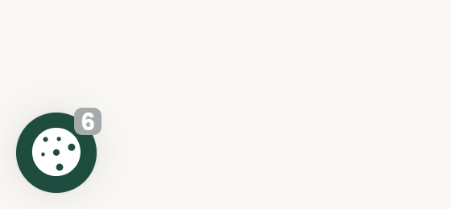
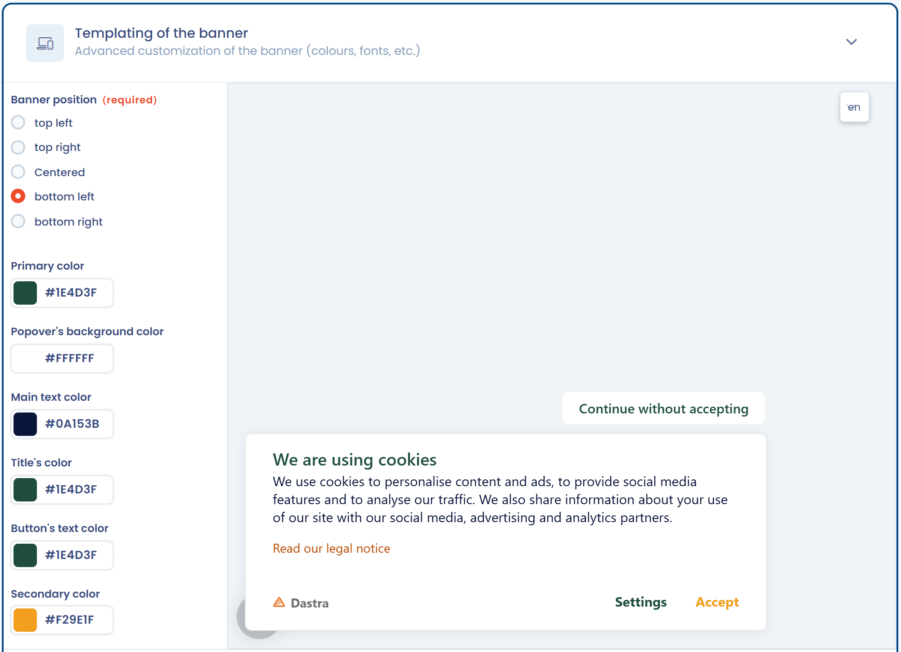
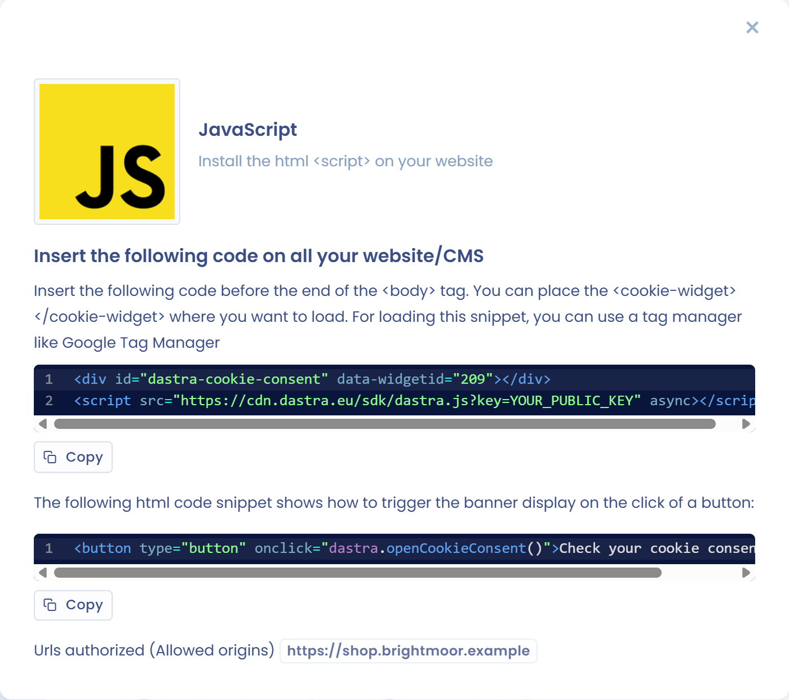
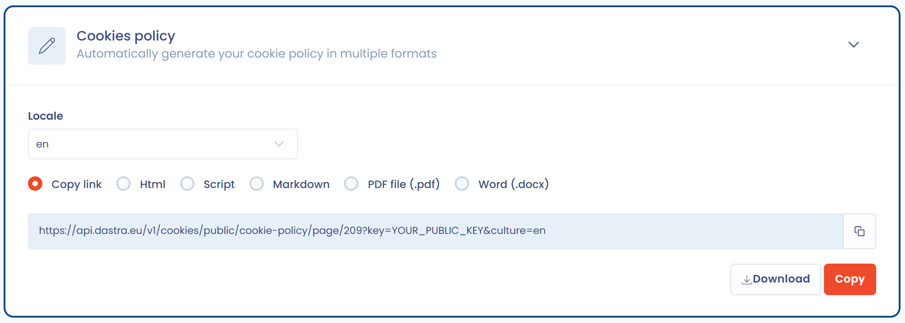

# Configurez la bannière de consentement aux cookies

Avec Dastra, vous mettez en place sur votre site une bannière de consentement aux cookies qui respecte les recommandations de la CNIL sur les cookies et autres traceurs.

## En quoi consiste la bannière de consentement

La bannière se compose de plusieurs éléments :

* un bouton « cookies » flottant, qui reste affiché pour permettre au visiteur de modifier ses choix ;
* une fenêtre d'introduction dépliable ;
* la liste des cookies par finalité utilisés par le site.

<figure><figcaption><p>Le bouton flottant</p></figcaption></figure>

<figure><figcaption><p>La fenêtre d'introduction</p></figcaption></figure>

<figure><figcaption><p>La liste des cookies par finalité</p></figcaption></figure>

## Prérequis

Pour mettre en place la bannière, vous devez avoir **identifié** les cookies déposés sur votre site, puis les avoir **classés** par finalité. Le module **Consentement cookies** regroupe toutes les étapes, depuis ces prérequis jusqu'au code à installer.

Pour scanner les cookies déposés sur votre site, consultez la page suivante :


[scan.md](scan.md)


Pour classifier les cookies par catégories de consentement, consultez la page suivante :


[classify.md](classify.md)


## Ouvrez l'éditeur de la bannière

1. Dans le menu, cliquez sur **Consentement cookies** > **Bannières**.
2. Cliquez sur la bannière à modifier.

L'éditeur est une page unique composée de sections repliables : **Installation**, **Configuration**, **Services**, **Textes et traductions**, **Apparence & design**, **Déclencheurs**, **Intégration du consentement** et **Politique de cookies**. Les sections **Installation** et **Configuration** n'existent que pour la configuration par défaut : une [variante géo-ciblée](geo-targeting.md) ne les affiche pas.

<figure><figcaption><p>L'éditeur de la bannière</p></figcaption></figure>

En haut de l'éditeur :

* l'interrupteur **Statut** active (**Actif**) ou désactive (**Désactivé**) la bannière ;
* la liste déroulante des variantes affiche **Configuration par défaut** et propose de [créer une variante géo-ciblée](geo-targeting.md) ;
* **Prévisualiser** affiche la bannière sur une page de votre site (voir [Tester l'intégration d'une bannière](../integration/test.md)). Le bouton est désactivé tant qu'aucune URL n'est renseignée dans **Urls autorisées (CORS)** ;
* **Enregistrer** et **Enregistrer et quitter** publient vos modifications ;
* le menu **Actions** donne accès à **Réinitialiser la collecte des preuves de consentement** et à **Supprimer**.


La duplication d'une bannière se fait depuis la liste des bannières, avec le menu à droite de la bannière.


## Référence des paramètres

### Configuration

La section **Configuration** contient les paramètres de base de la bannière.

<figure><figcaption><p>La section « Configuration »</p></figcaption></figure>

| Paramètre | Rôle |
| --- | --- |
| **Choisissez un nom pour cette bannière** | Nom de la bannière dans la liste. |
| **Urls autorisées (CORS)** | Champ obligatoire. Saisissez l'adresse de chaque site qui affiche la bannière, sous la forme `https://www.example.com`, sans chemin. L'adresse doit correspondre exactement à l'origine du site : `www.example.com` et `example.com` sont deux adresses distinctes. Une origine absente de cette liste est la première cause d'une bannière qui ne s'affiche pas. |
| **Générer automatiquement la politique des cookies ?** | Si l'option est active, la bannière propose un lien vers la politique de cookies générée par Dastra. Sinon, saisissez l'adresse de votre propre politique dans **Entrez une url valide de la notice sur la politique des cookies**. |

Le bloc de paramètres avancés contient les options suivantes.

| Paramètre | Rôle |
| --- | --- |
| **Mode prévisualisation** | Désactive le cache de la configuration et la collecte des statistiques. Ne le laissez pas actif en production. |
| **Ne pas déclencher l'affichage la bannière (tous les cookies consenties par défaut seront déclenchés)** | N'affiche aucune bannière : tous les services sont appliqués avec leur consentement par défaut. À réserver aux zones sans obligation de consentement préalable. |
| **Activer le Global Privacy Control (GPC)** | Refuse automatiquement les cookies non essentiels des visiteurs dont le navigateur envoie le signal GPC. Voir [Conformité US](us-privacy.md). |
| **Sauvegarde de la preuve de consentement** | Si l'option est désactivée, Dastra ne conserve aucune preuve de consentement ni aucune statistique d'affichage. |
| **Durée de vie du cookie de consentement (par défaut 180 jours)** | De 1 à 365 jours. À l'expiration, la bannière est de nouveau proposée. |
| **Activer le magasin localStorage pour les cookies de consentement** | Stocke les choix dans le `localStorage` du navigateur au lieu d'un cookie. Le consentement n'est alors pas partagé entre les sous-domaines. |
| **Domaine du cookies (par défaut, le sous-domaine de la page)** | Disponible avec le stockage par cookie. Saisissez par exemple `.example.com` pour partager le consentement entre tous les sous-domaines. |
| **Nom du cookie de stockage du consentement (par défaut 'consent-eu')** | Nom du cookie, ou de la clé `localStorage`, qui contient les choix du visiteur. |

### Services

La section **Services** liste les services déclarés dans la bannière. Cliquez sur **Scan des cookies** pour relancer le scan, sur **Sélection dans la librairie...** pour ajouter un service de la bibliothèque Dastra, ou sur **Ajouter un service** pour en créer un. Voir [Classifiez les cookies](classify.md) et [Scannez les cookies](scan.md).

### Textes et traductions

Cette section sert à ajouter des langues et à modifier les textes de la bannière. Voir [Gestion de la langue](../integration/languages.md).

### Apparence & design

Définissez ici l'aspect de la bannière. L'aperçu à droite se met à jour pendant vos modifications.

<figure><figcaption><p>La section « Apparence & design »</p></figcaption></figure>

| Paramètre | Rôle |
| --- | --- |
| **Position de la bannière** | Cinq positions : **En haut à gauche**, **En haut à droite**, **Centré**, **En bas à gauche**, **En bas à droite**. |
| **Couleur primaire**, **Couleur de fond de la popup**, **Couleur principale des textes**, **Couleur des titres**, **Couleur des boutons**, **Couleur du 'bouton accepter'** | Couleurs de la bannière. |
| **Nom de la police de caractères (vous pouvez mettre le nom d'une police installée sur votre site)** | Police utilisée par la bannière : une police web de base ou une police installée sur votre site. |
| **Personnaliser le bouton de la bannière** | Remplace le bouton d'ouverture par une image de votre choix, de préférence carrée. Une fois l'image importée, **Forme du bouton** propose **Cercle**, **Arrondi** ou **Carré**. |
| **Afficher le bouton "Continuer sans accepter"** | Ajoute ce bouton à la bannière. |
| **Montrer le bouton fixe d'ouverture du panel tout le temps** | Garde le bouton flottant affiché après le premier écran. |
| **Afficher le bouton de fermeture de la bannière (Les consentements seront redemandés le lendemain)** | Ajoute une croix de fermeture. Option masquée quand le bouton « Continuer sans accepter » est actif. |
| **Cacher le copyright de Dastra** | Selon votre offre. |
| **CSS personnalisé** | Règles CSS appliquées à la bannière. Voir [Design avancé](../integration/design.md). |

### Déclencheurs

Les déclencheurs définissent quand la bannière apparaît :

* **Hauteur de scroll en % de la taille de la page (0% = haut de la page)** : la bannière s'affiche quand le visiteur a fait défiler ce pourcentage de la page ;
* **Temps avant le déclenchement (millisecondes)** : délai avant l'affichage.


Une hauteur de scroll trop élevée empêche d'afficher la bannière à l'arrivée sur la page. Pour recueillir le consentement dès la première page, laissez ces deux valeurs à 0.


### Intégration du consentement

Cette section génère, pour chaque service, les extraits à placer dans vos pages pour bloquer effectivement les cookies : intégration HTML, JavaScript personnalisé et Google Tag Manager. Elle s'accompagne d'une liste de contrôle. Voir [Blocage des cookies](../integration/blocking/README.md).

### Politique de cookies

Cette section génère la politique de cookies. Voir [Générez la politique de cookies](#generez-la-politique-de-cookies).

### Réinitialiser la collecte des preuves de consentement

L'action **Réinitialiser la collecte des preuves de consentement** du menu **Actions** régénère la clé de version de la bannière : les visiteurs qui ont déjà fait un choix se voient proposer la bannière de nouveau à leur prochaine visite. Utilisez-la après avoir ajouté un service. Elle ne supprime pas les preuves déjà collectées.


Cette action n'a pas d'effet quand un domaine est renseigné dans **Domaine du cookies**, car le choix est alors partagé entre plusieurs sous-domaines.


## Insérez le code de la bannière sur votre site web

Une fois la bannière configurée, installez les lignes de code générées par Dastra.

1. Ouvrez la section **Installation** de la bannière.
2. Cliquez sur la carte **Javascript**.
3. Copiez le code généré.
4. Insérez-le avant la fermeture de la balise `</body>` de chaque page de votre site.

<figure><figcaption><p>Le code d'intégration généré</p></figcaption></figure>

Faites appel à votre webmaster pour cette étape. Une fois le code installé, la bannière apparaît sur votre site. Le bouton **Copier** copie le code, et un second extrait montre comment rouvrir la bannière depuis un bouton de votre site. Voir [Démarrage rapide](../integration/quickstart/README.md).


Vous pouvez utiliser Google Tag Manager pour insérer ce code dynamiquement sur chaque page.



Le code généré dépend de la région d'hébergement de votre organisation. Copiez-le toujours depuis l'application.


## Générez la politique de cookies

La section **Politique de cookies** de la bannière génère automatiquement votre politique de cookies à partir de la configuration de la bannière : services, cookies, finalités et durées. Choisissez d'abord la langue dans le champ **Langue**, puis le format :

* **Copier lien** : l'adresse d'une page publique qui affiche la politique ;
* **Html brut** : le code HTML de la politique, à copier ;
* **Script (Mise à jour auto.)** : un extrait à placer dans votre page de politique. Il charge le SDK de Dastra, qui affiche la politique et la met à jour automatiquement quand vous modifiez la bannière ;
* **Markdown**, **Fichier PDF (.pdf)** et **Word (.docx)** : des documents à télécharger.

Pour utiliser le format script, ajoutez dans votre page l'élément suivant, en remplaçant les valeurs par celles affichées dans l'application :

```html
<div id="dastra-cookie-policy" data-widgetid="{your_widget_id}" data-lang="{lang}"></div>
<script src="https://cdn.dastra.eu/sdk/dastra.js?key={your_public_key}" async></script>
```

La section est disponible quand vos modifications sont enregistrées. Chaque langue de la bannière produit une politique dans cette langue. Si vous activez **Générer automatiquement la politique des cookies ?** dans la section **Configuration**, la bannière renvoie ses visiteurs vers cette politique.

<figure><figcaption><p>Les formats de la politique de cookies</p></figcaption></figure>
