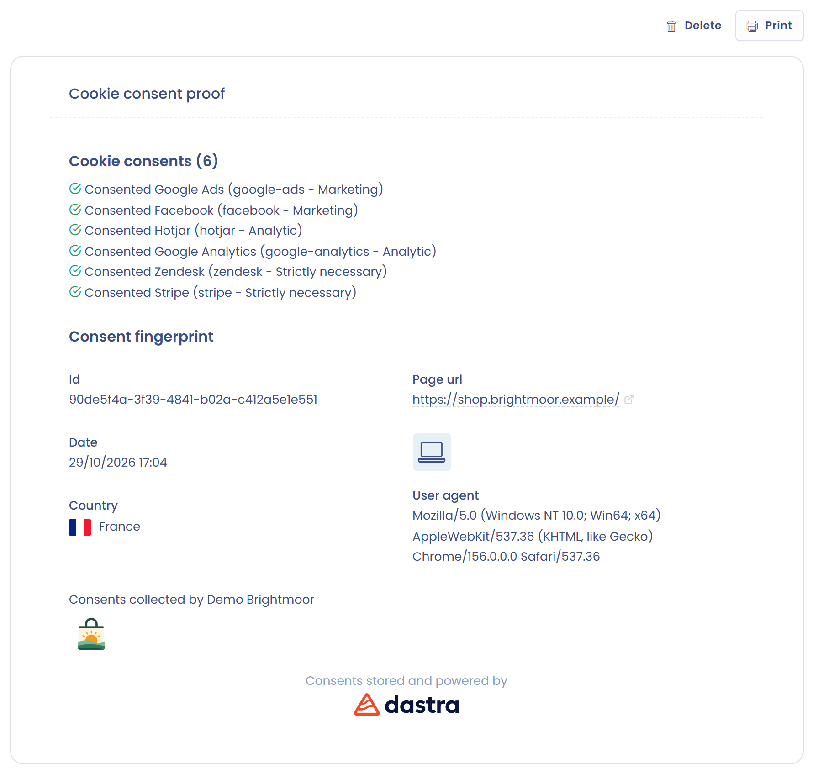

# Collectez les preuves de consentement cookies

Une fois la bannière de consentement aux cookies installée sur votre site, le module **Consentement cookies** collecte, conserve et exporte les **preuves de consentement**. Il affiche aussi les **statistiques** de la bannière.

## Prérequis

Vous devez avoir installé la bannière sur votre site.


[configure.md](configure.md)


## Consultez les preuves de consentement

Une fois la bannière installée, Dastra collecte automatiquement les preuves de consentement des visiteurs de votre site. Pour les consulter :

1. Dans le menu, cliquez sur **Consentement cookies** > **Consentements**.
2. Utilisez les filtres au-dessus de la liste : la période (les 7 derniers jours par défaut), la bannière (**Toutes les bannières**) et, une fois une bannière choisie, les services consentis.
3. Cliquez sur une ligne pour ouvrir la preuve.

<figure><figcaption>
La liste des consentements
</figcaption></figure>

La preuve de consentement aux cookies affiche la date, le pays, l'empreinte du consentement et la liste des services, chacun marqué **Consenti** ou **Refus**. Vous pouvez l'imprimer ou la supprimer.

<figure><figcaption>
Le détail d'une preuve de consentement
</figcaption></figure>

Depuis la liste, le bouton **Exporter** télécharge les preuves de la période et de la bannière sélectionnées. Pour supprimer des preuves, utilisez le menu de la ligne ou l'action groupée **Supprimer**.

La durée de vie des preuves de consentement est d'un an.


La collecte des preuves dépend de l'option **Sauvegarde de la preuve de consentement** de la section **Configuration** de la bannière. Si elle est désactivée, aucune preuve n'est conservée. Pour rapprocher une preuve d'un utilisateur de votre système, voir [Identification des utilisateurs](../integration/identification.md).


## Consultez les statistiques

La page **Statistiques** suit l'activité de vos bannières.

1. Dans le menu, cliquez sur **Consentement cookies** > **Statistiques**. Vous pouvez aussi ouvrir le menu d'une bannière dans la liste des bannières et choisir **Statistiques**.
2. Choisissez la période (les 7 derniers jours par défaut) et, si besoin, une bannière dans **Toutes les bannières**.

Trois graphiques sont affichés, chacun comparé à la période précédente :

* **Consentements collectés** : le volume de choix enregistrés, avec les indicateurs **Total**, **Acceptation totale**, **Acceptation partielle** et **Refus complet** ;
* **Nombre d'affichage du widget** : le nombre de sessions pendant lesquelles la bannière a été affichée. Le compteur augmente une fois par session de visiteur, une session durant au moins une heure ;
* **Fermetures de la bannière** : le nombre de fois où un visiteur a fermé la bannière avec la croix.


En mode prévisualisation, aucune statistique n'est collectée. Les affichages ne sont pas non plus comptés quand l'option **Sauvegarde de la preuve de consentement** est désactivée.


Pour appliquer réellement les choix des visiteurs sur votre site, passez à la page suivante :


[go-further.md](go-further.md)

