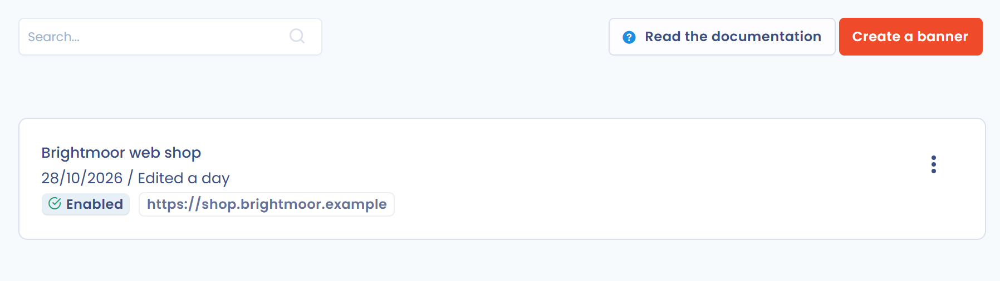
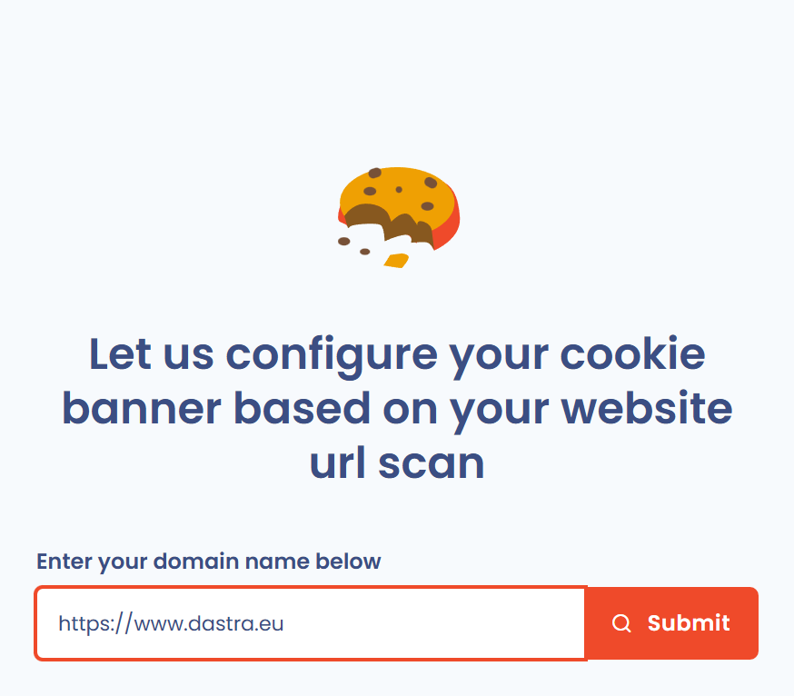

# Scannez les cookies déposés sur votre site Web

Dastra scanne les cookies déposés sur votre site web grâce à la fonctionnalité de **scan des cookies** du module **Consentement cookies**. Le scan sert de point de départ pour créer votre bannière.

## Accédez à la fonctionnalité de scan

Connectez-vous à votre espace de travail Dastra. Pour apprendre à le faire, consultez la page suivante :


[README.md](../../../getting-started/tutorial/README.md)


1. Dans le menu, cliquez sur **Consentement cookies**. La liste des bannières s'affiche.
2. Cliquez sur **Créer une bannière**.

<figure><figcaption>
Le module « Consentement cookies » dans le menu
</figcaption></figure>

<figure><figcaption>
Le bouton « Créer une bannière »
</figcaption></figure>

Dastra vous demande **Comment souhaitez-vous créer votre bannière ?** Deux choix sont proposés :

* **Analyse du site web** : Dastra analyse les cookies de votre site et vous propose une bannière avec les services détectés ;
* **Configuration manuelle** : vous créez la bannière à partir de zéro et déclarez vous-même les URL, les services et les cookies.

<figure><figcaption>
Le choix entre « Analyse du site web » et « Configuration manuelle »
</figcaption></figure>

Choisissez **Analyse du site web** pour continuer sur cette page.

## Scannez les cookies déposés sur votre site web

1. Saisissez l'adresse de votre site dans le champ **Saisissez votre nom de domaine (ex : https://www.github.com)**, par exemple `https://www.example.com`. Si vous omettez `https://`, Dastra l'ajoute.
2. Cliquez sur **Valider**.

<figure><figcaption>
La saisie de l'adresse du site à scanner
</figcaption></figure>


Le scan doit pouvoir ouvrir votre site. Si une authentification ou un pare-feu bloque l'accès, Dastra l'indique : utilisez alors la **Configuration manuelle**.


Le scan explore jusqu'à 20 pages de votre site pour détecter les cookies les plus fiables. Une barre de progression s'affiche pendant l'analyse.

<figure><figcaption>
Le scan est en cours
</figcaption></figure>

À la fin du scan, les résultats s'affichent : les services reconnus dans la base de cookies de Dastra, les cookies trouvés et leur répartition par catégorie. Cliquez sur **Scanner à nouveau** pour relancer l'analyse, ou sur **Créer une bannière** pour créer la bannière avec ces résultats.

<figure><figcaption>
Les résultats du scan
</figcaption></figure>

Une fois les cookies de votre site scannés, vous pouvez procéder à leur classification.


[classify.md](classify.md)


***

## Traitez les cookies non classés

Le scan compare les cookies détectés au référentiel de services de Dastra. Un cookie qui ne correspond à aucun service est un cookie non classé : il n'est rattaché à aucun service, il n'est jamais affiché dans la bannière publique et les visiteurs ne peuvent donc pas y consentir.

Dans les résultats du scan, un badge d'avertissement indique le nombre de cookies non classés (par exemple « 3 cookies non classés ») à côté du résumé du scan. Ces cookies sont regroupés dans l'onglet **Cookies non classés**, à côté des onglets **Services**, **Cookies trouvés** et **Répartition des catégories de cookies**.

<figure><figcaption>
L'onglet « Cookies non classés » des résultats du scan, avec le badge indiquant leur nombre
</figcaption></figure>

Sélectionnez un ou plusieurs cookies à l'aide des cases à cocher (la case de l'en-tête sélectionne toute la liste), puis choisissez l'une des actions proposées.

### Ajouter des cookies à un service existant

1. Sélectionnez les cookies, puis cliquez sur **Ajouter à un service existant**.
2. Dans le champ **Service cible**, choisissez le service auquel rattacher les cookies.
3. Validez.

Tous les cookies sélectionnés sont ajoutés au service en une seule fois. Un cookie déjà présent dans le service (même nom et même domaine) n'est pas ajouté une seconde fois.

### Créer un service à partir d'une sélection

1. Sélectionnez les cookies, puis cliquez sur **Créer un nouveau service**.
2. Le formulaire du service s'ouvre, pré-rempli à partir du domaine le plus fréquent parmi les cookies sélectionnés (nom, domaine et logo du service) et contenant les cookies sélectionnés.
3. Vérifiez les informations proposées, en particulier la finalité du service, puis enregistrez.

Seuls les cookies conservés dans le service quittent la liste des cookies non classés.

### Supprimer des cookies

Sélectionnez les cookies, cliquez sur **Supprimer**, puis confirmez. Les cookies sont retirés de la liste des cookies non classés.

### Retirer un cookie d'un service

Dans l'onglet **Services** des résultats du scan, dépliez la liste des cookies d'un service, puis cliquez sur l'icône de corbeille en regard du cookie (info-bulle « Retirer de ce service »). Le cookie est détaché du service et rejoint l'onglet **Cookies non classés**.

Après chaque action, les compteurs des onglets, le badge et le graphique de répartition se mettent à jour immédiatement.

### Traiter les cookies non classés depuis l'éditeur de bannière

Il n'est pas nécessaire de traiter tous les cookies avant de créer la bannière : les cookies non traités restent attachés à la bannière et peuvent être traités plus tard. Dans l'éditeur de la bannière, le titre de la section **Services** indique le nombre de cookies non classés, et l'onglet **Cookies non classés** de cette section propose les mêmes actions : **Supprimer**, **Ajouter à un service existant** et **Créer un nouveau service**.

Lorsque tous les cookies sont rattachés à un service, l'onglet affiche le message « Tous les cookies sont classés ».

### Relancer le scan d'une bannière existante

Dans l'onglet **Services** de l'éditeur de la bannière, cliquez sur **Scan des cookies** pour relancer le scan du site. Dans les résultats, une coche verte (info-bulle « Déjà dans votre configuration ») signale les services déjà déclarés dans la bannière. Les cookies détectés qui correspondent aux cookies d'un service déjà déclaré, y compris un service personnalisé, sont rattachés à ce service et ne figurent pas parmi les cookies non classés.


Les cookies non classés ne sont jamais affichés dans la bannière publique. Rattachez chaque cookie réellement déposé par votre site à un service pour que les visiteurs puissent y consentir.


***

## Limitations et bonnes pratiques

### Cookies déposés après consentement (services opt-in)

Par défaut, un scanner de cookies navigue sur votre site sans donner de consentement. Les cookies déposés uniquement après opt-in (analytique, marketing, etc.) ne sont donc pas déclenchés et ne peuvent pas être détectés.

**Exception : si le SDK Dastra est déjà intégré sur votre site**, le scanner est capable de contourner la bannière de consentement et de collecter l'ensemble des cookies réellement déposés, y compris ceux des services opt-in. Dans ce cas, le scan produit un résultat complet sans intervention manuelle.

Si le SDK Dastra n'est pas encore en place sur le site scanné, les services opt-in devront être **ajoutés manuellement** via la bibliothèque de services.

### Services ajoutés manuellement : cookies en excès

Lorsque vous ajoutez un service depuis la bibliothèque Dastra (ex. Google Analytics, Meta Pixel), Dastra importe la liste complète des cookies que ce service _peut_ déposer dans toutes ses configurations possibles. Votre implémentation n'en utilise probablement qu'une partie.

Il est recommandé de **supprimer les cookies que votre implémentation spécifique ne dépose pas réellement**. Déclarer des cookies non utilisés est trompeur pour les visiteurs et peut poser problème lors d'un audit de conformité.

Pour identifier les cookies à conserver, croisez les résultats du scan automatique (qui détecte ce qui est effectivement déposé) avec la liste importée depuis la bibliothèque, et supprimez les entrées qui n'apparaissent pas dans le scan.
