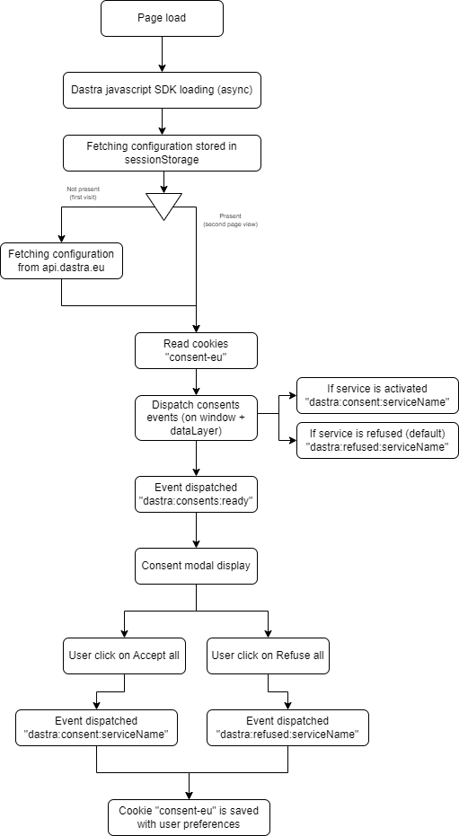

# Blocage des cookies

Pour bloquer effectivement les cookies, plusieurs méthodes existent : la suppression des cookies, le blocage d'un snippet, le JavaScript personnalisé ou Google Tag Manager.

## Suppression des cookies

Cette méthode est la plus rapide à mettre en place, mais aussi la moins fiable. Dans la section **Services** de la bannière, si vous renseignez le nom des cookies associés à chaque service (onglet **Cookies associés** du service), le SDK supprime automatiquement ces cookies au moment où un refus est enregistré pour le service.

<figure><figcaption><p>Les cookies associés à un service</p></figcaption></figure>

Cette méthode fonctionne dans certains cas, mais elle risque de perturber la fiabilité des outils tiers, en particulier des outils de web analytique. Utilisez-la en complément d'une autre méthode ci-dessous.

## Bloquer un snippet de code dans la page

Cette méthode désactive entièrement un snippet de code de suivi.

Dans le code HTML de votre page, remplacez le snippet suivant :

```html
<script>
  alert("hello, I'm a tracking javascript tag");
</script>
```

Par :

```html
<script data-consent="{your-service-slug}" type="dastra/script">
  alert("hello, I'm a tracking javascript tag");
</script>
```

Remplacez `{your-service-slug}` par l'identifiant du service, que vous trouvez dans le champ **Nom de la variable (Important pour l'intégration du consentement)** du formulaire du service :

<figure><figcaption><p>L'identifiant du service</p></figcaption></figure>

Si le visiteur a accepté le service, le contenu du script est exécuté automatiquement.

Pour charger un script externe, ajoutez l'attribut `src` : le navigateur ne le télécharge qu'après le consentement.

```html
<script data-consent="{your-service-slug}" type="dastra/script" src="https://example.com/tracker.js"></script>
```


Cette méthode a des effets de bord : la coloration syntaxique de la plupart des éditeurs de code ne reconnaît pas le type `dastra/script`. Le script n'est jamais exécuté si la bannière Dastra ne se charge pas correctement.


### Utiliser les extraits générés par l'application

La section **Intégration du consentement** de la bannière génère, pour chaque service, les extraits prêts à copier et une liste de contrôle. Trois onglets sont proposés : **Html integration** (le snippet ci-dessus), **Custom javascript** (le blocage en pur JavaScript ci-dessous) et **Google tag manager** (les évènements à brancher dans Google Tag Manager).

## Blocage en pur JavaScript

En JavaScript, vous pouvez écouter les évènements émis sur `window` pour collecter le consentement et gérer un comportement particulier selon l'acceptation ou le refus des cookies. Cette méthode vous donne plus de souplesse :

```html
<script>
  (function () {

    /*
     * Trigger a custom service tag with the expected cookies
     */
    function customTagsTrigger() {
      /* If the vendor provides a specific function to make the service work without cookies, call it here.
       * Otherwise, copy the default code snippet provided by the vendor. */
    }

    /*
     * Handle the global scope consent event.
     * If the user consented to the vendor's cookies, this event is fired on each page load
     * where the cookie consent banner is installed.
     */
    window.addEventListener('dastra:consent:{your-service-slug}', function () {
      /* The visitor opted in to the vendor's cookies */
      customTagsTrigger();
    });

    /*
     * Handle the global scope refused event (optional)
     */
    window.addEventListener('dastra:refused:{your-service-slug}', function () {
      /* The vendor's cookies are refused */
    });

  })();
</script>
```

## Google Tag Manager

Voir la page suivante :


[google-tag-manager.md](google-tag-manager.md)


## Rappel sur le cycle de vie du consentement

<figure><figcaption><p>Cycle de vie du consentement</p></figcaption></figure>

## Évènements JavaScript

La bannière émet plusieurs évènements sur l'élément `window` de la page. Les évènements de consentement sont émis à chaque chargement de page, quand la bannière applique les choix déjà enregistrés, puis à chaque enregistrement d'un choix.

| Nom de l'évènement | Remarques |
| --- | --- |
| `dastra:consent:<slug du service>` | Se déclenche quand le service est accepté, par le visiteur ou par défaut (les services strictement nécessaires ne sont pas concernés). Si le service est en mode « consenti par défaut », l'évènement est déclenché dès le premier chargement de la page. |
| `dastra:refused:<slug du service>` | Se déclenche quand le service n'est pas accepté : par défaut si aucun consentement n'est donné, ou après un refus explicite. |
| `dastra:consents:ready` | Se déclenche quand le consentement stocké (cookie `consent-eu` par défaut) a été lu et que les premiers évènements ont été émis. |
| `dastra:consents:updated` | Se déclenche à chaque chargement de page et à chaque enregistrement des choix (accepté, refusé ou personnalisé). Le détail de l'évènement contient la liste des consentements. |
| `dastra:consents:any_refused` | Se déclenche quand au moins un consentement enregistré est un refus, à chaque chargement de page et à chaque enregistrement des choix. |
| `dastra:consents:all_accepted` | Se déclenche quand aucun consentement enregistré n'est un refus, à chaque chargement de page et à chaque enregistrement des choix. |
| `dastra:consents:closed` | Se déclenche quand le visiteur ferme la bannière avec la croix de fermeture. |
| `dastra:gpc:applied` | Se déclenche quand la bannière refuse automatiquement les cookies non essentiels à cause d'un signal Global Privacy Control ou Do Not Track. Voir [Conformité US](../../banner/us-privacy.md). |


Comme les évènements `dastra:consent:*` et `dastra:consents:*` sont aussi émis au chargement de la page, enregistrez vos écouteurs de rechargement dans `dastra:consents:ready`. Voir [Google Tag Manager](google-tag-manager.md).


Pour réagir à chaque mise à jour du consentement, vous pouvez aussi utiliser `dastra.addConsentDastraListener(callback)` : la fonction est appelée à chaque évènement `dastra:consents:updated`.

---

## Foire aux questions

**Peut-on bloquer un script par catégorie plutôt que par service ? (par exemple `data-consent="analytics"`)**

Non. L'attribut `data-consent` attend un **slug de service**, pas un slug de catégorie. Il n'est pas possible d'écrire `<script data-consent="analytics" type="dastra/script">` pour bloquer tous les services d'une catégorie en une seule directive.

La raison : un utilisateur peut accepter certains services d'une catégorie tout en refusant d'autres services de la même catégorie. La bannière gère le consentement au niveau du service, pas de la catégorie.

Pour conditionner le chargement d'un script à l'acceptation d'une catégorie entière, utilisez l'API programmatique :

```javascript
window.addEventListener('dastra:consents:updated', function () {
  if (window.dastra.cookieConsent.consent.getPurposeConsent('Analytical')) {
    // load your analytics scripts here
  }
});
```


`getPurposeConsent` renvoie `true` seulement si **tous** les services de la catégorie sont acceptés. Si la bannière ne contient aucun service dans cette catégorie, l'appel déclenche une erreur : protégez-le, par exemple avec un `try ... catch`.

