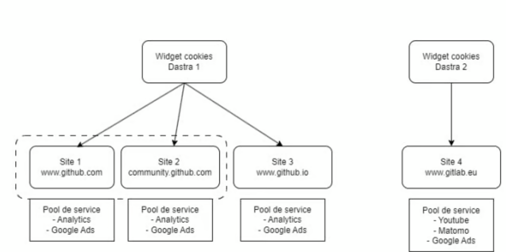

# Fonctionnement de la bannière

## Fonctionnement de la licence

Contrairement à d'autres solutions qui vendent les bannières de consentement par nom de domaine, la licence Dastra repose sur deux critères :

* **Le trafic mensuel maximal** : le nombre total de sessions utilisateur (ou visites) sur vos sites web pendant un mois.
* **Le nombre de bannières** : vous configurez une bannière avec un ensemble de cookies et de services, que vous pouvez réutiliser sur plusieurs sites web ou sous-domaines. Le cookie de consentement peut fonctionner sur plusieurs sous-domaines (par exemple `*.example.com`).

Le nombre de **domaines et de sous-domaines est donc illimité** par bannière.

<figure><figcaption><p>Une bannière peut servir plusieurs sites et sous-domaines</p></figcaption></figure>

## Fonctionnement global

La bannière de consentement fonctionne en trois grandes étapes :

1. La **proposition** de la fenêtre de consentement.
2. La **collecte** du consentement (stockage des preuves).
3. **L'exécution** réelle du consentement de l'utilisateur.


La bannière Dastra couvre les deux premières étapes de manière en grande partie automatique. Pour la troisième, qui consiste à appliquer les préférences de l'utilisateur, vous devez intégrer techniquement le système de consentement aux services tiers susceptibles de déposer des cookies. Consultez le [guide de blocage des cookies](blocking/README.md).


Le SDK JavaScript de la bannière doit être appelé sur toutes les pages du site qui utilisent des cookies.


### 1. Visite sur le site du client

L'internaute visite le site web sur lequel le snippet de code JavaScript est installé. Pour ne pas pénaliser les performances ni le référencement des pages, le SDK est chargé de manière totalement asynchrone, avec une durée de mise en cache d'une journée.

### 2. et 3. Collecte et mise en cache de la configuration

Pour fonctionner, la bannière a besoin d'une configuration à jour, récupérée depuis les serveurs de Dastra. Pour obtenir la version la plus récente, elle effectue une requête GET avec la clé d'API publique, pour contrôler que la bannière appartient bien au client.


Si le domaine du site n'est pas renseigné dans la bannière, la requête est refusée et la bannière ne s'affiche pas. Pour y remédier, ouvrez la bannière dans **Consentement cookies** > **Bannières**, puis ajoutez l'adresse du site dans **Urls autorisées (CORS)**, section **Configuration**.


### 4. Demande du consentement à l'utilisateur

Si le cookie `consent-eu` (le nom du cookie est modifiable) est absent, la fenêtre de consentement s'affiche. Pour tester l'affichage de la bannière, supprimez ce cookie de votre navigateur.

### 5. La collecte du consentement

Les consentements sont collectés automatiquement par l'API de Dastra, avec une requête POST au format JSON.

Dans l'interface de la bannière, le consentement s'exprime par finalité, mais il est stocké par service.

Voici à quoi ressemble une preuve de consentement, telle qu'elle est stockée dans nos bases. Les champs techniques internes ne sont pas reproduits.

```json
{
    "id": "6185fe65-0924-410d-9132-3cde838c4627",
    "sessionId": "0b93b823-ff36-4d61-8959-e9e8deee5ef8",
    "date": "2026-10-12T16:54:03.272Z",
    "dateExpiration": "2027-04-10T16:54:03.272Z",
    "type": 2,
    "widgetId": 43,
    "typeDevice": 2,
    "workSpaceId": 19,
    "consentId": "8a5e89c4-2243-4598-97c5-ba3cfb35a138",
    "countryCode": "FR",
    "referrer": "https://www.example.com/pricing",
    "consents": {
        "lang": "fr-FR",
        "versionKey": "6f65cb1d-85eb-4a64-976d-519679189f8d",
        "cookieConsents": [
            {
                "id": "584ffef3-251c-4e9a-efb8-08d7fbfbee92",
                "tenantId": 0,
                "name": "Drift",
                "slug": "drift",
                "consent": true,
                "version": "6f65cb1d-85eb-4a64-976d-519679189f8d",
                "date": "2026-10-12T16:53:59.511Z",
                "purpose": 3
            }, {
                "id": "1c3baa61-0d05-44e4-da3d-08d7eeadee05",
                "tenantId": 0,
                "name": "Google Analytics",
                "slug": "google-analytics",
                "consent": true,
                "version": "6f65cb1d-85eb-4a64-976d-519679189f8d",
                "date": "2026-10-12T16:54:00.568Z",
                "purpose": 2
            }
        ]
    }
}
```

En retour, l'API renvoie un identifiant `consentId`, qui est enregistré avec les choix du visiteur dans le stockage du consentement : le cookie `consent-eu` par défaut, ou le `localStorage` si vous avez choisi ce mode. Sa durée de vie est celle du paramètre **Durée de vie du cookie de consentement** (180 jours par défaut, de 1 à 365 jours). Cet identifiant est l'identifiant unique de la preuve de consentement. En cas de litige, c'est lui qu'il faut rechercher dans le navigateur du client.

### 6. L'exécution du consentement

Une fois le consentement collecté, il faut appliquer le choix de l'utilisateur en transmettant l'information de consentement à tous les services du site.

Pour cette phase, consultez le guide sur le blocage des cookies :


[README.md](blocking/README.md)



À l'exception des cookies strictement nécessaires, tous les services tiers qui effectuent du traçage doivent être bloqués par défaut.


Vous pouvez maintenant commencer l'intégration technique de la bannière :


[README.md](quickstart/README.md)

