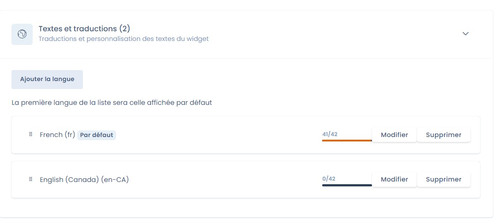

# Gestion de la langue

## Comment gérer plusieurs langues pour le widget ?

Rendez-vous sur la page de réglages du widget souhaité, puis dans l'onglet "Textes et traductions". Vous pouvez ajouter une ou plusieurs langues.



## Comment est détectée la langue du widget ?

Par défaut, le widget utilise la langue indiquée par l'attribut `lang` de la balise `<html>` de la page. Si cet attribut est absent, il utilise la langue du navigateur.

## Comment forcer la langue du widget ?

Pour forcer la langue du widget, ajoutez l'attribut `data-lang` à la div du widget :

```html
<div id="dastra-cookie-consent" data-widgetid="{your_widget_id}" data-lang="fr"></div>
```

Si vous chargez le widget avec la méthode `loadCookieConsent`, passez plutôt l'option `lang` :

```javascript
dastra.push(['loadCookieConsent', {
    widgetId: {your_widget_id},
    selector: '#cookie-consent',
    lang: 'fr'
}]);
```
