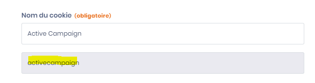

# Gérer le consentement programmatiquement

## Où sont stockés les consentements ?

Par défaut, les consentements sont stockés dans un cookie du navigateur nommé `consent-eu`, au format JSON sérialisé, pendant 180 jours. Dans la configuration de la bannière, vous pouvez :

* changer le nom de ce cookie (**Nom du cookie de stockage du consentement**) ;
* changer sa durée de vie (**Durée de vie du cookie de consentement**) et son domaine (**Domaine du cookies**) ;
* stocker les consentements dans le localStorage à la place (**Activer le magasin localStorage pour les cookies de consentement**). La clé est alors `dastra-consents`, ou le nom choisi pour le cookie.


La propagation des consentements dépend de ces données : ne les modifiez pas directement. Utilisez le SDK JavaScript de Dastra.


### Accès au service de consentement

Le service de consentement de dastra est accessible de cette façon

```javascript
<script>
  window.dastra = window.dastra || [];
  window.dastra.push(['cookieReady',function(manager)
  {console.log(manager.consent)}]);
</script>
```

### Liste des méthodes disponibles dans le manageur de consentement

dans manager.consent, vous disposez des méthodes suivantes :

* getAllConsents() : récupère tous les consentements
* hasConsented() : retourne `true` si l'utilisateur a déjà enregistré un consentement explicite
* getPurposeConsent(purposeLabel:string) : récupère le consentement d'une catégorie de cookies
* setPurposeConsent(purposeLabel:string, consent:bool): définit le consentement pour une catégorie
* getServiceConsent(serviceShortName:string): récupère le consentement d'un service particulier.
* setServiceConsent(serviceShortName:string, consent:bool): définit le consentement d'un élément particulier
* save() : enregistre les consentements dans le stockage et déclenche les événements
* dispatchEvents() : applique les consentements en cours (événements, Google Consent Mode, scripts) sans les enregistrer

Pour ouvrir ou fermer le widget, utilisez `manager.open()` et `manager.close()`. En dehors du callback `cookieReady`, utilisez `dastra.push(['openCookieConsent'])` et `dastra.push(['closeCookieConsent'])`.

### Récupérer la liste des consentements de l'utilisateur (getAllConsents)

Une fois que vous accédez au manager de consentement, il est très aisé de récupérer les consentements de l'utilisateur courant :

```javascript
<script>
window.dastra = window.dastra || []
window.dastra.push(['cookieReady', function(manager){
    // Get the complete consent services list
    var consents = manager.consent.getAllConsents()
}]);
</script>
```


Pour appeler `getAllConsents()` **en dehors du callback `cookieReady`** (par exemple depuis votre propre code après le chargement du widget), utilisez le chemin complet :

```javascript
var consents = window.dastra.cookieConsent.consent.getAllConsents();
```

L'ancienne syntaxe `dastra.getAllConsents()` (à la racine) n'est plus supportée.


La méthode ci-dessus renvoie la liste de tous les consentements de l'utilisateur

```javascript
[
  {
    "id": "000000-0000000-000000",
    "name": "Google Analytics",
    "slug": "google-analytics",
    "consent": true,
    "version": "1",
    "date": "2026-10-28T10:00:00.000Z",
    "purpose": "Analytical"
  },
  ...
]
```

### Interroger les consentements par catégorie (getPurposeConsent/setPurposeConsent)

Les catégories de cookies sont identifiées par les labels suivants :

| Catégorie   | Label          |
| ----------- | -------------- |
| Nécessaires | `Necessary`    |
| Préférences | `Preference`   |
| Analytique  | `Analytical`   |
| Marketing   | `Marketing`    |
| Autre       | `Other`        |
| Non classé  | `Unclassified` |


Utilisez bien les **labels en chaîne de caractères** (ex. `'Analytical'`) et non les valeurs numériques, qui ne sont pas supportées par l'API.


```javascript
<script>
window.dastra = window.dastra || [];
window.dastra.push(['cookieReady',function(manager){
    let consents = manager.consent.getPurposeConsent('Analytical');
    manager.consent.setPurposeConsent('Analytical', false);

    // persist consent in cookies
    manager.consent.save();
}]);
</script>
```

### Manipuler les consentements par service

Pour manipuler les consentements par service, vous aurez besoin du nom simplifié du service disponible dans l'interface de gestion des services de votre widget.


**Comment trouver le nom simplifié du service ?**\
Rendez-vous dans l'interface de gestion des services, en éditant un service, le nom simplifié (slug) du service apparaît en dessous du nom du cookie.




```javascript
<script>
window.dastra = window.dastra || [];
window.dastra.push(['cookieReady',function(manager){
      let cookieService = 'google-analytics';
    let consents = manager.consent.getServiceConsent(cookieService);
    manager.consent.setServiceConsent(cookieService, false);

    // sauvegarder le consentement
    manager.consent.save();
}]);
</script>
```

### Exemple complet

L'exemple suivant montre comment appliquer un refus global par programmation — par exemple lorsque l'utilisateur clique sur un bouton "Tout refuser" personnalisé, ou pour honorer un signal de confidentialité navigateur.

```javascript
<script>
window.dastra = window.dastra || [];
window.dastra.push(['cookieReady', function(manager) {

  // N'agir que si l'utilisateur n'a pas encore fait de choix explicite
  if (!manager.consent.hasConsented()) {

    // Refuser toutes les catégories non essentielles
    manager.consent.setPurposeConsent('Preference',   false);
    manager.consent.setPurposeConsent('Analytical',   false);
    manager.consent.setPurposeConsent('Marketing',    false);
    manager.consent.setPurposeConsent('Other',        false);
    manager.consent.setPurposeConsent('Unclassified', false);

    // Sauvegarder le choix dans le navigateur
    manager.consent.save();
  }

}]);
</script>
```

Il est également possible d'accepter sélectivement certaines catégories — par exemple accepter uniquement l'analytique :

```javascript
<script>
window.dastra = window.dastra || [];
window.dastra.push(['cookieReady', function(manager) {

  manager.consent.setPurposeConsent('Analytical', true);
  manager.consent.setPurposeConsent('Marketing',  false);
  manager.consent.save();

}]);
</script>
```

### Réagir aux mises à jour de consentement (événement `dastra:consents:updated`)

Chaque fois qu'un utilisateur modifie ses choix de consentement (via le widget ou par programmation avec `save()`), Dastra émet un événement `dastra:consents:updated` sur `window`. Vous pouvez vous y abonner pour déclencher vos propres actions — rechargement de scripts tiers, mise à jour de l'interface, envoi d'un événement analytics, etc.

```javascript
window.addEventListener('dastra:consents:updated', function(event) {
  // event.detail contient les consentements mis à jour
  console.log('Consentements mis à jour', event.detail);

  // Exemple : recharger Google Analytics si l'utilisateur vient d'accepter
  if (window.dastra.cookieConsent.consent.getPurposeConsent('Analytical')) {
    // charger ou réactiver vos scripts analytics ici
  }
});
```


Cet événement se déclenche à chaque appel à `save()` ou à `dispatchEvents()`, mais aussi à chaque chargement de page, lorsque le widget applique les choix enregistrés. Pour ne réagir qu'aux changements faits par le visiteur, enregistrez l'écouteur dans `dastra:consents:ready` (voir [Google Tag Manager](blocking/google-tag-manager.md)).

