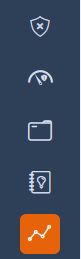
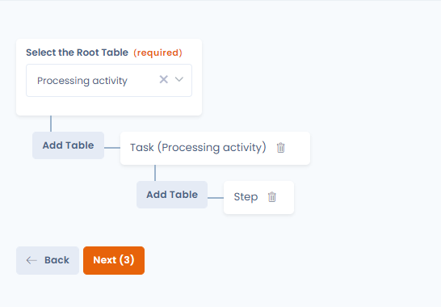
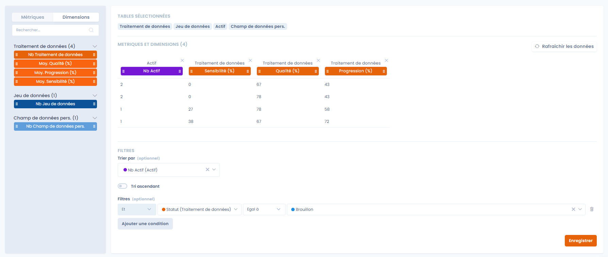
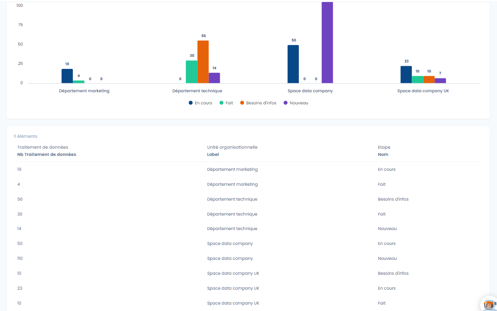
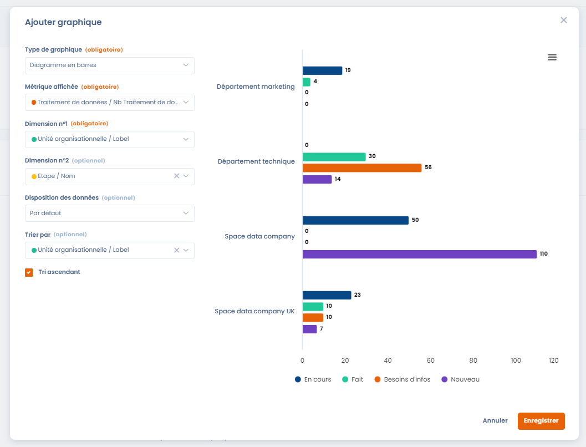

# Rapports personnalisés

Cette fonctionnalité puissante vous permet de créer des rapports sur mesure, adaptés à vos besoins spécifiques. Que vous soyez un utilisateur débutant ou avancé, cette fonctionnalité conviviale vous offre une flexibilité maximale pour extraire les informations importantes des données de Dastra.

### Démarrage rapide

1. Cliquez sur le menu à gauche "Rapports personnalisés"\
   
2. Les rapports sont organisés dans un système de catégorie. Avant de créer votre premier rapport, vous devez **créer une première catégorie**
3. **Cliquez sur créer un rapport** et choisissez une des deux options : créer nouveau rapport ou créer à partir d'un modèle

## Glossaire

* **Métrique** : une métrique est une valeur mesurable permettant de regrouper (agréger) les éléments _Exemple: Le nombre de traitement, la moyenne de durée de traitement d'une tâche..._
* **Dimension** : par opposition à la métrique, la dimension ne permet pas d'agréger les données. Il s'agit d'une propriété (= une colonne) toute simple d'un élément.\
  \&#xNAN;_Exemple: le nom du traitement, le statut du traitement, la référence, ..._

## Construction du rapport

### Principes de base

1. **Sélection des Données :** Choisissez les données que vous souhaitez inclure dans votre rapport. Notre interface conviviale vous permet de parcourir facilement vos ensembles de données et de sélectionner les variables (métriques et dimensions) pertinentes des différentes tables de Dastra.
2. **Filtres Avancés :** Affinez vos résultats en utilisant des filtres avancés. Créez des critères spécifiques pour extraire uniquement les données pertinentes à votre analyse.
3. **Personnalisation Graphique :** Donnez vie à vos rapports en personnalisant les graphiques et les tableaux. Modifiez les styles de graphiques qui répondent le mieux à vos besoins.
4. **Exportation Multiple :** Exportez vos rapports dans divers formats : PDF, Word, HTML, Excel, CSV, JSON ou Markdown. Partagez facilement vos résultats avec vos collègues, clients ou partenaires. Intégrez vos données simplement à des outils comme PowerBI.

### Sélection des données

#### Sélection des tables de données

Sélectionnez les différentes tables de données que vous souhaitez requêter : les traitements, les étapes du traitement, finalité, tags... Vous pouvez requêter **jusque 6 tables différentes dans chaque rapport**.

<figure><figcaption></figcaption></figure>

Cliquez sur "Suivant" quand vous avez choisi les tables


Attention, une fois les tables sélectionnées, vous ne pourrez plus revenir en arrière pour remodifier les tables concernées.


#### Construction du rapport à partir des métriques et dimensions

Construisez votre rapport en sélectionnant les métriques et dimensions que vous souhaitez afficher.

<figure><figcaption></figcaption></figure>

Cliquez sur le bouton "Enregistrer" en bas à droite de la page

#### Lien vers la fiche de l'objet

Pour les tables d'objets dotés d'une fiche — traitements, exercices des droits, violations de données, actifs, acteurs, audits, mesures de sécurité, contrats, systèmes d'IA et tâches — la dimension **« Lien vers la ressource (url) »** ajoute à chaque ligne un lien cliquable **« Détails »**. Ce lien ouvre la fiche de l'objet dans le bon module, dans un nouvel onglet et en tenant compte de l'espace de travail courant. La colonne est également incluse dans les exports, sous forme d'URL.

<figure><figcaption>
Ajout de la dimension « Lien vers la ressource (url) » au rapport
</figcaption></figure>

<figure><figcaption>
Chaque ligne affiche un lien « Détails » ouvrant la fiche de l'objet
</figcaption></figure>


Automatiquement les données seront agrégées par dimension afin de calculer les métriques sélectionnées.


Exemple : Vous sélectionnez la variable "Nb Traitements de données" et "Statut", vous obtenez un rapport regroupé sous cette forme

| Statut    | Nb Traitements de données |
| --------- | ------------------------- |
| Brouillon | 12                        |
| Actif     | 560                       |

## Affichage et visualisation graphique du rapport personnalisé

Une fois le rapport créé, vous serez redirigé sur la page suivante :

<figure><figcaption>
Capture du résultat des rapports personnalisés
</figcaption></figure>

Pour ajouter un graphique, cliquez sur "**Ajouter un graphique**".

Vous pouvez alors définir plusieurs catégories de graphique.\

## Corbeille

Un rapport ou une catégorie supprimé passe d'abord par la corbeille : vous pouvez le restaurer tant qu'il n'a pas été supprimé définitivement.

* **Placer un élément dans la corbeille** : dans le menu d'actions d'un rapport, cliquez sur **« Déplacer dans la corbeille »** puis confirmez. Le menu d'actions d'une catégorie, dans le panneau de gauche, propose la même action : la catégorie et tous ses rapports sont placés dans la corbeille.
* **Consulter la corbeille** : activez l'option **« Voir la corbeille »** au-dessus de la liste des rapports, ou depuis le menu du panneau des catégories.
* **Restaurer** : depuis la corbeille, **« Restaurer »** remet l'élément dans la liste active. Restaurer une catégorie restaure aussi les rapports placés dans la corbeille avec elle ; restaurer un rapport dont la catégorie est dans la corbeille restaure aussi cette catégorie.
* **Supprimer définitivement** : depuis la corbeille, **« Supprimer »** efface l'élément après confirmation. La suppression d'une catégorie supprime aussi tous ses rapports. Cette action est irréversible.


Les actions de la corbeille nécessitent le droit de modification des rapports personnalisés.


