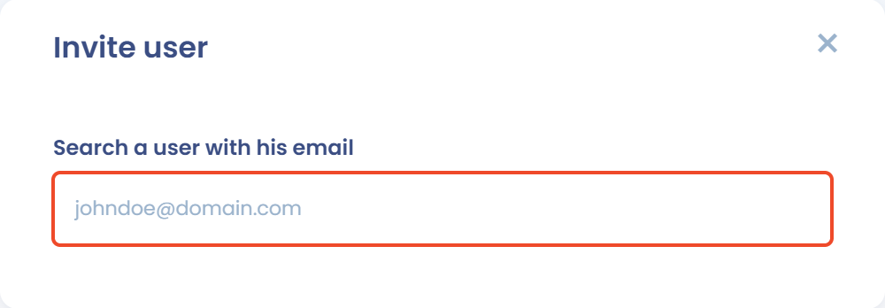

# Tableau de bord



Le tableau de bord est la première page que vous voyez en entrant dans un espace de travail. Il résume l'état de votre conformité au RGPD et donne accès aux modules. Pour y revenir depuis n'importe quelle page, cliquez sur **Tableau de bord** en haut du menu de gauche.

## Les zones de l'écran

L'écran se compose de trois zones :

* **Le menu de gauche** : le sélecteur d'espace de travail, qui rappelle vos rôles dans l'espace, puis les modules regroupés sous **Inventaire**, **Opérations**, **Gouvernance**, **Automatisations** et **Ressources**. Le bouton **Inviter un membre** et l'entrée **Réglages espace de travail** se trouvent en bas du menu. Un module n'apparaît que si votre abonnement l'inclut et si vos permissions vous y donnent accès.
* **La section centrale** : au-dessus des tuiles, selon vos droits et votre abonnement, vous trouvez l'invite de l'agent IA (**Comment puis-je vous aider aujourd'hui ?**), la carte de la dernière note de version, le **Guide de démarrage** et la **Présentation de l'espace de travail**, un texte libre qui présente l'espace à ses utilisateurs.
* **L'onglet de la communauté**, à droite de l'écran : il ouvre le panneau des **Webinaires à venir**. Vous pouvez replier ce panneau ; l'onglet reste alors à droite de l'écran pour le rouvrir, et votre choix est mémorisé dans votre navigateur.

<figure><figcaption>
Le tableau de bord d'un espace de travail
</figcaption></figure>

## Les tuiles du tableau de bord

Les tuiles résument l'activité de chaque module. Par défaut, elles apparaissent dans cet ordre, pour les modules auxquels vous avez accès :

* **Traitements de données**
* **Conformité**
* **Actualités et veille**
* **Tâches**
* **Exercices des droits sur les 90 derniers jours**
* **Derniers incidents**
* **Registre des contrats et politiques**
* **Systèmes d'IA**
* **Gestion des risques**
* **Vos questionnaires**
* **Actifs**

La plupart des tuiles (traitements de données, tâches, exercices des droits, incidents, contrats, systèmes d'IA, risques et questionnaires) proposent un filtre par unité organisationnelle. Utilisez-le pour limiter la tuile aux éléments d'une entité ou d'un service.

### Réorganiser les tuiles

Pour changer l'ordre des tuiles, faites glisser la poignée située à côté d'une tuile, ou cliquez sur les boutons **Monter** et **Descendre** qui l'accompagnent. L'ordre est enregistré dans votre navigateur : il ne change pas pour les autres utilisateurs.

<figure><figcaption>
Une tuile et ses commandes de déplacement
</figcaption></figure>

## Inviter un membre

Si vous avez le droit de gérer les utilisateurs, le bouton **Inviter un membre** s'affiche en bas du menu de gauche. Il ouvre le formulaire d'invitation d'un nouvel utilisateur. Pour le détail des champs, voir [Inviter des utilisateurs](../getting-started/setup/users.md).

<figure><figcaption>
Le formulaire d'invitation d'un membre
</figcaption></figure>

## Aller plus loin

Explorez dès maintenant les fonctionnalités :


[editer-le-registre](ropa/README.md)



[la-visualisation-des-donnees](ropa/visualization/README.md)



[la-gestion-des-risques](risks/README.md)



[planifier](tasks/README.md)



[gerer-les-exercices-des-droits](requests/README.md)



[documenter-les-violations-de-donnees](incidents/README.md)



[gerer-le-consentement-aux-cookies](cookies/README.md)



[audit](questionnaires/README.md)



[settings](settings/README.md)

