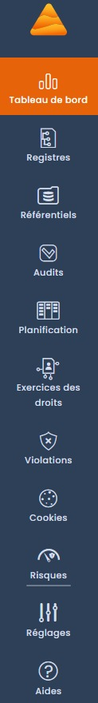
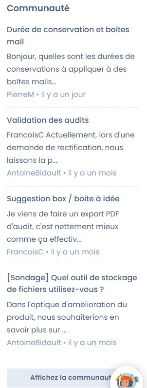
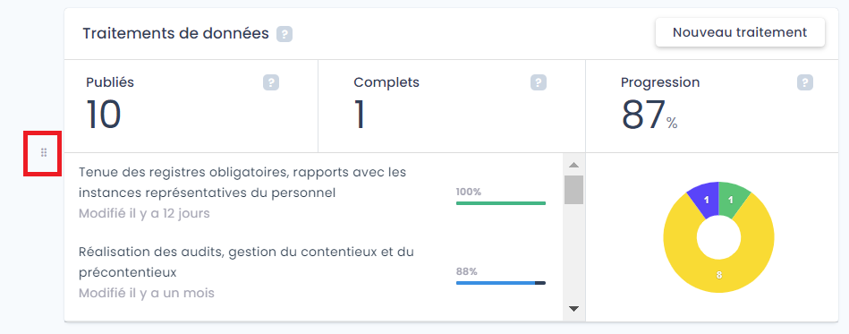
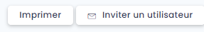

# Tableau de bord



## Introduction

Le tableau de bord de Dastra est la première page auquel vous accédez au moment d'entrer dans votre espace de travail, et constitue une synthèse de votre conformité RGPD.

Celui-ci est composé de 3 sections principales :

* La barre de fonctionnalités à gauche de l'écran,
* L'onglet de la communauté à droite de l'écran,
* La section au centre contenant les tuiles synthétisant l'actualité et la veille de votre espace, et les différentes fonctionnalités.

### Les tuiles du tableau de bord

Dans la section contenant les tuiles, vous pouvez modifier l'ordre d'apparence de ces tuiles en cliquant sur le bouton glisser / déposer permettant de déplacer l'ordre d'apparence de la tuile.

Il existe plusieurs **catégories de tuiles** disponible dans le tableau de bord :

* **Actualité et veille**
* **Traitements de données**
* **Analyse de risque**
* **Vos audits**
* **Tâches à échéance**
* **Exercice des droits des personnes**
* **Widget de consentement aux cookies**
* **Derniers incidents**

## Comment partager le tableau de bord ?

Vous pouvez également imprimer le tableau de bord ou invitez directement en utilisateur en cliquant sur l'un des boutons disponibles en haut à droite de la section réservée aux tuiles.

## Aller plus loin

Explorez dès maintenant les fonctionnalités :


[editer-le-registre](ropa/README.md)



[la-visualisation-des-donnees](ropa/visualization/README.md)



[la-gestion-des-risques](risks/README.md)



[planifier](tasks/README.md)



[gerer-les-exercices-des-droits](requests/README.md)



[documenter-les-violations-de-donnees](incidents/README.md)



[gerer-le-consentement-aux-cookies](cookies/README.md)



[audit](questionnaires/README.md)



[settings](settings/README.md)

