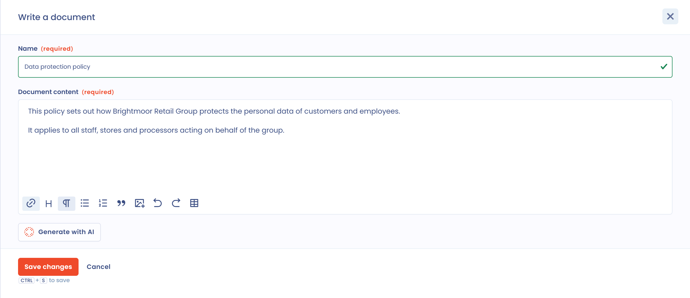
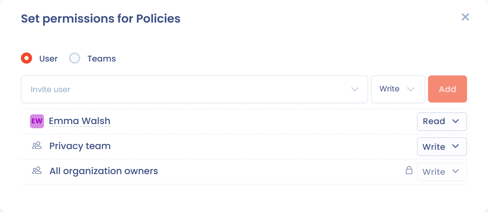

# Gestionnaire de fichiers

Dastra intègre nativement un gestionnaire de fichiers, aussi appelé GED (gestion électronique de documents). Il centralise et mutualise l'accès à tous les documents associés dans Dastra. Vous y trouvez le module sous **Ressources** > **Gestionnaire de fichiers**, dans le menu de gauche.

C'est par exemple ici que vous pouvez stocker toute la documentation utile pour prouver votre conformité au RGPD.


**Focus sur la documentation RGPD**

L'exigence de documentation découle du **principe de responsabilité** (accountability) rappelé à l'article 24 du RGPD.

Cette documentation se traduit en pratique en premier lieu par le registre des traitements, mais aussi par d'autres éléments de gestion des données et de la conformité au RGPD. **Il peut s'agir des éléments suivants (liste non exhaustive) :**

* procédures internes encadrant la création d'un nouveau traitement de données à caractère personnel (contrôle interne, évaluation des risques et de la proportionnalité, etc.)
* procédure de réalisation des PIA
* politiques de protection des données écrites et contraignantes, à appliquer aux nouvelles opérations de traitement (par exemple, conformité aux critères de qualité des données, préavis, principes de sécurité, consultation, etc.), qui devraient être mises à la disposition des personnes concernées
* cartographie des procédures pour veiller au bon recensement de toutes les opérations de traitement des données et tenue d'un inventaire de celles-ci
* programmes de formation pour les personnes en charge de la gestion des traitements de données
* procédures de gestion des demandes d'accès, de rectification et d'effacement et des droits détenus par les personnes concernées sur les données
* mécanisme interne de gestion des plaintes
* procédures internes pour une gestion et une notification efficaces des violations de données
* procédures de vérification pour s'assurer que toutes les mesures n'existent pas seulement sur papier, mais qu'elles sont aussi mises en œuvre et fonctionnent dans la pratique (audits internes ou externes, etc.)

Vous pouvez également stocker dans cet espace **tout document utile à la compréhension des traitements, les notes de formation ainsi que les contrats encadrant le traitement le cas échéant**.


## Les formats acceptés

De nombreux formats sont acceptés :

* PDF
* Word
* Excel
* JPG
* ZIP
* etc.

Si un format n'est pas accepté, placez le fichier dans une archive .zip pour l'ajouter à la documentation.

## Créer un document

Vous pouvez rédiger un document directement dans Dastra, par exemple pour prendre des notes. Dans le gestionnaire de fichiers, cliquez sur **Écrire un document**.

<figure><figcaption>
Le bouton Écrire un document
</figcaption></figure>

Saisissez le libellé du document, puis son contenu dans l'éditeur Markdown. Le document est enregistré au format Markdown (.md).

<figure><figcaption>
L'éditeur de document
</figcaption></figure>

### Générer un document avec l'IA

L'assistant IA peut **générer un document** à partir d'une description et, si besoin, de fichiers ou d'une adresse de site web fournis en contexte.

Pour l'utiliser, cliquez sur **Écrire un document**, puis sur **Générer avec AI** dans l'éditeur. Décrivez brièvement le document souhaité (type, objectif, contenu attendu) et ajoutez éventuellement des fichiers pour enrichir le contexte. Le texte généré s'affiche dans l'éditeur : relisez-le, modifiez-le et enregistrez-le. Le bouton n'est actif que si l'assistant IA est disponible dans votre abonnement.


Cette fonctionnalité est utile pour rédiger une première version d'une politique de protection des données, d'une procédure interne ou de tout autre document de conformité.


## Créer un dossier

Rangez vos documents dans des dossiers pour les retrouver. Cliquez sur **Créer un dossier**, nommez-le et choisissez son emplacement : les sous-dossiers sont possibles.

<figure><figcaption>
La fenêtre de création d'un dossier
</figcaption></figure>

## Gérer les droits d'accès

Vous pouvez restreindre l'accès à des dossiers et à des fichiers. Les droits s'appliquent aux dossiers comme aux fichiers. Ils sont configurés par l'administrateur de l'espace de travail ou par un utilisateur autorisé à gérer les fichiers.


Par défaut, aucune restriction n'est appliquée à l'arborescence des dossiers. Les permissions liées aux rôles de l'utilisateur restent toutefois appliquées.


Sur la ligne d'un dossier ou d'un fichier, cliquez sur le bouton **Droits d'accès à l'élément**, puis ajoutez les équipes et les utilisateurs avec le niveau de permission voulu.

<figure><figcaption>
La fenêtre de gestion des droits d'accès
</figcaption></figure>

Ces permissions s'appliquent à tous les éléments « enfants », c'est-à-dire à tout ce que contient le dossier, sous-dossiers compris.


Un dossier sans permission définie est accessible à tous les utilisateurs.

Si des permissions sont définies ou héritées sur un élément, celui-ci est masqué pour les utilisateurs qui n'ont pas les habilitations nécessaires.


## Les fichiers des autres modules

Les fichiers joints aux traitements, aux actifs, aux acteurs et aux contrats peuvent être stockés dans le gestionnaire de fichiers, dans un dossier dédié. Cela les rend visibles de tous les utilisateurs autorisés à consulter les fichiers : vous devez alors gérer l'accès aux dossiers.

Pour choisir ce comportement par défaut, cliquez sur **Réglages espace de travail** > **Général**, puis, dans la carte **Gestionnaire de fichiers**, activez **Téléverser les fichiers dans le gestionnaire de fichier commun par défaut**. Si vous désactivez l'option, les fichiers restent rattachés à leur élément et n'apparaissent pas dans le gestionnaire de fichiers, ce qui peut simplifier la gestion des accès.

<figure><figcaption>
L'option de téléversement par défaut
</figcaption></figure>

Les utilisateurs qui peuvent gérer les fichiers disposent de trois commandes complémentaires :

* **Afficher fichiers en dehors du gestionnaire**, dans le menu **Filtres** du gestionnaire de fichiers, liste les fichiers qui n'y sont pas stockés ;
* **Basculer vers gestionnaire de fichiers commun (GED)** déplace un fichier dans le gestionnaire de fichiers, dans le dossier de votre choix ;
* **Sortir du gestionnaire de fichiers commun (GED)** retire le fichier du gestionnaire : le fichier est conservé, mais les autres utilisateurs ne peuvent plus le découvrir.

## Stockage cloud

Par défaut, Dastra stocke les fichiers sur Azure Blob Storage : ils sont chiffrés, analysés par antivirus et redondés. Vous pouvez aussi connecter votre propre stockage, Microsoft OneDrive & SharePoint ou Google Drive, pour ne pas dupliquer vos fichiers d'un système à l'autre.


[cloud-storage.md](../settings/cloud-storage.md)


## Modèles de documents

Dastra propose des modèles de documents prêts à l'emploi pour vous aider à constituer votre documentation de conformité.


[templates.md](templates.md)

