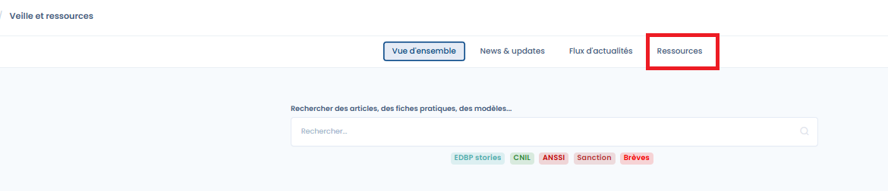
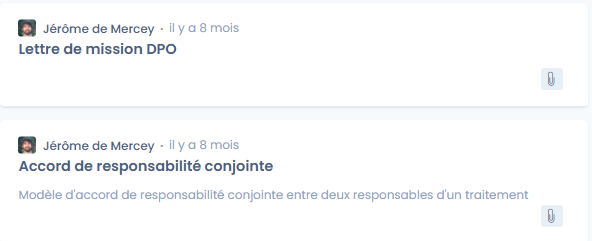

# Modèles de documents

Dastra propose des modèles de documents, par exemple pour votre documentation de conformité. Ils se trouvent dans le module **Veille et ressources**.

1. Dans le menu de gauche, sous **Ressources**, cliquez sur **Veille et ressources**.
2. Ouvrez l'onglet **Ressources**.

<figure><figcaption>
Accès aux ressources
</figcaption></figure>

Sélectionnez le modèle voulu. Les modèles sont disponibles en téléchargement au format Word.

<figure><figcaption>
Exemples de modèles de documents
</figcaption></figure>
