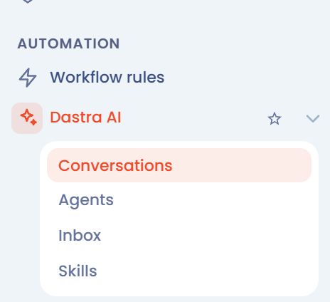
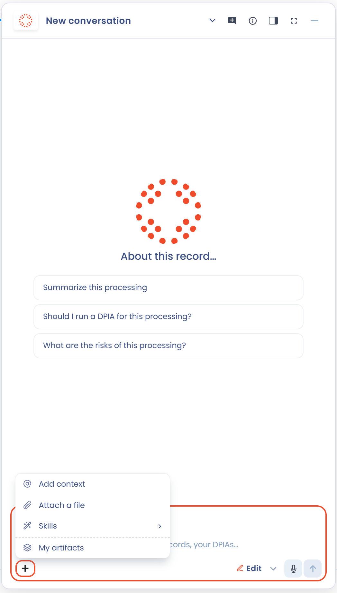
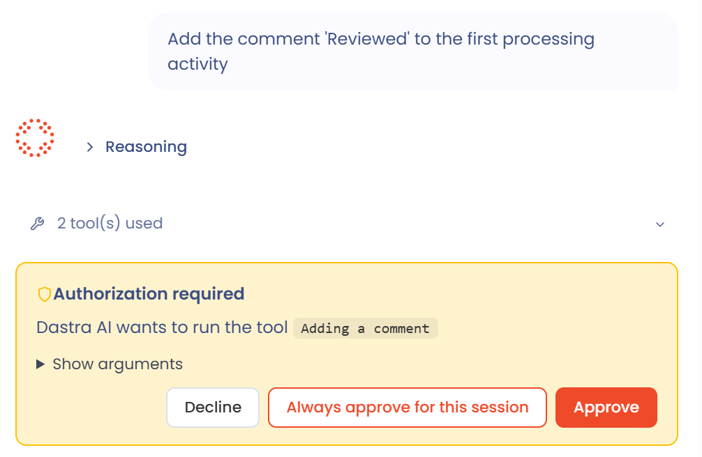

# Dastra AI

Dastra AI regroupe l'ensemble des fonctions d'IA de Dastra. Vous l'interrogez sur votre espace de travail, vous lui confiez des tâches, vous créez vos propres agents et vous connectez vos outils d'IA à Dastra. Il s'appuie sur des modèles d'IA générative hébergés sur Azure, en France et dans l'Espace Économique Européen, sans qu'aucune donnée de votre organisation ne soit utilisée pour entraîner ces modèles.

Ses fonctions se répartissent en deux familles :

* Le **mode conversationnel** réunit le chat Dastra AI, les [compétences](agents/skills.md), les [agents](agents/README.md), les [artefacts](artifacts.md) et le [serveur MCP](mcp.md). Il est ouvert : vous posez vos questions et confiez des tâches en langage naturel.
* Les **assistants IA** sont des fonctions de génération très encadrées. Un bouton, dans un module, répond à un cas d'usage précis : générer un traitement, une notice d'information, une analyse de risque.

La disponibilité de chaque fonction dépend de l'offre de votre organisation, module par module, et des permissions de chaque utilisateur. Dans un module que votre offre n'inclut pas, les boutons IA sont grisés, ou n'apparaissent pas pour quelques fonctions. Pour modifier le périmètre de votre offre, contactez notre équipe.

## Ce que vous pouvez faire avec Dastra AI

* **Interroger votre espace de travail.** Demandez un résumé, la liste des demandes en retard ou les traitements qui n'ont pas de PIA. En mode Édition, Dastra AI crée et modifie aussi des fiches, après votre accord. Voir [Discuter avec Dastra AI](#discuter-avec-dastra-ai).
* **Lancer une compétence.** Saisissez `/` dans la zone de message pour appliquer un prompt réutilisable, fourni par Dastra ou rédigé par votre équipe. Voir [Compétences](agents/skills.md).
* **Créer vos propres agents.** Un agent conversationnel répond avec ses propres instructions et ses outils. Un agent autonome exécute une tâche seul, quand vous le lancez, selon une planification ou depuis une règle de workflow, et ses exécutions sont listées dans la **Boîte de réception**. Voir [Les agents Dastra AI](agents/README.md).
* **Conserver des artefacts.** Les tableaux de bord, schémas et documents que Dastra AI construit dans une conversation sont enregistrés comme artefacts, que vous pouvez rouvrir et partager. Voir [Artefacts](artifacts.md).
* **Connecter vos outils d'IA.** Claude, ChatGPT, Microsoft Copilot et d'autres outils accèdent à vos données Dastra par le serveur MCP. Voir [Le serveur MCP](mcp.md).

Vous ouvrez Dastra AI depuis le tableau de bord, avec le bouton **Ouvrir Dastra AI** en bas à droite de l'écran, avec **Ctrl+J** (**Cmd+J** sur Mac), ou depuis l'entrée **Dastra AI** du menu **Automatisation**. Cette entrée regroupe le chat en grand (**Conversations**, avec la liste des **Artefacts**), **Agents**, **Boîte de réception** et **Compétences**. Les trois dernières apparaissent lorsque votre offre inclut les agents personnalisés et que votre rôle les autorise.

<figure><figcaption>
Automatisation &#x3E; Dastra AI
</figcaption></figure>

Toutes les fonctionnalités IA partagent le quota mensuel de crédits IA décrit dans [Comment ça marche ?](how-it-works.md#credits-et-quotas-ia).

## Discuter avec Dastra AI

**Dastra AI** répond à vos questions sur votre espace de travail dans une conversation. Il consulte vos fiches avec des outils en lecture seule : vous pouvez demander un résumé, la liste des demandes en retard ou les traitements qui n'ont pas de PIA.

Pour répondre, Dastra AI peut aussi s'appuyer sur la base réglementaire indexée par Dastra, sur la documentation Dastra et sur une recherche web. En mode Édition, il peut créer des fiches, modifier des champs, créer un plan d'actions, un questionnaire, un commentaire ou un tag, et lancer des actions de fiche comme le changement d'étape de workflow. Il peut construire des [artefacts](artifacts.md), vous poser des questions de précision avant d'agir et vous diriger vers la fiche concernée.

1. Cliquez sur **Ouvrir Dastra AI**, en bas à droite de l'écran, ou appuyez sur **Ctrl+J** (**Cmd+J** sur Mac). Sur le tableau de bord, vous pouvez aussi saisir votre question dans la zone de message sous **Comment puis-je vous aider aujourd'hui ?** : le panneau s'ouvre et répond.
2. Saisissez votre question, ou choisissez l'une des **Suggestions**. Elles changent selon la page où vous êtes : la fiche consultée, le registre, les demandes, les systèmes d'IA.
3. Lisez la réponse. Lorsque l'assistant s'appuie sur vos fiches, il affiche ses étapes et les cite. Utilisez les **Suggestions de questions** pour poursuivre.

<figure><figcaption>
Le panneau Dastra AI, avec le menu + ouvert
</figcaption></figure>

La fiche ou le registre que vous consultez est transmis à l'assistant comme contexte : vous pouvez demander « résume ce traitement » sans le nommer. Une visite guidée du panneau est disponible : cliquez sur **Afficher le guide**, l'icône d'information de l'en-tête du panneau.

Le panneau propose plusieurs outils :

* **Ouvrir en grand** ouvre la conversation sur la page Dastra AI, dans le menu **Automatisation**, où vos conversations sont listées à gauche. Les anciens liens vers la page de l'agent IA d'un espace de travail mènent à la même page.
* **Ancrer à droite** place le panneau dans une colonne à côté de la page, **Détacher** le replace par-dessus la page et **Réduire** le ferme. L'ancrage est proposé sur les écrans d'au moins 1 480 pixels de large. Dastra mémorise votre choix.
* **Nouvelle conversation** démarre une conversation vierge. La liste des conversations conserve les précédentes, regroupées par date, avec une zone de recherche : renommez-les ou supprimez-les depuis cette liste. Supprimer une conversation supprime tous ses messages.
* **Choisir un agent** passe du **Chat standard** aux [agents](agents/README.md) activés dans votre espace de travail.
* **Ajouter du contexte** donne à l'assistant une fiche ou un utilisateur sur lequel travailler. Saisissez `@` dans le message pour mentionner une fiche ou un utilisateur.
* **Joindre un fichier**, ou déposez un fichier dans la zone de message. Dastra AI lit lui-même les fichiers PDF, PNG et JPEG. Les fichiers CSV, XLSX, DOCX, JSON, TXT et Markdown sont acceptés aussi, mais seule l'exécution de code peut les ouvrir, lorsqu'elle est disponible. Un fichier est limité à 10 Mo.
* **Mes artefacts**, dans le menu **+**, ouvre la liste des [artefacts](artifacts.md) de l'espace de travail.
* Saisissez `/` ou cliquez sur **Compétences** pour lancer une [compétence](agents/skills.md), un prompt réutilisable. Un message applique au plus cinq compétences.
* **Dicter un message** enregistre votre voix et la transcrit dans la zone de message. Votre navigateur demande l'accès au micro la première fois.
* **Copier** place une réponse dans votre presse-papiers.
* Évaluez une réponse avec **Bonne réponse** ou **Mauvaise réponse**. Une **Mauvaise réponse** ouvre une fenêtre où vous pouvez ajouter un commentaire. Dastra enregistre la note et le commentaire avec le message.

Dastra restaure ce que vous faisiez après un rechargement de la page : le texte en cours de saisie et, si votre dernier échange date de moins de six heures, la conversation.

Lorsqu'une conversation s'allonge, un indicateur **Contexte** apparaît près de la zone de message dès 50 % de la place disponible. À partir de 80 %, l'indicateur devient orange et propose une nouvelle conversation. L'envoi reste possible, mais l'assistant peut perdre le début de la conversation une fois la place épuisée.

### Modes Question et Édition

En mode **Question**, l'assistant lit seulement : rien ne change dans votre espace de travail. En mode **Édition**, il peut aussi créer et modifier des fiches. Le sélecteur de mode apparaît pour les utilisateurs qui ont la permission d'écriture de l'assistant. Le mode **Édition** nécessite l'option correspondante dans l'offre de votre organisation. Sans elle, l'option est verrouillée.

**Outils disponibles en mode Question.** Recherche dans l'espace de travail, la documentation, les réglementations et le web. Parcours et lecture des fiches, commentaires, fichiers, unités organisationnelles, questionnaires et du profil de l'espace de travail. Inspection de la structure d'un type de fiche, de ses champs modifiables et de ses actions disponibles. Liste des utilisateurs, des tags, des étapes de workflow et des catégories de réglementation. Export de fiches, construction d'[artefacts](artifacts.md), exécution de code (lorsqu'elle est disponible) et délégation d'une sous-tâche. L'assistant peut aussi vous poser des questions et vous emmener vers une page de Dastra.

**Outils ajoutés par le mode Édition.** Création d'une fiche, modification d'une ou plusieurs fiches, exécution d'une action de fiche (archiver, restaurer, cloner, changer l'étape de workflow, etc.), ajout d'un commentaire, création d'un plan d'actions ou d'un tag, planification et remplissage d'un questionnaire, rédaction d'un document, liaison ou enregistrement d'un fichier, rédaction d'une fiche à partir d'une description, analyse d'une fiche et création ou modification d'un agent. La suppression et l'anonymisation ne sont pas proposées.

Avant d'exécuter l'un de ces outils, Dastra AI affiche une carte **Autorisation requise** qui nomme l'outil. Cliquez sur **Voir les arguments** pour voir ce qu'il s'apprête à envoyer, puis choisissez :

* **Approuver** pour exécuter l'outil cette fois ;
* **Toujours approuver pour cette session** pour ne plus être sollicité pour les outils de cette conversation ;
* **Refuser** pour refuser.

<figure><figcaption>
La carte d'autorisation du mode Édition
</figcaption></figure>

Si vous envoyez un autre message pendant qu'une carte est en attente, la carte n'est plus pertinente.


Dastra AI est disponible lorsque votre offre l'inclut et que votre rôle a la permission de l'assistant IA. Les messages consomment le quota mensuel de crédits IA, et une bannière vous prévient lorsque le quota est presque épuisé.


## Les assistants IA dans les modules

Les assistants IA sont des boutons présents dans les modules de la plateforme, chacun pour une tâche précise :

* **Traitements de données** : générer des descriptions, des jeux de données, des mesures de sécurité, des notices d'information, l'évaluation des critères d'AIPD et des analyses de conformité
* **Systèmes d'IA** : générer des descriptions, des notices, la justification du rôle, des analyses de risque et l'évaluation de la valeur métier
* **Questionnaires** : générer un modèle, le traduire, et générer des réponses assistées par IA à des PIA et analyses de risque
* **Demandes d'exercice de droits** : rédiger des réponses dans plusieurs langues et registres, et caviarder automatiquement des documents
* **Violations de données** : générer un post-mortem
* **Actifs et acteurs** : générer des entrées structurées à partir d'une URL ou d'une description libre
* **Contrats** : extraire des métadonnées depuis un document importé
* **Conformité** : suggérer des contrôles, des tests et des références d'exigences, et analyser des preuves de test
* **Règles de workflow et intégrations** : générer une action HTTP ou proposer un mapping de champs
* **Documents et rapports personnalisés** : générer du contenu à partir de vos propres instructions

Pour un guide pas à pas de chaque fonctionnalité, consultez la page [Cas d'usage](use-cases.md).

## L'IA comme point de départ, pas comme réponse définitive

Dastra AI est conçu pour **accélérer votre travail de conformité**, non pour remplacer l'expertise humaine. Tout contenu généré par Dastra AI, qu'il s'agisse d'une description de traitement, d'une notice d'information ou d'une analyse de conformité, est **une proposition qui nécessite une relecture et une validation** par une personne qualifiée avant tout usage.

En particulier :


**Le contenu généré par l'IA ne constitue pas un avis juridique.** Il ne peut pas se substituer au jugement d'un professionnel de la protection des données ou d'un conseil juridique.

**Les évaluations de conformité sont des aides à l'analyse.** Les scores et recommandations produits par l'IA reposent uniquement sur les informations enregistrées dans votre espace de travail. Ils reflètent la qualité de cette documentation, et non un avis juridique indépendant.

**Vous gardez le contrôle.** Aucun résultat généré par l'IA n'est appliqué ou communiqué automatiquement. Chaque résultat nécessite une action humaine délibérée pour être utilisé. La seule exception est un [agent autonome](agents/autonomous.md) que vous configurez : il s'exécute sans que personne ne le surveille et applique les modifications que ses outils de modification permettent, c'est pourquoi vous choisissez vous-même ces outils.


## Protection des données et confidentialité

Les données de votre organisation ne sont jamais utilisées pour entraîner des modèles d'IA. Les modèles utilisés par Dastra sont hébergés sur l'infrastructure Microsoft Azure en France, sous des garanties contractuelles qui excluent vos données de tout entraînement ou partage avec des tiers. Pour tous les détails, consultez la page [Comment ça marche ?](how-it-works.md#comment-ca-marche).

## Fonctionnalités en bêta

Certaines fonctionnalités IA sont publiées en version bêta : elles sont opérationnelles mais continuent d'être affinées sur la base des retours utilisateurs. Les fonctionnalités bêta sont clairement identifiées dans l'interface.

Lors de l'utilisation d'une fonctionnalité bêta :

* Les résultats peuvent être moins constants que dans les fonctionnalités stables et doivent être traités avec une vigilance accrue.
* Les prompts et critères sous-jacents sont activement améliorés. Les résultats peuvent évoluer entre les versions.
* Les retours sont les bienvenus et aident Dastra à améliorer la fonctionnalité. Utilisez l'option de feedback disponible dans l'interface.


Les fonctionnalités bêta ne doivent jamais constituer l'unique fondement d'une décision de conformité. Elles sont conçues pour accompagner une revue humaine approfondie, non pour la remplacer.


**Actuellement en bêta** : l'analyse de conformité par l'IA, disponible sur les traitements, les systèmes d'IA, les contrats, les actifs, les acteurs et les synthèses de réponses d'audit. Ouvrez-la avec le bouton **Analyse IA** de la fiche, ou demandez à Dastra AI d'analyser une fiche en mode Édition. Le résultat donne une note de A à F, les critères analysés et des tâches suggérées. Vous pouvez l'imprimer, le relancer ou le poursuivre dans la conversation.

***


[README.md](agents/README.md)



[competences.md](agents/skills.md)



[artefacts.md](artifacts.md)



[serveur-mcp.md](mcp.md)



[cas-dusage.md](use-cases.md)



[comment-ca-marche.md](how-it-works.md)



[foire-aux-questions.md](faq.md)

