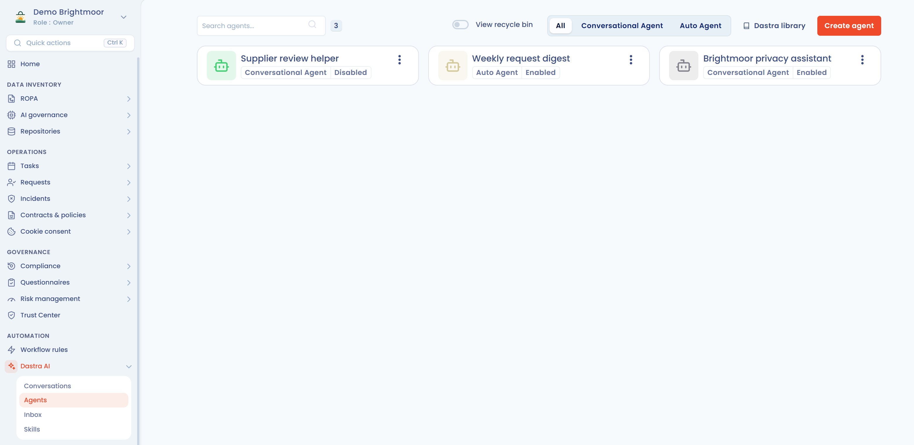
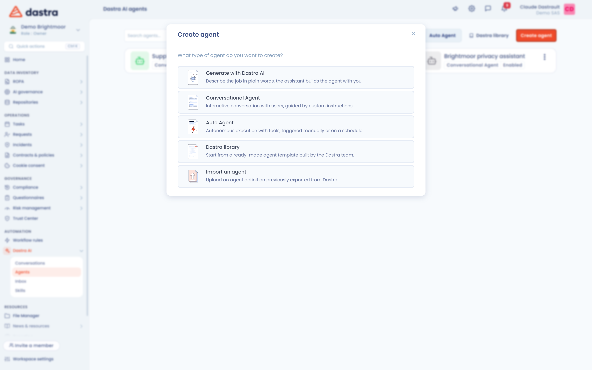

# Les agents Dastra AI

Un **agent Dastra AI** est un assistant que vous configurez vous-même : vous lui donnez un rôle, des instructions, et la liste des outils qu'il est autorisé à utiliser dans votre espace de travail. Là où l'[assistant IA](../README.md) standard répond à tout, un agent est spécialisé sur une mission précise et se comporte toujours de la même façon.

Les agents se configurent depuis **Automatisation** > **Dastra AI** > **Agents**. Les entrées **Agents**, **Boîte de réception** et **Compétences** apparaissent lorsque votre offre inclut les agents personnalisés et que votre rôle a la permission **Agents IA personnalisés**.

<figure><figcaption>
Automatisation &#x3E; Dastra AI &#x3E; Agents : la liste des agents configurés
</figcaption></figure>


**Ne confondez pas avec le registre des systèmes d'IA.** La rubrique [Systèmes d'IA](../../../ai-systems/README.md) sert à documenter **vos propres** systèmes d'IA au titre de l'AI Act. Les agents décrits ici sont une fonctionnalité de Dastra que vous utilisez pour travailler sur vos données.


***

### Deux types d'agents

| | Agent conversationnel | Agent autonome |
| --- | --- | --- |
| **À quoi ça sert** | Un assistant de chat spécialisé, avec sa propre personnalité et ses propres règles | Une tâche répétitive exécutée sans personne devant l'écran |
| **Qui le déclenche** | Un utilisateur, en ouvrant une conversation | Une exécution manuelle, un planning, ou une règle de workflow |
| **Interaction** | L'agent peut poser des questions et demander confirmation | L'agent ne peut ni poser de question ni demander confirmation : il va au bout et rend son résultat |
| **Où on le trouve** | Dans le panneau Dastra AI, via le sélecteur **Choisir un agent** | Dans **Agents**, avec ses exécutions dans la **Boîte de réception** |
| **Ce qu'on configure** | Message d'accueil, instruction de l'assistant, amorces de conversation | Instruction système, champs de saisie, planification |

***

### Créer un agent

Cliquez sur **Créer un agent**. Cinq points de départ vous sont proposés :

<figure><figcaption>
Les cinq façons de créer un agent
</figcaption></figure>

* **Générer avec Dastra AI** : décrivez la mission en quelques mots et cliquez sur **Générer l'agent**. L'assistant pose quelques questions, puis crée l'agent que vous relisez et ajustez. C'est la compétence intégrée `/design_agent`.
* **Agent conversationnel** : repartez d'une page blanche pour un assistant de chat. Voir [Créer un agent conversationnel](conversational.md).
* **Agent autonome** : repartez d'une page blanche pour une exécution outillée. Voir [Créer un agent autonome](autonomous.md).
* **Bibliothèque Dastra** : partez d'un modèle prêt à l'emploi. La bibliothèque propose les modèles conçus par l'équipe Dastra, ceux de votre bibliothèque partenaire si vous en avez une, et les agents d'un autre espace de travail auquel vous avez accès. Cliquez sur **Installer** : le modèle est importé **en brouillon**, désactivé et sans utilisateurs notifiés. Relisez ses instructions et ses outils avant de l'activer. Le bouton **Bibliothèque Dastra** de la liste des agents ouvre la même galerie.
* **Importer un agent** : déposez un fichier de définition précédemment exporté depuis Dastra.

Dans tous les cas, la création se fait en deux temps : vous choisissez le type, vous saisissez un **nom** (120 caractères maximum) et une **description** facultative, puis l'éditeur complet s'ouvre. L'éditeur accepte des descriptions de 3000 caractères au plus, avec une mise en forme Markdown de base.

L'éditeur **enregistre automatiquement** : la date de dernière sauvegarde s'affiche en haut à droite. Il n'y a pas de bouton « Enregistrer ».

***

### Activer, désactiver, placer dans la corbeille, supprimer

* **Désactiver** et **Activer**, dans l'éditeur ou dans le menu de la ligne, font passer un agent de **Désactivé** à **Actif** et inversement. Un agent désactivé n'apparaît plus dans le sélecteur d'agents, et un planning ou une règle de workflow ne peut pas le démarrer. Vous pouvez toujours l'exécuter manuellement avec **Exécuter**, ce qui permet de le tester. C'est l'état à utiliser pendant que vous mettez au point ses instructions.
* **Placer dans la corbeille** : l'agent part à la corbeille et ne s'exécute plus, même si une règle de workflow le nomme encore. Activez **Voir la corbeille** dans la liste pour le retrouver et cliquez sur **Restaurer**. Ses exécutions passées sont conservées.
* **Supprimer** : disponible pour un agent placé dans la corbeille. La suppression est définitive et **efface également toutes les sessions et tous les messages** de l'agent. Utilisez-la lorsque vous devez purger ces données.

### Exporter et importer un agent

Le bouton **Exporter**, dans l'éditeur ou dans le menu de la ligne, produit un fichier JSON contenant la définition de l'agent (instructions, outils, champs de saisie, planification). Vous pouvez le réimporter dans un autre espace de travail via **Créer un agent** > **Importer un agent**.

À l'import, Dastra réinitialise certains éléments : l'agent est créé **désactivé**, sans logo et sans utilisateurs notifiés. Relisez-le puis cliquez sur **Activer**.

***

### Qui peut faire quoi

L'accès aux agents dépend à la fois de votre **offre** et de vos **permissions**. Deux permissions de l'éditeur de rôles sont concernées, chacune avec un niveau lecture et un niveau modification :

| Permission | Niveau | Ce qu'elle autorise |
| --- | --- | --- |
| **Agent IA conversationnel** | Lecture | Utiliser l'assistant conversationnel en mode Question et les compétences |
| **Agent IA conversationnel** | Modification | Utiliser le mode Édition, où l'assistant crée et modifie des fiches (l'offre doit aussi l'inclure) |
| **Agents IA personnalisés** | Lecture | Voir les agents de l'espace de travail, discuter avec eux et les exécuter |
| **Agents IA personnalisés** | Modification | Créer, modifier, exporter, importer, placer dans la corbeille et supprimer des agents ; créer et modifier des [compétences](skills.md) |

Les permissions se règlent dans l'éditeur de rôles, voir [Rôles](../../../settings/roles.md). Le [serveur MCP](../mcp.md) fait l'objet d'une offre distincte.


**Un agent conversationnel n'a jamais plus de droits que la personne qui discute avec lui.** Ses outils s'exécutent avec vos propres permissions : si vous n'avez pas accès à une fiche, l'agent n'y a pas accès non plus. La suppression et l'anonymisation ne sont pas proposées aux agents.

**Un agent autonome n'est pas lié aux permissions d'un utilisateur.** Une exécution lancée par un planning, par une règle de workflow ou par **Exécuter** s'effectue avec les droits de l'espace de travail, quelle que soit la personne qui l'a lancée. Ne lui donnez que les outils que sa mission exige.


***

### Crédits et consommation

Les messages envoyés à un agent et les exécutions d'un agent autonome sont comptés dans le quota mensuel de crédits IA de votre organisation, comme les messages envoyés à Dastra AI. Voir [Crédits et quotas IA](../how-it-works.md#credits-et-quotas-ia).

Le quota mensuel de votre organisation et son état de consommation se suivent dans **Paramètres de l'organisation > Dastra AI**. Lorsque le quota est atteint, les conversations et les exécutions sont refusées, et le bouton **Exécuter** d'un agent autonome est désactivé.

Le détail des familles de modèles, de l'hébergement et des données transmises est documenté dans [Comment ça marche ?](../how-it-works.md).

***

<table data-view="cards"><thead><tr><th></th><th></th><th data-hidden data-card-target data-type="content-ref"></th></tr></thead><tbody><tr><td><strong>Créer un agent conversationnel</strong></td><td>Créez un assistant de chat spécialisé, avec sa propre personnalité, ses règles et ses outils</td><td><a href="conversational.md">conversational.md</a></td></tr><tr><td><strong>Créer un agent autonome</strong></td><td>Configurez un agent qui s'exécute seul, manuellement, selon un planning ou depuis une règle de workflow</td><td><a href="autonomous.md">autonomous.md</a></td></tr><tr><td><strong>Les compétences</strong></td><td>Enregistrez vos instructions récurrentes sous forme de commandes réutilisables dans le chat Dastra AI</td><td><a href="skills.md">skills.md</a></td></tr><tr><td><strong>Suivre les exécutions</strong></td><td>Retrouvez l'historique des exécutions de vos agents, leur statut et le détail de ce qu'ils ont fait</td><td><a href="inbox.md">inbox.md</a></td></tr></tbody></table>
