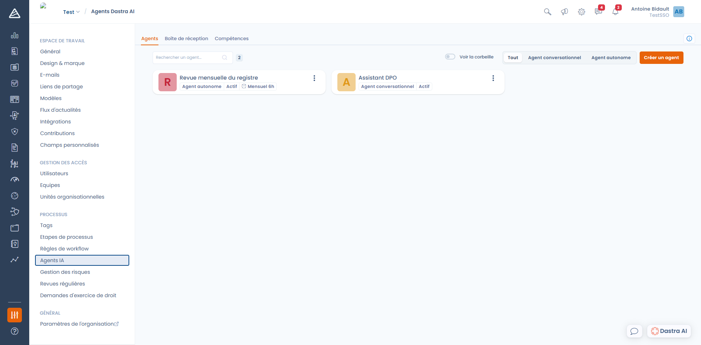
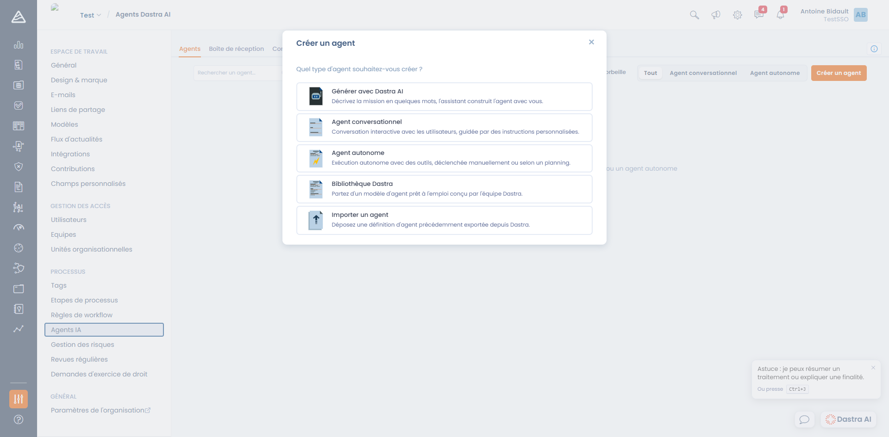

# Les agents Dastra AI

Un **agent Dastra AI** est un assistant que vous configurez vous-même : vous lui donnez un rôle, des instructions, et la liste des outils qu'il est autorisé à utiliser dans votre espace de travail. Là où l'[assistant IA](../README.md) standard répond à tout, un agent est spécialisé sur une mission précise et se comporte toujours de la même façon.

Les agents se configurent depuis **Réglages espace de travail > Agents IA** ([accès direct](https://app.dastra.eu/workspace/0/settings/ai-agents)).

<figure><figcaption>
Réglages espace de travail &#x3E; Agents IA — la liste des agents configurés
</figcaption></figure>


**Ne confondez pas avec le registre des systèmes d'IA.** La rubrique [Systèmes d'IA](../../../ai-systems/README.md) sert à documenter **vos propres** systèmes d'IA au titre de l'AI Act. Les agents décrits ici sont une fonctionnalité de Dastra que vous utilisez pour travailler sur vos données.


***

### Deux types d'agents

| | Agent conversationnel | Agent autonome |
| --- | --- | --- |
| **À quoi ça sert** | Un assistant de chat spécialisé, avec sa propre personnalité et ses propres règles | Une tâche répétitive exécutée sans personne devant l'écran |
| **Qui le déclenche** | Un utilisateur, en ouvrant une conversation | Une exécution manuelle, un planning, ou une règle de workflow |
| **Interaction** | L'agent peut poser des questions et demander confirmation | L'agent ne peut ni poser de question ni demander confirmation : il va au bout et rend son résultat |
| **Où on le trouve** | Dans le panneau Dastra AI, via le sélecteur **Choisir un agent** | Dans **Agents IA**, avec ses exécutions dans la **Boîte de réception** |
| **Ce qu'on configure** | Message d'accueil, instruction de l'assistant, amorces de conversation | Instruction système, champs de saisie, planification |

***

### Créer un agent

Cliquez sur **Créer un agent**. Cinq points de départ vous sont proposés :

<figure><figcaption>
Les cinq façons de créer un agent
</figcaption></figure>

* **Générer avec Dastra AI** — décrivez la mission en quelques mots, l'assistant construit l'agent avec vous et l'enregistre après votre validation. C'est la compétence intégrée `/scaffold_agent`.
* **Agent conversationnel** — repartez d'une page blanche pour un assistant de chat. Voir [Créer un agent conversationnel](conversational.md).
* **Agent autonome** — repartez d'une page blanche pour une exécution outillée. Voir [Créer un agent autonome](autonomous.md).
* **Bibliothèque Dastra** — partez d'un modèle prêt à l'emploi conçu par l'équipe Dastra. Le modèle est importé **en brouillon** : relisez ses instructions et ses outils avant de le publier.
* **Importer un agent** — déposez un fichier de définition précédemment exporté depuis Dastra.

Dans tous les cas, la création se fait en deux temps : vous choisissez le type, vous saisissez un **nom** (120 caractères maximum) et une **description** facultative (1000 caractères), puis l'éditeur complet s'ouvre.


L'éditeur **enregistre automatiquement** : la date de dernière sauvegarde s'affiche en haut à droite. Il n'y a pas de bouton « Enregistrer ».


***

### Publier, désactiver, archiver, supprimer

* **Actif / Désactivé** — un agent désactivé n'apparaît plus pour les utilisateurs et ses planifications ne se déclenchent plus. C'est l'état à utiliser pendant que vous mettez au point ses instructions.
* **Archiver** — l'agent part à la corbeille. Cochez **Voir la corbeille** dans la liste pour le retrouver et le restaurer. Ses exécutions passées sont conservées.
* **Supprimer** — la suppression est définitive et **efface également toutes les sessions et tous les messages** de l'agent. Utilisez-la lorsque vous devez purger ces données.

### Exporter et importer un agent

Le bouton **Exporter** produit un fichier JSON contenant la définition de l'agent (instructions, outils, champs de saisie, planification). Vous pouvez le réimporter dans un autre espace de travail via **Créer un agent > Importer un agent**.

À l'import, Dastra réinitialise certains éléments : l'agent est créé **désactivé**, sans logo et sans utilisateurs notifiés. Relisez-le puis activez-le.

***

### Qui peut faire quoi

L'accès aux agents dépend à la fois de votre **offre** et de vos **permissions**.

| Permission | Ce qu'elle autorise |
| --- | --- |
| **Utilisation de l'assistant IA** | Utiliser l'assistant conversationnel : poser des questions, laisser l'agent utiliser ses outils de lecture |
| **Mode édition de l'assistant IA** | Laisser l'assistant créer et modifier des fiches depuis la conversation |
| **Exécution des agents IA personnalisés** | Voir les agents de l'espace de travail et les exécuter |
| **Gestion des agents IA personnalisés** | Créer, modifier et supprimer les agents de l'espace de travail |

Les permissions se règlent dans **Paramètres de l'organisation > Rôles et permissions**. Le [serveur MCP](../mcp.md) fait l'objet d'une offre distincte.


**Un agent n'a jamais plus de droits que la personne qui le déclenche.** Ses outils s'exécutent avec vos propres permissions : s'il n'a pas accès à une fiche, l'agent n'y a pas accès non plus.


***

### Crédits et consommation

Chaque **message que vous envoyez** à un agent consomme **1 crédit Dastra AI**, quel que soit le nombre d'outils que l'agent utilise ensuite pour vous répondre. Reprendre une conversation après une demande de confirmation ne coûte rien de plus.

Le quota mensuel de votre organisation et son état de consommation se suivent dans **Paramètres de l'organisation > Assistant IA**. Lorsque le quota est atteint, les conversations et les exécutions sont refusées, et le bouton **Exécuter** d'un agent autonome est désactivé.

Le détail des familles de modèles, de l'hébergement et des données transmises est documenté dans [Comment ça marche ?](../how-it-works.md).

***


[agent-conversationnel.md](conversational.md)



[agent-autonome.md](autonomous.md)



[competences.md](skills.md)



[boite-de-reception.md](inbox.md)

