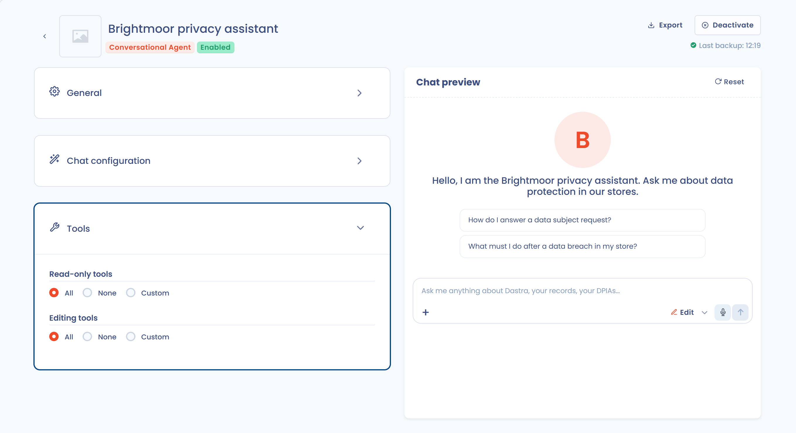
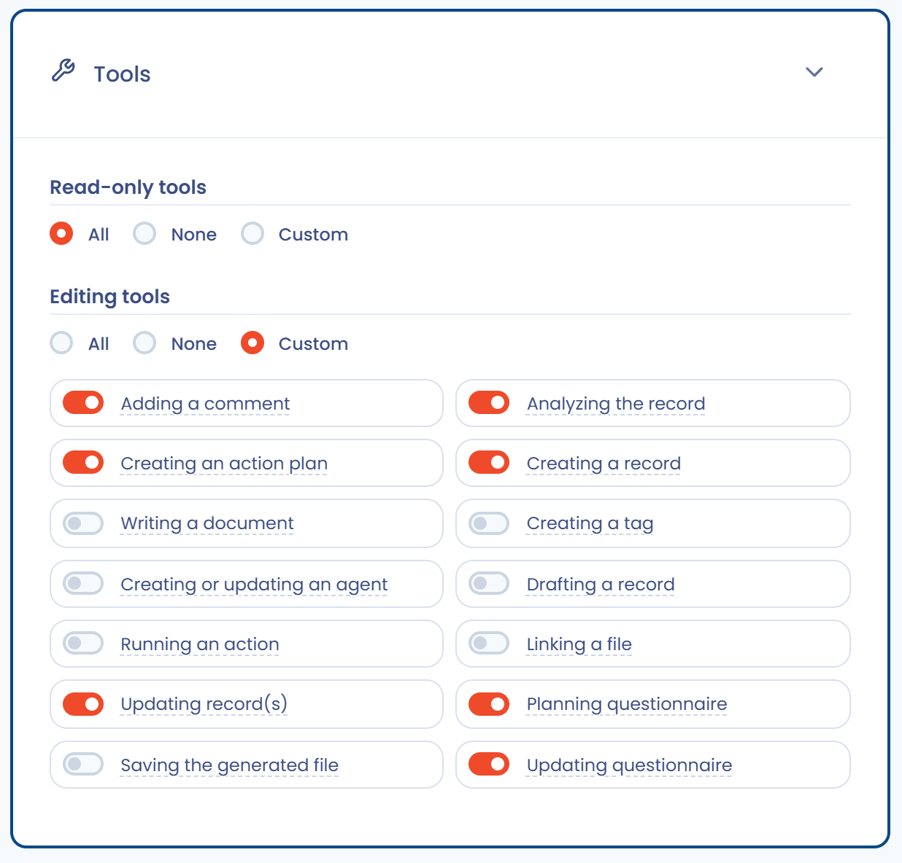
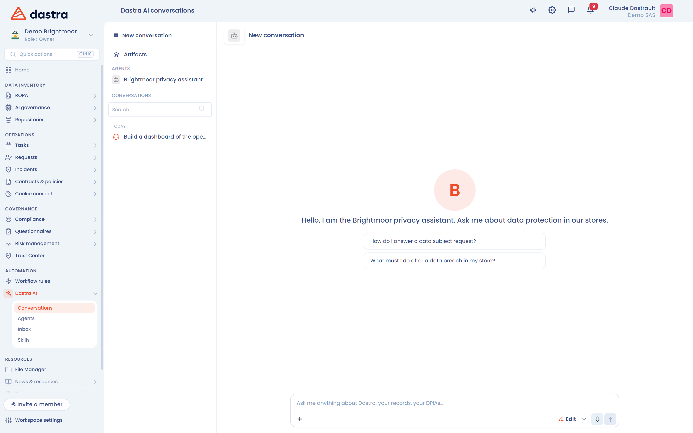

# Créer un agent conversationnel

Un agent conversationnel est un assistant de chat que vous spécialisez sur un sujet : un assistant DPO qui ne répond qu'à partir du registre, un assistant achats qui vérifie les contrats fournisseurs, un assistant sécurité qui aide à qualifier un incident.

Rendez-vous dans **Automatisation** > **Dastra AI** > **Agents**, cliquez sur **Créer un agent**, puis sur **Agent conversationnel**.

***

### Général

Le nom et la description identifient l'agent dans la liste et dans le sélecteur d'agents. Vous pouvez également lui donner un **logo**, qui servira d'avatar dans la conversation.

Le nom est limité à 120 caractères. La description, limitée à 3000 caractères, accepte une mise en forme Markdown de base.

### Configuration du chat

<figure><figcaption>
L'éditeur d'un agent conversationnel, avec l'aperçu du chat à droite
</figcaption></figure>

#### Message d'accueil

Le premier message affiché à l'utilisateur à l'ouverture de la conversation (1000 caractères maximum). Servez-vous-en pour annoncer ce que l'agent sait faire et ce qu'il ne sait pas faire.

#### Instruction de l'assistant

C'est le cœur de l'agent : sa personnalité et ses règles de conduite, dans la limite de **10 000 caractères**.


**Votre instruction ne remplace pas tout le prompt.** Elle définit la persona de l'agent. Dastra continue d'ajouter automatiquement ses propres règles : le vocabulaire produit, la description des outils disponibles, et les règles du mode Question ou Édition. Vous n'avez donc pas à réexpliquer ce qu'est un traitement ou comment utiliser un outil.


Une instruction efficace précise :

* **le rôle** : « Vous êtes le délégué à la protection des données de l'organisation. »
* **la source de vérité** : « Répondez toujours à partir des fiches enregistrées dans l'espace de travail : recherchez la fiche concernée avant de répondre, et citez-la systématiquement. »
* **le comportement en cas de manque** : « Si l'information n'existe pas dans l'espace de travail, dites-le explicitement plutôt que de l'inventer. »
* **le format attendu** : langue, longueur, mentions obligatoires.

#### Amorces de conversation

Les questions suggérées affichées sous le message d'accueil. Elles servent de mode d'emploi implicite : choisissez-les pour montrer les usages que vous voulez encourager. Ajoutez-en autant que nécessaire avec **Ajouter une amorce**.

***

### Outils



Par défaut, un agent a accès à **tous** les outils. Chaque groupe ci-dessous propose trois options : **Tout**, **Aucune** et **Personnalisé**. Choisissez **Personnalisé** pour n'activer que les outils voulus. Un agent a besoin d'au moins un outil.

Les outils sont séparés en deux groupes :

* **Outils de lecture** : recherche dans l'espace de travail, la documentation Dastra, le corpus réglementaire et le web, parcours et lecture des fiches, des commentaires, des fichiers et des questionnaires, construction d'[artefacts](../artifacts.md), export de fiches.
* **Outils de modification** : création et mise à jour de fiches, exécution d'actions de fiche comme le changement d'étape de workflow, ajout de commentaires, création de plans d'actions et de tags, planification et remplissage de questionnaires, rédaction de documents, liaison de fichiers.

Poser une question et vous emmener vers une page de Dastra sont toujours disponibles dans une conversation : ces outils ne figurent pas dans la liste.



<figure><figcaption>
Les outils sont regroupés en outils de lecture et outils de modification
</figcaption></figure>




Restreindre les outils est la façon la plus sûre de cadrer un agent. Un assistant destiné à répondre à des questions n'a besoin d'aucun outil de modification : ne lui en donnez pas.


***

### Mode Question et mode Édition

Dans la conversation, un sélecteur permet de basculer entre deux modes :

* **Question** : l'agent est en lecture seule. Il peut chercher et lire, mais rien n'est modifié.
* **Édition** : l'agent peut créer et modifier des fiches. Les outils de modification ne sont disponibles que dans ce mode.

Le mode Édition dépend de votre offre et de la permission correspondante. Si votre offre ne l'inclut pas, l'option **Édition** est verrouillée. Sans la permission d'écriture de l'assistant, le sélecteur n'apparaît pas. Dans les deux cas, les outils de modification restent inactifs, même s'ils sont cochés dans la définition de l'agent.

Dans la conversation, chaque outil de modification affiche une carte **Autorisation requise** avant de s'exécuter : choisissez **Approuver**, **Toujours approuver pour cette session** ou **Refuser**. L'agent ne peut ni supprimer ni anonymiser une fiche : ces actions ne lui sont pas proposées.

***

### Tester avant de publier

L'**aperçu du chat**, à droite de l'éditeur, est une vraie conversation avec l'agent tel qu'il est configuré à cet instant. Utilisez-le pour vérifier le ton, la longueur des réponses et le respect de vos règles avant d'activer l'agent. Le bouton **Réinitialiser** repart d'une conversation vierge.

### Utiliser l'agent au quotidien

Une fois l'agent activé, les utilisateurs de l'espace de travail qui peuvent exécuter les agents personnalisés y accèdent :

* depuis le panneau **Dastra AI**, en bas à droite de l'écran ;
* avec le raccourci clavier **Ctrl+J** (**Cmd+J** sur Mac) ;
* depuis la page Dastra AI, dans **Automatisation** > **Dastra AI** > **Conversations**, où les agents sont listés sous **Agents** ;
* avec **Ouvrir dans le chat**, dans la fenêtre de détails de l'agent dans la liste.

Le sélecteur **Choisir un agent**, en haut de la conversation, permet de passer d'un agent à l'autre.

<figure><figcaption>
L'agent affiche son message d'accueil et ses amorces de conversation
</figcaption></figure>

Chaque réponse peut être notée avec **Bonne réponse** ou **Mauvaise réponse**. Une mauvaise réponse ouvre une fenêtre où vous pouvez ajouter un commentaire.

***


[agent-autonome.md](autonomous.md)

