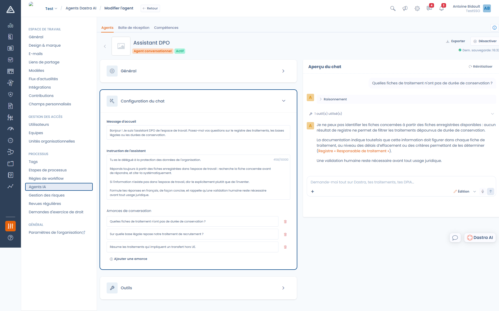
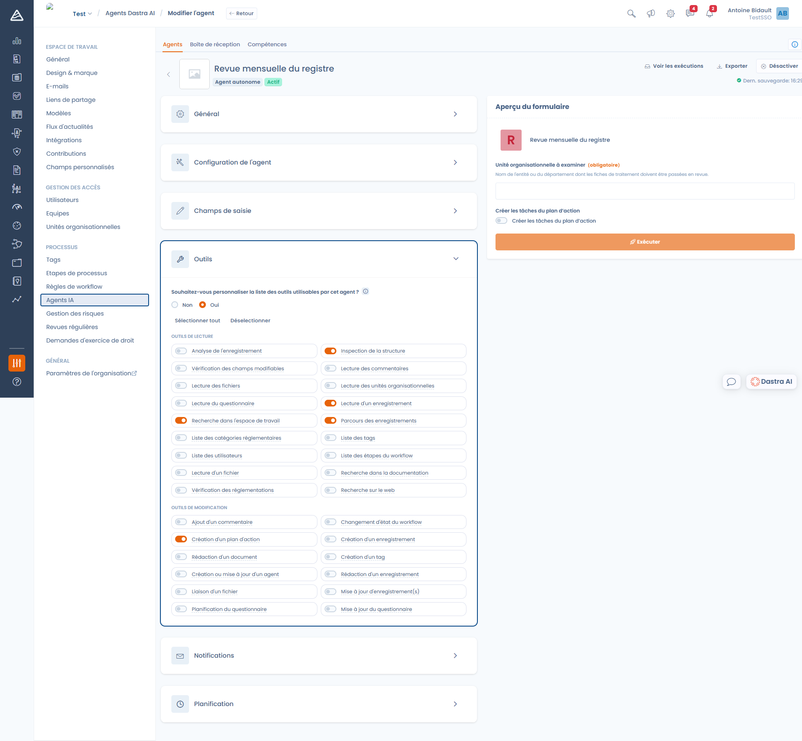
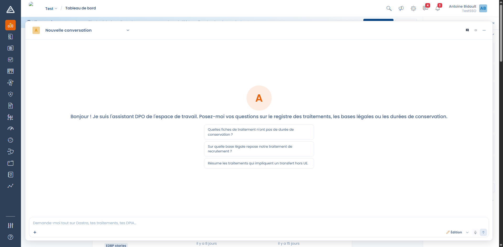

# Créer un agent conversationnel

Un agent conversationnel est un assistant de chat que vous spécialisez sur un sujet : un assistant DPO qui ne répond qu'à partir du registre, un assistant achats qui vérifie les contrats fournisseurs, un assistant sécurité qui aide à qualifier un incident.

Rendez-vous dans **Réglages espace de travail > Agents IA**, cliquez sur **Créer un agent**, puis sur **Agent conversationnel**.

***

### Général

Le nom et la description identifient l'agent dans la liste et dans le sélecteur d'agents. Vous pouvez également lui donner un **logo**, qui servira d'avatar dans la conversation.

Le nom est limité à 120 caractères, la description à 1000.

### Configuration du chat

<figure><figcaption>
L'éditeur d'un agent conversationnel, avec l'aperçu du chat à droite
</figcaption></figure>

#### Message d'accueil

Le premier message affiché à l'utilisateur à l'ouverture de la conversation (1000 caractères maximum). Servez-vous-en pour annoncer ce que l'agent sait faire et ce qu'il ne sait pas faire.

#### Instruction de l'assistant

C'est le cœur de l'agent : sa personnalité et ses règles de conduite, dans la limite de **10 000 caractères**.


**Votre instruction ne remplace pas tout le prompt.** Elle définit la persona de l'agent. Dastra continue d'ajouter automatiquement ses propres règles : le vocabulaire produit, la description des outils disponibles, et les règles du mode Question ou Édition. Vous n'avez donc pas à réexpliquer ce qu'est un traitement ou comment utiliser un outil.


Une instruction efficace précise :

* **le rôle** — « Tu es le délégué à la protection des données de l'organisation. »
* **la source de vérité** — « Réponds toujours à partir des fiches enregistrées dans l'espace de travail : recherche la fiche concernée avant de répondre, et cite-la systématiquement. »
* **le comportement en cas de manque** — « Si l'information n'existe pas dans l'espace de travail, dis-le explicitement plutôt que de l'inventer. »
* **le format attendu** — langue, longueur, mentions obligatoires.

#### Amorces de conversation

Les questions suggérées affichées sous le message d'accueil. Elles servent de mode d'emploi implicite : choisissez-les pour montrer les usages que vous voulez encourager. Ajoutez-en autant que nécessaire avec **Ajouter une amorce**.

***

### Outils

Par défaut, un agent a accès à **tous** les outils. Répondez **Oui** à « Souhaitez-vous personnaliser la liste des outils utilisables par cet agent ? » pour restreindre cette liste.

<figure><figcaption>
Les outils sont regroupés en outils de lecture et outils de modification
</figcaption></figure>

Les outils sont séparés en deux groupes :

* **Outils de lecture** — recherche dans l'espace de travail, lecture d'une fiche, lecture des commentaires et des fichiers, consultation de la documentation Dastra et du corpus réglementaire, recherche sur le web.
* **Outils de modification** — création et mise à jour de fiches, ajout de commentaires, changement d'étape de workflow, création de tâches et de tags, planification et remplissage de questionnaires.


Restreindre les outils est la façon la plus sûre de cadrer un agent. Un assistant destiné à répondre à des questions n'a besoin d'aucun outil de modification : ne lui en donnez pas.


### Utilisateurs notifiés

Les personnes qui recevront une notification Dastra à la fin d'une exécution de l'agent.

***

### Mode Question et mode Édition

Dans la conversation, un sélecteur permet de basculer entre deux modes :

* **Question** — l'agent est en lecture seule. Il peut chercher, lire et analyser, mais rien n'est modifié.
* **Édition** — l'agent peut créer et modifier des fiches. Les outils de modification ne sont disponibles que dans ce mode.

Le mode Édition dépend de votre offre et de la permission correspondante. S'il ne vous est pas accessible, le sélecteur n'apparaît pas et les outils de modification restent inactifs, même s'ils sont cochés dans la définition de l'agent.

***

### Tester avant de publier

L'**aperçu du chat**, à droite de l'éditeur, est une vraie conversation avec l'agent tel qu'il est configuré à cet instant. Utilisez-le pour vérifier le ton, la longueur des réponses et le respect de vos règles avant d'activer l'agent. Le bouton **Réinitialiser** repart d'une conversation vierge.

### Utiliser l'agent au quotidien

Une fois l'agent **Actif**, les utilisateurs de l'espace de travail y accèdent :

* depuis le panneau **Dastra AI**, en bas à droite de l'écran ;
* avec le raccourci clavier **Ctrl+J** (**⌘J** sur Mac) ;
* depuis la page plein écran de Dastra AI.

Le sélecteur **Choisir un agent**, en haut de la conversation, permet de passer d'un agent à l'autre.

<figure><figcaption>
L'agent affiche son message d'accueil et ses amorces de conversation
</figcaption></figure>

Chaque réponse peut être notée d'un pouce vers le haut ou vers le bas, avec un commentaire. Ces retours vous aident à ajuster l'instruction de l'agent.

***


[agent-autonome.md](autonomous.md)

